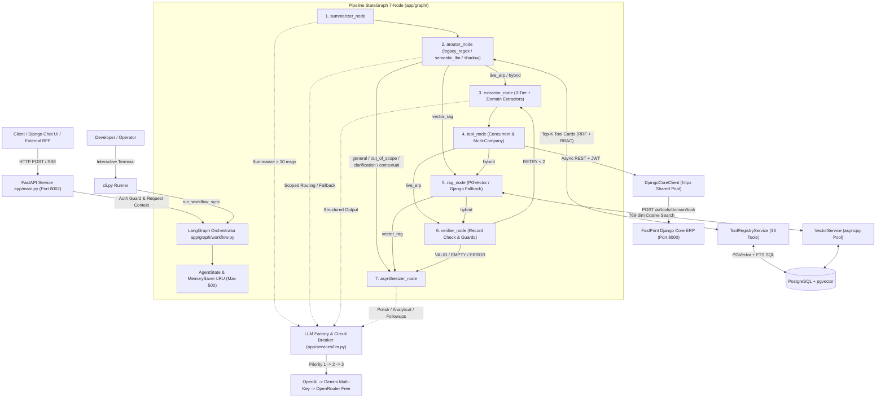
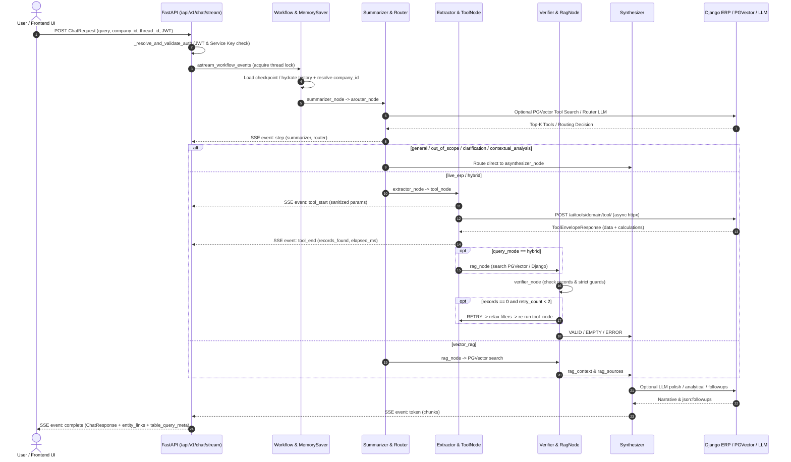

# Analisis Teknis & Arsitektur Menyeluruh: FastPrint ERP AI Orchestrator (`erp-langgraph`)

> **Catatan Metodologi:** Seluruh temuan dalam dokumen ini didasarkan pada inspeksi langsung struktur direktori, source code (`43` file pada `app/` dengan `25.543` baris), konfigurasi, dependensi, skrip evaluasi, serta eksekusi langsung test suite (`829` unit tests lulus dalam `34,17` detik), `ruff check` (`0` error), dan benchmark NLU offline (`100` golden cases). Dokumen ini membedakan secara tegas antara **Fakta** (terverifikasi dari kode/eksekusi), **Asumsi** (disimpulkan dari artefak karena ketiadaan PRD formal tunggal), dan **Rekomendasi**.

---

## 1. Project Overview

### 1.1 Latar Belakang & Tujuan Project
FastPrint ERP memiliki banyak modul operasional lintas domain (Akuntansi, Gudang/Inventaris, Penjualan, dan Operasional Marketplace seperti Shopee/TikTok Shop/Tokopedia/Lazada) serta belasan entitas cabang/perusahaan (`company_id` 1 s.d. 17 di `app/core/branches.py`). Pada sistem ERP tradisional, pengguna manajerial dan operasional harus membuka berbagai menu terpisah, menyusun filter laporan berulang kali, dan melakukan cross-check manual antar modul (misalnya mencocokkan stok gudang dengan log sinkronisasi marketplace atau menelusuri akun penyebab rugi operasional pada Laba Rugi).

**Fakta (teramati di kode & dokumen internal):**
- Project `erp-langgraph` dibangun sebagai **layanan AI Orchestrator terpisah** berbasis FastAPI + LangGraph (`APP_NAME="erp-ai-orchestrator"`, port `8002`) yang berkomunikasi via HTTP REST ke layer `ai_tools` pada backend Django Core (`ERP_BASE_URL`, default `http://127.0.0.1:8000`).
- Seluruh `36` tool operasional yang terdaftar di `TOOL_DOMAIN_MAP` (`app/schemas/tools.py`) dan `CORE_TOOL_DEFINITIONS` (`app/services/tool_registry_service.py`) bersifat **read-only (`is_write: False`)**.
- Project menyediakan tiga jalur akses: REST API sinkron (`POST /api/v1/chat`), Server-Sent Events streaming (`POST /api/v1/chat/stream`), dan CLI interaktif (`cli.py`).

### 1.2 Permasalahan yang Ingin Diselesaikan
Berdasarkan implementasi node pipeline, skema filter, dan fixture uji di `tests/`, sistem ini dirancang untuk mengatasi 6 masalah operasional utama:
1. **Fragmentasi Data Multi-Domain & Multi-Cabang:** Menjawab pertanyaan bisnis lintas modul (misal stok + saldo kas + SOP) dan lintas cabang (`semua cabang` atau perbandingan cabang tertentu) dalam satu kueri bahasa Indonesia alami, termasuk bahasa informal/singkatan (`sby`, `ms`, `ho`, `omset`, `bln lalu`).
2. **Risiko Halusinasi Angka pada LLM:** Laporan keuangan (Laba Rugi, Neraca, Buku Besar) dan kuantitas stok tidak boleh dihitung ulang atau dikarang oleh LLM. Sistem harus menjamin angka berasal 100% dari backend ERP.
3. **Keterbatasan Skala Tool Calling Tradisional:** Dengan 36+ tool (dan target pengembangan ke 50–200+ tool di `docs/ENTERPRISE_SCALING_PLAN.md`), memasukkan seluruh JSON schema tool ke dalam prompt LLM secara langsung boros token dan menurunkan akurasi pemilihan tool.
4. **Ambiguitas & Ketidaklengkapan Parameter Query:** Pengguna sering menanyakan filter tanggal relatif (*"minggu lalu"*, *"Q1"*), rujukan anafora (*"harganya berapa?"*, *"di mainstore"*), atau kueri kosong hasil karena filter terlalu sempit.
5. **Kesenjangan antara Data Transaksional & Pengetahuan Kualitatif (SOP):** Pengguna membutuhkan jawaban gabungan antara data angka live (ERP API) dan aturan/kebijakan tertulis (dokumen SOP di PGVector).
6. **Stabilitas & Biaya Provider LLM:** Ketergantungan pada satu API LLM berisiko terkena rate-limit (`429`) atau outage.

### 1.3 Goals & Hasil Akhir yang Diharapkan
Tidak terdapat satu berkas PRD tunggal di repositori; oleh karena itu goals di bawah dipisahkan menjadi yang tertulis eksplisit di dokumen teknis (`README.md`, `docs/ENTERPRISE_SCALING_PLAN.md`, `nlu_architecture_blueprint.md`, `PROJECT_PROGRESS.md`) dan asumsi bisnis.

- **Goals Terdokumentasi (Fakta):**
  1. Menyediakan asisten percakapan ERP berbahasa Indonesia yang akurat, *zero-hallucination*, berlatensi rendah, dan memiliki UI streaming real-time via SSE (`step`, `tool_start`, `tool_end`, `token`, `complete`).
  2. Mendukung cakupan domain bisnis FastPrint: saat ini `accounting`, `inventory`, `sales`, `marketplace`, serta `knowledge` (RAG SOP), dengan ekspansi bertahap ke `fastpos` dan `helpdesk` (`PROJECT_PROGRESS.md`).
  3. Memodernisasi routing NLU dari 2.500+ baris regex menuju arsitektur **Hybrid PGVector + FTS RRF Retrieval + Scoped LLM Router + Conservative Disambiguation** dengan exit gate akurasi >= 95% dan false-clarification <= 3% (`nlu_architecture_blueprint.md`, `scripts/eval_nlu_router.py`).
  4. Mencapai kesiapan skala enterprise: persistensi sesi multi-pod, RBAC berbasis role & multi-company, serta kapasitas 50–200+ tools (`docs/ENTERPRISE_SCALING_PLAN.md`).
- **Goals Tersirat (Asumsi Bisnis):**
  1. Mempercepat waktu pengambilan keputusan manajerial/operasional (owner, finance, tim gudang, admin marketplace) tanpa perlu keahlian query ERP.
  2. Menekan biaya inferensi LLM per percakapan melalui pemrosesan deterministik untuk pertanyaan tabular dan penggunaan model kecil/hemat biaya (`gpt-4o-mini`, `gemini-2.5-flash`, atau model gratis OpenRouter).
  3. Menjaga kepatuhan keamanan agar orchestrator tidak pernah memutasi data transaksi ERP secara tidak sengaja maupun membocorkan data antar-cabang/peran tanpa otorisasi.

### 1.4 Kondisi Implementasi Saat Ini
Fakta kondisi aktual repositori saat analisis dilakukan:
- **Pipeline Inti:** Compiled LangGraph `StateGraph` dengan **7 node** (`summarizer`, `router`, `extractor`, `tool_node`, `rag_node`, `verifier`, `synthesizer`). *(Catatan: docstring di `cli.py` dan `.agents/GEMINI.md` masih menyebut "5-node" dari versi lama).*
- **Katalog Tool Aktif:** **36 tool read-only** pada 4 domain (`8` accounting, `12` inventory, `5` sales, `11` marketplace) ditambah modul `rag_node` untuk pencarian dokumen pengetahuan. Domain `helpdesk` (2 tools) dan `fastpos` (4 tools) masih berstatus `Pending` di `PROJECT_PROGRESS.md` dan belum ada di `app/schemas/tools.py`.
- **Mode NLU Router:** Infrastruktur `semantic_llm` (`app/graph/nodes/router_semantic.py`) dan hybrid search RRF (`ToolRegistryService.search_tools_hybrid`) sudah terimplementasi, namun flag default di `app/core/config.py` dan `.env.example` masih berada pada `NLU_ROUTER_MODE="legacy_regex"`.
- **Persistensi Memori:** Menggunakan `MemorySaver` in-memory dengan LRU bound (`MAX_CHECKPOINT_THREADS=500`) + hidrasi stateless via `ChatRequest.history`. `AsyncPostgresSaver` belum diimplementasikan maupun dimasukkan ke `requirements.txt`.
- **Korpus Pengetahuan (RAG):** Infrastruktur PGVector + `ingest_knowledge.py` siap pakai, namun berkas lokal di `data/knowledge/` baru berisi `1` dokumen contoh (`sop_retur_barang_cetak.md`, 18 baris).
- **Kualitas Uji & Linter:** Seluruh **`829` unit test** pada `49` berkas tes di `tests/` lulus dalam `34,17` detik secara terisolasi (mock HTTP/DB), dan `ruff check app cli.py scripts tests` lulus dengan `0` error.

---

## 2. System Architecture

### 2.1 Arsitektur Sistem Keseluruhan
Project ini mengadopsi pola **Decoupled AI Orchestrator Gateway (BFF/Sidecar Pattern)**. Layanan AI (`erp-langgraph`) berdiri sebagai microservice stateless-capable yang terpisah dari monolith ERP Django. Pemisahan ini membuat pembaruan LLM SDK, prompt engineering, pipeline graf, dan pencarian vektor tidak membebani runtime utama ERP transaksional, sementara otorisasi data dan logika bisnis inti (query ORM, kalkulasi akuntansi/HPP) tetap dikuasai oleh Django Core (`/ai/tools/`).

### 2.2 Teknologi & Alasan Penggunaan
| Teknologi | File Referensi | Peran & Relevansi Bisnis |
|---|---|---|
| **Python 3.11+ & AsyncIO** | `Dockerfile`, `pyproject.toml` | Mendukung eksekusi konkuren I/O (HTTP ke ERP & LLM API, query asyncpg) dalam satu event loop tanpa overhead thread berlebih. |
| **FastAPI & Uvicorn** | `app/main.py`, `requirements.txt` | Menyediakan validasi request/response otomatis, OpenAPI docs, dan `StreamingResponse` native untuk SSE real-time. |
| **LangGraph (`StateGraph`)** | `app/graph/workflow.py`, `state.py` | Cocok untuk alur bisnis ERP yang deterministik dan siklik (membutuhkan loop *Verifier -> Extractor* dan percabangan kondisional), berbeda dari chain linier biasa. |
| **Pydantic v2 & `pydantic-settings`** | `app/core/config.py`, `app/schemas/` | Menjamin kontrak tipe ketat untuk konfigurasi `.env`, API schema (`ChatRequest`/`ChatResponse`), serta `36` skema filter tool ERP. |
| **HTTPX (`httpx.AsyncClient`)** | `app/services/django_client.py` | Connection pooling asinkron berkinerja tinggi ke backend Django ERP dengan isolasi cache per event loop. |
| **PostgreSQL + `pgvector` + `asyncpg`** | `app/services/vector_service.py`, `tool_registry_service.py` | Menyimpan dua indeks vektor sekaligus (chunk SOP `ai_knowledge_chunks` & katalog tool `ai_tool_catalog`) dengan indeks HNSW + PostgreSQL FTS (`tsvector`) untuk RRF. |
| **Google GenAI SDK (`gemini-embedding-001`)** | `app/services/vector_service.py` | Menghasilkan embedding 768 dimensi yang ringkas dan akurat untuk bahasa Indonesia/istilah teknis ERP. |
| **LangChain OpenAI (`ChatOpenAI`)** | `app/services/llm.py` | Abstraksi seragam untuk 3 provider kompatibel OpenAI (OpenAI, Gemini OpenAI-compatible endpoint, OpenRouter) + fitur `.with_structured_output()`. |
| **`free-llm-models`** | `app/services/llm.py` | Memfilter dan memprioritaskan model gratis OpenRouter yang mendukung `tools` dan output JSON sebagai lapisan cadangan berbiaya nol. |
| **Ruff & `unittest`** | `pyproject.toml`, `.github/workflows/deploy.yml` | Menjaga kebersihan kode (`E`, `F`) dan regresi cepat (`829` tes dalam ~34 detik) tanpa dependensi eksternal di CI. |

### 2.3 Fungsi Komponen Utama
- **API & Middleware Layer (`app/main.py`):** Mengelola lifecycle startup/shutdown (pre-warm model & inisialisasi tabel PGVector di background, penutupan pool saat shutdown), middleware `X-Request-ID` & `X-Process-Time-Ms`, liveness `/health`, readiness `/health/ready`, validasi autentikasi (`_resolve_and_validate_auth`), serta endpoint `/api/v1/chat` dan `/api/v1/chat/stream`.
- **Core Utilities (`app/core/`):**
  - `config.py`: Singleton `Settings` dengan deteksi test runtime (`_is_test_runtime()`) agar `.env` lokal tidak bocor saat testing.
  - `branches.py`: Registry cabang FastPrint (`BRANCH_COMPANY_MAP`, `COMPANY_NAME_MAP`), deteksi multi-cabang/semua cabang, dan resolusi sticky branch dari riwayat pesan.
  - `context.py`: Manajemen window pesan (`trim_conversation_messages`), sanitasi payload ERP (`sanitize_erp_payload`), sanitasi parameter SSE (`sanitize_tool_params`), deteksi anafora/kueri analitis, dan penghitung record kanonik terpusat (`resolve_tool_record_count`).
- **Schemas (`app/schemas/`):**
  - `chat.py`: Kontrak `ChatRequest`, `ChatResponse`, `FollowupSuggestion`, dan `ChatMessageHistoryItem`.
  - `tools.py`: `36` model filter Pydantic, envelope respons `ERPResponseEnvelope`, serta `TOOL_DOMAIN_MAP`.
- **Service Layer (`app/services/`):**
  - `django_client.py`: `DjangoCoreClient` asinkron dengan shared `httpx.AsyncClient` per event loop, login otomatis (`/external_api/get_token/`), retry token kadaluarsa (401), dan auto-binding 35+ method `fetch_<tool>`.
  - `llm.py`: `CircuitBreakerChatOpenAI` dan `get_chat_model()` / `get_router_chat_model()` dengan cache warm client dan failover berantai.
  - `vector_service.py`: Pool `asyncpg` per event loop (`WeakKeyDictionary`), LRU embedding cache in-RAM (`512` entri), dan query similarity search.
  - `tool_registry_service.py`: Katalog 36 tool diperkaya (`sample_queries`, `negative_hints`), hybrid search PGVector + FTS RRF, Conditional RBAC, dan in-memory fallback.
- **Orchestration Graph (`app/graph/`):** `state.py` mendefinisikan `AgentState` dan `ToolCallPlan`; `workflow.py` mengompilasi `StateGraph`, mengelola thread lock per `thread_id`, LRU checkpointer eviction, hidrasi history, dan konversi event LangGraph `v2` ke SSE.
- **Pipeline Nodes (`app/graph/nodes/`):** Terdiri dari 7 node plus subpaket modular `extractors/` (per domain) dan `formatters/` (per domain + `multi_company.py` + `entity_links.py`).
- **Operational Scripts & CLI:** `cli.py` (runner terminal interaktif dengan spinner & command `co`, `token`, `undo`, `verbose`), `app/scripts/seed_tools.py` (seeding katalog tool ke PGVector), `scripts/ingest_knowledge.py` (chunking & ingest SOP Markdown), dan `scripts/eval_nlu_router.py` (benchmark golden cases).

### 2.4 Hubungan & Komunikasi Antar Komponen
- **Frontend / Django BFF -> `erp-langgraph`:** Mengirim JSON `ChatRequest` ke `POST /api/v1/chat` atau `/chat/stream` dengan header opsional `Authorization: Bearer <jwt>` dan `X-Internal-Service-Key`.
- **`erp-langgraph` -> Django Core (`/ai/tools/`):** Menggunakan `DjangoCoreClient` via HTTP POST ke `/ai/tools/<domain>/<tool_name>/` dengan payload `{"company_id": ..., "params": ..., "parameters": ...}`, meneruskan `user_token` (atau system login fallback) dan header `X-AI-Source: LangGraph`.
- **`erp-langgraph` -> PostgreSQL PGVector:** Koneksi langsung asinkron via `asyncpg` ke dua tabel: `ai_tool_catalog` (untuk retrieval tool di tahap router) dan `ai_knowledge_chunks` (untuk pencarian SOP di tahap `rag_node`). Jika `VECTOR_DB_URL` tidak tersedia, tool retrieval turun ke scorer in-memory sementara RAG dapat fallback ke endpoint Django `/ai/tools/knowledge/search/`.
- **`erp-langgraph` -> LLM Providers:** Memanggil API eksternal OpenAI, Google Gemini (baik OpenAI-compat untuk chat maupun Google GenAI SDK untuk embedding), atau OpenRouter.

### 2.5 Alur Data dari Input hingga Output
1. **Input Masuk:** `ChatRequest` divalidasi oleh Pydantic -> autentikasi & `X-Internal-Service-Key` diverifikasi (`user_roles` dibuang jika service key tidak terverifikasi).
2. **Persiapan State:** `_prepare_workflow_execution()` membaca checkpoint `MemorySaver` (jika ada `thread_id`), melakukan hidrasi `history` bila memori kosong, dan menyelesaikan `company_id` efektif (`_resolve_effective_company_scope`).
3. **Eksekusi Graph:** State mengalir melalui `summarizer` -> `router` -> (cabang ke `extractor` -> `tool_node` -> `verifier` [loop maks 2x] -> `rag_node` jika hybrid) -> `synthesizer`.
4. **Sanitasi & Pengayaan Output:** `tool_node` membersihkan field teknis Django (`sanitize_erp_payload`) sambil mempertahankan blok `calculations`/`summary`; `synthesizer` membangun Markdown, metadata paginasi (`table_query_meta`), tautan internal ERP tervalidasi (`entity_links`), dan tombol lanjutan (`suggested_followups`).
5. **Output Keluar:** Dikembalikan sebagai JSON `ChatResponse` atau dialirkan bertahap sebagai frame SSE (`step`, `tool_start`, `tool_end`, `token`, `complete`).

### 2.6 Diagram Arsitektur Sistem

---

## 3. AI Agent Architecture & Approach

### 3.1 Pendekatan AI Agent & Klasifikasi Arsitektur
Secara klasifikasi arsitektur, `erp-langgraph` **bukan** *Autonomous ReAct Agent* (di mana LLM dibiarkan bebas memilih tool berulang-ulang dalam `while` loop sampai merasa cukup). Sebaliknya, sistem ini menerapkan **Deterministic-First Hybrid Pipeline / Plan-and-Execute StateGraph**.

- **Klasifikasi:** **Single Orchestrated Workflow Graph dengan Concurrent Sub-Plan Fan-Out** (hybrid deterministik + LLM terarah). Meskipun komentar kode (`ToolCallPlan` di `state.py:27`) menyebut *"subagent tool execution plan"*, secara arsitektural tidak ada sub-agent otonom yang berkomunikasi bebas; melainkan satu graf terpusat yang memecah pertanyaan majemuk menjadi daftar `active_tools` lalu mengeksekusinya secara paralel melalui `ThreadPoolExecutor` (di `extractor.py`) dan `asyncio.gather` (di `tool_node.py`).
- **Mengapa Pendekatan Ini Dipilih (Analisis Arsitektur):** Dalam konteks ERP akuntansi dan gudang, kebebasan penuh ReAct sangat berbahaya karena latensi tak terprediksi, pemborosan token saat LLM bingung memilih dari 36 tool, dan risiko halusinasi parameter tanggal/cabang. Pipeline terstruktur membatasi peran LLM hanya pada titik yang benar-benar membutuhkan pemahaman bahasa alami.

### 3.2 Mekanisme Reasoning, Planning, Execution, dan Decision-Making
1. **Query Decomposition (`router_decomposer.py`):** Memecah prompt panjang berdasarkan baris baru, penomoran, tanda baca (`?`, `!`, `;`), dan kata hubung koordinatif (*"dan"*, *"lalu"*, *"serta"*) sambil melindungi frasa domain seperti `"laba dan rugi"` atau `"semua cabang dan HO"`.
2. **Routing & Planning (Dual Mode di `router.py` & `router_semantic.py`):**
   - **Mode `legacy_regex` (Default Saat Ini):** Mengandalkan `classify_query_rule_based()` dengan puluhan kelompok pola regex di `router_patterns.py`, aturan penekanan bentrokan (*collision suppression*), resolusi follow-up percakapan, lalu fallback ke LLM (`MultiRouterDecision`) atau `ToolRegistryService.search_tools()` jika regex tidak menemukan kecocokan.
   - **Mode `semantic_llm` (Target Modernisasi):** Menjalankan 4 *Hard Guardrails* berisiko nol (sapaan/meta, blokir operasi tulis/out-of-scope/piutang customer, regex ID dokumen ketat seperti `JE/...` atau `WH/OUT/...`, serta analisis kontekstual), dilanjutkan **Per-Clause Hybrid Retrieval** (Top-K 8 kandidat) agar LLM Router hanya melihat kandidat relevan. Mendukung **Conservative Disambiguation** (`needs_clarification=True`) jika terjadi konflik intent atau objek wajib kosong.
   - **Mode `shadow`:** Menjalankan `legacy_regex` untuk pengguna sembari mengeksekusi `aroute_semantic_nlu` secara asinkron di background (`asyncio.create_task`, timeout `5s`) dan mencatat selisih ke log `NLU_SHADOW_DIFF`.
3. **3-Tier Parameter Extraction (`extractor.py` & `extractors/`):**
   - **Tier 1 (Fast-Path Deterministik):** Sebagian besar tool (`get_stock_level`, `get_profit_and_loss`, `get_balance_sheet`, `get_sales_orders`, dll.) dicoba diekstrak secara regex/heuristik terlebih dahulu tanpa menginisialisasi LLM (`get_chat_model()` ditunda secara lazy).
   - **Tier 2 (LLM Structured Output):** Jika Tier 1 tidak cukup (misal ada ekspresi temporal kompleks atau nama entitas tak berpola), model dipanggil dengan `.with_structured_output(target_schema)` sesuai `TOOL_SCHEMA_REGISTRY`.
   - **Tier 3 (Fallback & 3-Tier Entity Harvesting):** Jika LLM gagal/offline, jatuh kembali ke `_fallback_extract_*`. Setelah itu dijalankan pemanen entitas lintas-plan (`_backfill_peer_entities`) dan resolusi dari riwayat percakapan/anafora (`tool_result` sebelumnya) serta validasi akhir Pydantic.
4. **Execution & Pre-Resolution (`tool_node.py`):**
   - Mendukung eksekusi tunggal, multi-tool paralel (`asyncio.gather`), dan multi-company (baik native `company_ids` maupun fan-out per cabang dengan `asyncio.Semaphore` + fallback 403 per cabang).
   - Memiliki mekanisme **2-Step Resolution otomatis** sebelum memanggil tool utama:
     - `get_stock_level`: mencari `location_id` (`fetch_locations`) atau `warehouse_id` (`fetch_warehouses`) dari teks lokasi.
     - `get_price_comparison`: mencari `account_id` aktif (`fetch_account_health`) lintas cabang jika tidak disebutkan.
     - `get_general_ledger`: mencari akun kas/bank aktif (`fetch_account_balance`) jika user hanya menyebut kategori (*"buku besar akun kas"*).
     - **HQ Auto-Probe:** Jika query sales pada Kantor Pusat/HQ (ID 1/3) menghasilkan 0 data, otomatis mencoba cabang yang diotorisasi.
5. **Decision-Making & Adaptive Retry (`verifier.py`):**
   - Menggunakan `resolve_tool_record_count()` untuk memverifikasi kelayakan hasil.
   - Jika 0 record ditemukan pada query umum dan `retry_count < 2`, status menjadi `RETRY` dengan instruksi bertahap: percobaan 1 melonggarkan filter tanggal (`date_from`/`date_to`), percobaan 2 menghapus keyword/status spesifik.
   - Dilindungi oleh **4 Guard Verifier** agar tidak membuang retry pada kueri spesifik yang memang kosong: *Strict Identifier Guard* (`JE/...`, `PC/...`), *Strict Product Guard*, *Strict Marketplace Guard* (`account_id`), dan *Strict Daily Sales Existence Guard* (*"apakah ada penjualan hari ini"*).

### 3.3 Pengelolaan Context, Memory, Tools, dan State
- **State (`AgentState`):** `TypedDict` komprehensif berisi riwayat `messages` (dengan reducer `add_messages` LangGraph), scoping perusahaan (`company_id`, `company_ids`, `authorized_company_ids`, `company_scope_source`), snapshot turn sebelumnya (`prior_tool_result`, `prior_detected_tool`) untuk analisis lanjutan tanpa memanggil API ulang, rencana sub-tool (`active_tools`), hasil RAG, serta status klarifikasi.
- **Short-Term & Long-Term Memory:**
  - `MemorySaver` in-memory menyimpan state per `thread_id`, dibatasi LRU maksimal `500` thread (`_enforce_checkpoint_lru_bound`). Request tanpa `thread_id` memakai ID `ephemeral_<uuid>` dan langsung dihapus di blok `finally` (`_cleanup_ephemeral_thread`) agar tidak terjadi kebocoran memori/sesi antar pengguna.
  - Untuk deployment stateless atau setelah restart/eviction, `_hydrate_messages_from_history` memulihkan `HumanMessage`/`AIMessage` dari `ChatRequest.history`, dan `resolve_sticky_branch_from_history` memulihkan cabang aktif dari pesan sebelumnya.
  - `summarizer_node` berjalan otomatis bila jumlah pesan melewati `SUMMARIZATION_THRESHOLD_MESSAGES` (default `10`), menghasilkan `conversation_summary` via LLM atau fallback regex deterministik (`format_deterministic_summary`).
- **Context Pruning & Sanitization (`app/core/context.py`):** `trim_conversation_messages` memotong history (maks 6 pesan di semantic router, maks 10 pesan di extractor). `sanitize_erp_payload` membuang 12 field teknis Django ORM (`create_uid`, `access_token`, `audit_trail`, dll.) dan memangkas list panjang (maks `50` item, atau `200` untuk P&L/Neraca) sambil menghitung ulang agregat (`_compute_bills_calculations`) dan mempertahankan `total_count` sebelum pemotongan.
- **Tool Metadata Management (`ToolRegistryService`):** 36 tool di-enrich dengan `keywords`, `sample_queries`, `negative_hints`, dan `required_permission`, diindeks ke PostgreSQL menggunakan **PGVector HNSW (cosine)** + **PostgreSQL `tsvector('simple')` (GIN)**, lalu digabungkan dengan rumus **Reciprocal Rank Fusion (RRF, k=60)**.

### 3.4 Strategi Prompt Engineering & Penggunaan LLM
Strategi utama codebase ini adalah **"LLM sebagai Translator & Analyst, Bukan Database atau Kalkulator"**:
- **Minimal Token Schema (`SemanticRouterOutput`):** Pada `router_semantic.py`, alih-alih mengirim skema JSON lengkap 36 tool ke LLM, router hanya menyisipkan kartu ringkas Top-K kandidat (`nama`, `domain`, `deskripsi`, `nama parameter`, `Bukan untuk`).
- **Anti-Hallucination & Zero-AI-Slop Prompting (`synthesizer.py`):**
  - Pada laporan tabular/angka besar (`_should_keep_verbatim_deterministic`), hasil formatter Python dipertahankan verbatim; jika LLM tetap dipanggil, prompt `_build_followup_only_prompt` memintanya **hanya** membuat blok `json:followups` tanpa menulis ulang angka tabel.
  - Untuk pertanyaan kausal/berpikir (*"kenapa rugi?"*), `_build_analytical_prompt` menyuntikkan ringkasan terhitung (`_build_pnl_analytical_digest`) dan melarang LLM mengarang angka eksternal, menggunakan basa-basi (*"Tentu!"*), emoji, atau kata klise korporat.
  - Opsi `SYNTHESIZER_FAST_DETERMINISTIC=true` memungkinkan bypass panggilan LLM synthesizer sepenuhnya pada tabel reguler (menghemat ~2–3 detik dan ~1.500 token/turn), serta mendukung model khusus router (`NLU_ROUTER_PROVIDER`/`NLU_ROUTER_MODEL`) yang lebih ringan/cepat daripada model synthesizer.
- **Model Adaptation (`llm.py`):** Menangani perbedaan keluarga model OpenAI (`gpt-4*` memakai `temperature=0.0`, sedangkan `o*` dan `gpt-5+` otomatis menanggalkan parameter `temperature` dan menyisipkan `reasoning_effort`, termasuk negative cache jika API menolak `temperature` dengan HTTP 400).

### 3.5 Mekanisme Orchestration, Error Handling, Fallback, dan Guardrails
- **LLM Circuit Breaker & Multi-Tier Failover (`llm.py`):** `CircuitBreakerChatOpenAI` membungkus `invoke`, `ainvoke`, `stream`, dan `astream`. Jika terdeteksi error `401`/expired/quota/`429`, provider ditandai tidak sehat selama `15 menit` (`900s`) dan cache model di-reset. Jalur failover otomatis: `OpenAI -> Google Gemini (rotasi hingga 3 API keys) -> OpenRouter (katalog free models)`.
- **Graceful Degradation Lapis Ganda:**
  - *Router gagal/offline:* `semantic_llm` fallback ke `legacy_regex`; PGVector offline fallback ke `search_tools_fallback()` in-memory.
  - *Extractor LLM gagal:* Fallback ke 35+ fungsi `_fallback_extract_*` deterministik.
  - *RAG PGVector gagal/kosong:* Fallback ke endpoint Django `/ai/tools/knowledge/search/`; jika tidak ada dokumen, menjawab informatif tanpa mengarang SOP.
  - *Synthesizer LLM gagal:* Fallback ke `format_deterministic_answer()` atau `_build_deterministic_analytical_fallback()` (khusus P&L memiliki analisis deterministik lokal!).
- **Guardrails Berlapis:**
  - *Read-Only Enforcement:* Tidak ada write tool di registry, dan pola perintah mutasi (`MARKETPLACE_WRITE_PATTERNS`, `_ERP_WRITE_PATTERNS`) diblokir di router ke `out_of_scope` (kecuali pertanyaan diagnostik seperti *"kenapa update stok gagal"*).
  - *Customer vs Vendor Disambiguation:* Mencegah kueri *"tagihan customer Budi"* atau *"piutang"* masuk ke `fetch_vendor_invoices` / `get_vendor_bills`.
  - *Output Sanitization:* `_clean_ai_slop`, `_is_routable_followup_query` (memastikan chip saran lanjutan benar-benar bisa dieksekusi oleh router), dan validasi URL ketat pada `entity_links.py` (`^/(?!/)[A-Za-z0-9_\-./?=&%]+$`).
  - *HITL Hook:* `create_workflow_graph()` mendukung `interrupt_before=["tool_node"]` saat `ENABLE_HITL_INTERRUPT=true` (saat ini default `False`).

### 3.6 Kelebihan & Kekurangan Pendekatan Saat Ini
| Aspek | Kelebihan | Kekurangan |
|---|---|---|
| **Akurasi Angka** | Format tabel & kalkulasi deterministik di Python menghilangkan risiko salah hitung/halusinasi angka oleh LLM. | Menambah beban kode formatter (`formatters/` ~4.800+ baris termasuk `entity_links.py`) yang harus dirawat tiap ada field baru di Django. |
| **Biaya & Latensi** | Tier-1 fast-paths + `SYNTHESIZER_FAST_DETERMINISTIC` membuat banyak query berjalan dengan 0–1 panggilan LLM saja. | Pada mode `legacy_regex`, maintainability berat; sementara pada mode `semantic_llm`, setiap kueri non-guardrail menambah 1x embedding API + 1x LLM call di router. |
| **Ekstensibilitas** | Penambahan `ToolRegistryService` (RRF PGVector + `negative_hints`) siap menampung 50–200+ tool tanpa prompt bloat. | Ekstraktor parameter masih bergantung pada 36 fungsi fallback manual dan `TOOL_SCHEMA_REGISTRY` statis di `extractor.py`. |
| **Otonomi Agent** | Prediktabel, aman untuk data finansial perusahaan, dan tahan terhadap loop tak terbatas (maks 2 retry). | Tidak dapat melakukan *multi-hop dynamic reasoning* (misal: hasil tool A memicu keputusan dinamis untuk memanggil tool B yang sebelumnya tidak direncanakan router), kecuali pola 2-step hardcoded di `tool_node.py`. |

---

## 4. End-to-End Workflow

### 4.1 Tahapan Proses dari Awal hingga Akhir
1. **HTTP Ingress & Auth (`app/main.py`):** Request masuk ke `/api/v1/chat` atau `/api/v1/chat/stream`. Middleware mencatat waktu dan menyematkan `X-Request-ID`. `_resolve_and_validate_auth()` mengekstrak `user_token` (body atau Bearer header) dan memverifikasi `X-Internal-Service-Key` dengan `hmac.compare_digest`. Jika `APP_ENV` adalah `production`/`staging` atau `REQUIRE_USER_TOKEN=true`, request tanpa token ditolak (`HTTP 401`). `user_roles` dibersihkan menjadi `[]` bila service key tidak valid.
2. **Thread Locking & Scoping (`app/graph/workflow.py`):** `_resolve_thread_lock_ctx()` mengunci eksekusi per `thread_id` agar turn paralel pada sesi yang sama tidak saling menimpa state. `_prepare_workflow_execution()` memuat checkpoint `MemorySaver` (atau menghidrasi `ChatRequest.history`), lalu `_resolve_effective_company_scope()` menentukan `company_id`/`company_ids` dengan prioritas: eksplisit `company_ids` payload -> penyebutan cabang/semua cabang di teks -> sticky follow-up multi-company -> sticky branch teks di checkpoint -> explicit `company_id` payload -> default.
3. **Node 1 — `summarizer_node` (`summarizer.py`):** Jika total pesan `<= SUMMARIZATION_THRESHOLD_MESSAGES` (10) atau fitur nonaktif, langsung pass-through (`{}`). Jika melebihi batas, merangkum entitas bisnis (Company ID, Vendor, SKU, Tanggal, Akun) ke `conversation_summary`.
4. **Node 2 — `arouter_node` (`router.py` / `router_semantic.py`):** Menangani `is_retry_query` (mengambil kueri sebelumnya), mengecek analisis kontekstual/drill-down P&L/ganti cabang, memecah multi-pertanyaan, dan mengklasifikasikan `query_mode` (`live_erp`, `vector_rag`, `hybrid`, `general`, `out_of_scope`, `contextual_analysis`, atau `clarification`) beserta daftar `active_tools`. `decide_after_router` mengarahkan alur ke `extractor`, `rag_node`, atau langsung `synthesizer`.
5. **Node 3 — `extractor_node` (`extractor.py` + `extractors/`):** Menyalin `active_tools` (immutability), menjalankan ekstraksi paralel (`ThreadPoolExecutor` maks 4 worker jika > 1 tool) melalui Tier-1 fast-path -> Tier-2 LLM Structured Output -> Tier-3 fallback, menerapkan pelonggaran filter bila `retry_count > 0`, melakukan `_backfill_peer_entities()`, membersihkan noise cabang/SKU, dan memvalidasi ke skema Pydantic.
6. **Node 4 — `tool_node` (`tool_node.py`):** Menjalankan dispatch asinkron ke `DjangoCoreClient`:
   - Multi-tool via `asyncio.gather` (mengisolasi error per tool tanpa menjatuhkan tool lain yang sukses).
   - Multi-company menggunakan parameter native `company_ids` (untuk marketplace, contacts, sales orders/summary, velocity, price history) atau fan-out paralel per `company_id` dengan batas konkurensi `ERP_MULTI_COMPANY_CONCURRENCY` (`16`) dan isolasi `HTTP 403` ke `unauthorized_companies`.
   - Menangani 2-step lookup (`location_name` -> `location_id`, `get_price_comparison` -> `account_id`, `get_general_ledger` -> `account_code`, dan HQ Auto-Probe).
   - Membersihkan payload via `sanitize_erp_payload()`. Jika `query_mode == "hybrid"`, diteruskan ke `rag_node`; selain itu ke `verifier`.
7. **Node 5 — `rag_node` (`rag_node.py`):** Bila `ENABLE_RAG=true`, menjalankan pencarian paralel (`asyncio.gather`) atas `rag_queries` via `VectorService.search_knowledge` (PGVector `ai_knowledge_chunks` terfilter `company_id` dan `threshold >= 0.65`) atau fallback ke Django `/ai/tools/knowledge/search/`.
8. **Node 6 — `verifier_node` (`verifier.py`):** Menghitung jumlah record dengan `resolve_tool_record_count()`. Jika ada error atau data cukup -> `ERROR` atau `VALID` -> `synthesizer`. Jika 0 record dan tidak terkena Strict Guard serta `retry_count < 2` -> `RETRY` (increment `retry_count`, set `retry_instruction`) -> kembali ke `extractor`. Jika `retry_count >= 2` -> `EMPTY` -> `synthesizer`.
9. **Node 7 — `asynthesizer_node` (`synthesizer.py` + `formatters/`):**
   - Jika `clarification`, langsung kirim pertanyaan klarifikasi + maks 4 chip tanpa memanggil LLM.
   - Selain itu, merangkai jawaban deterministik per tool/multi-company/multi-pertanyaan, memanggil LLM hanya bila diperlukan (narasi ringkas, analisis penyebab, follow-up JSON, atau general greeting), membersihkan AI slop, menyusun `entity_links`, `table_query_meta`, dan memvalidasi maks 3 `suggested_followups`, lalu memancarkan custom event `token` untuk SSE.

### 4.2 Contoh Skenario Penggunaan Nyata

#### Skenario A: Query Multi-Cabang & Resolusi Lokasi + Guardrail Verifier
- **Input:** `"Cek stok kertas foto glossy di gudang cabang Bandung"` (`company_id=1`, `thread_id="sess-101"`).
- **Eksekusi:**
  1. `_resolve_effective_company_scope` mendeteksi `"cabang Bandung"` dan mengalihkan `company_id` ke `6` (`company_scope_source="text"`).
  2. `arouter_node` memilih domain `inventory`, tool `get_stock_level`.
  3. `extractor_node` mengekstrak `{"code": "kertas foto glossy", "location_name": "bandung", "company_id": 6}` via Tier-1 fast-path (`0` panggilan LLM).
  4. `tool_node` melakukan 2-step lookup: memanggil `inventory.get_locations(search="bandung", company_id=6)` -> mendapat `location_id`, lalu memanggil `inventory.get_stock_level(code="kertas foto glossy", location_id=..., company_id=6)`.
  5. `verifier_node` memeriksa hasil; jika ditemukan >0 baris -> `VALID` -> `synthesizer` merender tabel stok per rak + menyisipkan `entity_links` ke halaman produk. Jika 0 baris -> `RETRY 1/2` -> `extractor` melonggarkan filter dan mencoba ulang.

#### Skenario B: Query Majemuk Lintas Domain + Hybrid RAG + Blokir Write
- **Input:** `"Cek omzet bulan ini, apa SOP retur barang cetak, dan update stok tinta ke Shopee sekarang"`
- **Eksekusi:**
  1. `router_decomposer.decompose_user_query()` memecah menjadi 3 klausa berurutan.
  2. Klausa 1 -> `sales.get_sales_summary` (`live_erp`); Klausa 2 -> `knowledge` (`rag_query="SOP retur barang cetak"`); Klausa 3 -> terdeteksi `MARKETPLACE_WRITE_PATTERNS` -> masuk ke `non_tool_questions` berkategori `marketplace_write` (`out_of_scope`). Gabungan mode menjadi `hybrid`.
  3. `extractor_node` mengekstrak rentang tanggal bulan berjalan (ISO 8601) untuk `get_sales_summary`.
  4. `tool_node` mengeksekusi `get_sales_summary`, lalu `decide_after_tool` mengarahkan ke `rag_node` yang mengambil chunk dari `ai_knowledge_chunks` (`sop_retur_barang_cetak.md`), lalu ke `verifier`.
  5. `synthesizer` menyusun jawaban berurutan per sub-pertanyaan (`_build_question_ordered_answer`): bagian 1 tabel omzet, bagian 2 ringkasan SOP retur + sitasi sumber, bagian 3 penolakan sopan bahwa mutasi stok ke Shopee bersifat *read-only* di asisten ini.

#### Skenario C: Query Ambigu pada Mode `semantic_llm` -> Klarifikasi Konservatif -> Resolusi Turn-2
- **Input Turn 1:** `"Cek order minggu ini"` (`NLU_ROUTER_MODE="semantic_llm"`).
- **Eksekusi Turn 1:**
  1. Hard guardrails tidak menangkap intent spesifik -> `aretrieve_candidate_tools` mengambil Top-8 kandidat via PGVector + FTS RRF (`get_sales_orders`, `get_marketplace_orders`, `get_kilat_order_diagnostics`, dll.).
  2. Scoped LLM Router mendeteksi konflik kuat antara order penjualan ERP vs order marketplace SLA -> mengembalikan `query_mode="clarification"`, `needs_clarification=True`, pertanyaan singkat, dan 2 chip opsi (`Sales Order ERP` & `Order Marketplace`).
  3. `decide_after_router` bypass langsung ke `synthesizer`, mengirim jawaban + chips (`<10ms`, 0 LLM call tambahan).
- **Input Turn 2:** User mengklik chip atau membalas `"yang marketplace"`.
- **Eksekusi Turn 2:** `_build_retrieval_queries` memperkaya pencarian dengan `prior_detected_tool`/pesan sebelumnya, Scoped LLM Router melihat konteks klarifikasi di `messages` dan langsung mengeksekusi `marketplace.get_marketplace_orders` untuk minggu ini.

### 4.3 Sequence Diagram End-to-End (Streaming SSE)

---

## 5. Technical Assessment

Penilaian menggunakan skala **1–10** (1 = sangat buruk/tidak layak, 5 = cukup dengan celah struktural, 8 = kuat dengan catatan minor, 10 = standar enterprise sempurna).

| # | Aspek | Skor | Ringkasan Bukti Kunci |
|---|---|---:|---|
| 1 | **Architecture Design** | **8.0** | Pemisahan bersih FastAPI/LangGraph vs Django Core, modularisasi domain, 7-node StateGraph deterministik; minus `MemorySaver` in-RAM & node sync di async graph. |
| 2 | **AI Agent Effectiveness** | **7.5** | 100% retrieval recall offline, multi-tool & multi-company kuat, anti-halusinasi tabel; namun default masih `legacy_regex` (akurasi 84,04% di 100 golden cases) & RAG corpus lokal baru 1 file. |
| 3 | **Code Quality** | **7.5** | Pydantic v2, TypedDict immutable, `ruff check` 0 error, 829 tests pass; namun beberapa file masih sangat besar (`router.py` 2.533L, `synthesizer.py` 2.531L) dan doc drift. |
| 4 | **Scalability** | **5.5** | `Semaphore(16)` + shared `httpx`/`asyncpg` pool bagus untuk 1 worker; namun `MemorySaver`, cache outage, & cache embedding bersifat proses-lokal (tidak multi-pod safe). |
| 5 | **Maintainability** | **6.5** | Subpaket `extractors/` & `formatters/` + 829 tes membantu regresi; terbebani koeksistensi dual-router (`legacy_regex` + `semantic_llm`), pola regex masif, & docs tidak sinkron. |
| 6 | **Reliability** | **8.0** | Circuit-breaker 3-tier LLM, multi-key Gemini rotation, fallback PGVector->in-memory & RAG->Django, verifier 2x retry + strict guards; celah kecil pada cold-start background seeding & ketiadaan HITL resume API. |
| 7 | **Security** | **6.5** | `user_roles` spoof fixed, hardcoded secret dihapus, prod error/docs masking; tersisa `authorized_company_ids` body trust, default auth `False`, MD5 time-based login, & tidak ada rate-limit. |
| 8 | **Performance** | **7.5** | Tier-1 deterministic fast-paths (P95 router regex 56,85ms), `asyncio.gather`, SSE immediate token; terhambat node sync (`extractor_node`, `summarizer_node`) & nested `ThreadPoolExecutor`. |
| 9 | **Cost Efficiency** | **8.5** | Zero-LLM pada fast-path, `SYNTHESIZER_FAST_DETERMINISTIC`, skema ringkas Top-K di `router_semantic.py`, payload pruning, & dukungan model gratis OpenRouter. |
| 10 | **Observability** | **5.5** | Ada `X-Request-ID`, `X-Process-Time-Ms`, SSE lifecycle events, `/health/ready`, & `NLU_SHADOW_DIFF`; belum ada `/metrics` Prometheus, JSON logging, OTel tracing, & cost/token counter. |
| 11 | **Production Readiness** | **6.5** | CI/CD `ruff`+`unittest`, non-root Docker, healthcheck deploy gate; tertahan oleh `MemorySaver`, `docker compose down/up` downtime, unpinned `requirements.txt`, & belum adanya rate limiting. |
| 12 | **Goal Alignment** | **7.5** | Tujuan asisten read-only lintas 4 domain inti & multi-company sudah matang; modul `helpdesk` & `fastpos`, cutover `semantic_llm`, serta korpus SOP lengkap belum rampung. |

### Penjelasan Detail Per Aspek

#### 1. Architecture Design — **8 / 10**
- **Alasan:** Pemisahan *Orchestrator* (`erp-langgraph`) dari *System of Record* (Django ERP) melalui kontrak `/ai/tools/` sangat tepat secara arsitektural. StateGraph 7-node memisahkan concern dengan jelas: kompresi memori (`summarizer`), routing (`router`), parsing parameter (`extractor`), I/O eksternal (`tool_node`/`rag_node`), quality gate (`verifier`), dan presentasi (`synthesizer`). Refaktor ke `app/core/branches.py`, `app/graph/nodes/extractors/`, dan `app/graph/nodes/formatters/` menghilangkan ketergantungan sirkular antar-node.
- **Bukti:** `app/graph/workflow.py:129-211`, `app/services/django_client.py:593-598` (declarative binding dari `TOOL_DOMAIN_MAP`), `app/graph/nodes/tool_node.py:41-54`.
- **Rekomendasi:** Pindahkan `summarizer_node` dan `extractor_node` ke `async def` murni (`ainvoke`) agar konsisten dengan `arouter_node`, `tool_node`, `rag_node`, dan `asynthesizer_node`, serta pisahkan penyimpanan state percakapan ke checkpointer persisten.

#### 2. AI Agent Effectiveness — **7.5 / 10**
- **Alasan:** Agent sangat efektif menghasilkan jawaban faktual dan terstruktur untuk 36 tool di 4 domain, termasuk kasus sulit seperti kueri multi-cabang (`_compute_company_scope`), multi-pertanyaan campuran (`_assemble_decomposed_route`), dan analisis kausal P&L (`_build_pnl_analytical_digest`). Namun efektivitas NLU default masih tertahan di mode `legacy_regex`.
- **Bukti:** Hasil eksekusi `scripts/eval_nlu_router.py --mode offline` terhadap `tests/fixtures/nlu_golden_cases.json` (`100` kasus) menunjukkan `Legacy Regex Accuracy = 84.04%` (94 kasus) dan `0/6` kasus klarifikasi tertangani, sedangkan `Retrieval Top-K Recall = 100.0%` (78 kasus). Di `data/knowledge/`, hanya terdapat 1 file (`sop_retur_barang_cetak.md`).
- **Rekomendasi:** Jalankan evaluasi mode `--mode live` pada staging dengan `semantic_llm`, aktifkan mode `shadow` untuk validasi trafik nyata, lalu cutover default `NLU_ROUTER_MODE` ke `semantic_llm`, serta isi korpus SOP lengkap ke `ai_knowledge_chunks`.

#### 3. Code Quality — **7.5 / 10**
- **Alasan:** Disiplin tipe data kuat (Pydantic v2 di `app/schemas/`, `TypedDict` di `AgentState`), imutabilitas state dijaga (`copy.deepcopy` di `extractor.py:1038`, `dict(raw_result)` di `tool_node.py:697`), helper terpadu untuk record count (`resolve_tool_record_count`) dan branch (`branches.py`). Kelemahannya ada pada ukuran beberapa file yang masih gemuk dan adanya duplikasi jalur `_router_node_impl` vs `_arouter_node_impl` serta `synthesizer_node` vs `asynthesizer_node`.
- **Bukti:** `ruff check app cli.py scripts tests` menghasilkan `All checks passed!`; `unittest` lulus `829` tes dalam `34,17s`. Namun statistik file `app/` menunjukkan `router.py` (`2.533` baris), `synthesizer.py` (`2.531` baris), `tool_registry_service.py` (`1.513` baris), `tools.py` (`1.391` baris), `entity_links.py` (`1.305` baris), `extractor.py` (`1.300` baris).
- **Rekomendasi:** Setelah cutover `semantic_llm` stabil, hapus blok legacy di `router.py` dan satukan entry point sync sebagai wrapper tipis di atas fungsi async agar tidak memelihara dua jalur kode paralel.

#### 4. Scalability — **5.5 / 10**
- **Alasan:** Untuk deployment satu proses Uvicorn (`1` worker), sistem mampu menangani konkurensi tinggi berkat shared `httpx.AsyncClient`, pool `asyncpg` (`min=1, max=10`), dan `asyncio.Semaphore(16)` pada fan-out multi-company. Namun, layanan **belum aman untuk horizontal scaling (multi-worker atau multi-pod Kubernetes)** karena state checkpoint, thread lock, circuit-breaker LLM, dan embedding cache semuanya disimpan di RAM proses lokal.
- **Bukti:** `app/graph/workflow.py:199` memakai `MemorySaver()`, `app/graph/workflow.py:606` (`_THREAD_LOCKS_BY_LOOP`), `app/services/llm.py:42` (`_PROVIDER_OUTAGE_UNTIL`), `app/services/vector_service.py:46` (`_embedding_cache`), `docker-compose.yml:8` (`network_mode: "host"`).
- **Rekomendasi:** Implementasikan `AsyncPostgresSaver` untuk checkpointer, simpan status circuit-breaker/rate-limit ke Redis bila menjalankan >1 replica, dan hindari `network_mode: "host"` di produksi.

#### 5. Maintainability — **6.5 / 10**
- **Alasan:** Paket modular `extractors/` dan `formatters/` serta `829` unit test (termasuk regression tests untuk thread QA nyata seperti `test_qa_history_pass1_regressions.py` dan `test_thread_*`) sangat membantu mencegah regresi. Tetapi biaya pemeliharaan tinggi karena: (1) aturan regex 2.500+ baris masih menjadi default, (2) 36 tool di-hardcode di beberapa registry (`TOOL_DOMAIN_MAP`, `CORE_TOOL_DEFINITIONS`, `TOOL_SCHEMA_REGISTRY`, `SINGLE_TOOL_FORMATTERS`, `MULTI_COMPANY_FORMATTERS`), dan (3) dokumentasi proyek tidak konsisten satu sama lain.
- **Bukti:** `.agents/GEMINI.md` menyebut 5 node & 145 tes; `README.md` menyebut 22 tools & 627 tes; `cli.py:3,156` menyebut 5-node; `PROJECT_PROGRESS.md` menyebut 752 tes; faktanya ada 7 node, 36 tools, dan 829 tes.
- **Rekomendasi:** Konsolidasikan metadata tool ke satu *Tool Manifest* deklaratif (minimal schema + domain + formatter + extractor registration) dan perbarui dokumentasi serta CI check untuk mencegah drift.

#### 6. Reliability — **8 / 10**
- **Alasan:** Penanganan kegagalan pihak ketiga sangat matang. Outage LLM, timeout, kuota habis, PGVector mati, hingga JSON korup dari Django ditangani tanpa crash. Bounded `asyncio.Queue(maxsize=256)` dan SSE heartbeat `: ping` menjaga stabilitas streaming di belakang reverse proxy seperti Nginx. Dua celah kecil: (1) `registry.initialize_catalog()` berjalan sebagai background task saat startup (`main.py:87`), sehingga request pertama saat cold-start bisa jatuh ke fallback sebelum catalog selesai ter-seed; (2) `ENABLE_HITL_INTERRUPT=true` akan menjeda graph di `tool_node`, tetapi `main.py` tidak menyediakan endpoint resume.
- **Bukti:** `app/services/llm.py:142-276`, `app/services/vector_service.py:92-130`, `app/graph/nodes/verifier.py:296-338`, `app/main.py:84-90, 397-450`.
- **Rekomendasi:** Pastikan `seed_tools.py` dijalankan sebagai init/pre-deploy step di `deploy.sh` (bukan hanya background startup), serta tambahkan endpoint `/resume` atau hapus klaim HITL aktif hingga tool tulis tersedia.

#### 7. Security — **6.5 / 10**
- **Alasan:** Banyak celah kritis dari audit sebelumnya (`SECURITY_AUDIT_REPORT.md`) sudah ditutup di kode terkini (`codebase_audit_report.md`): `user_roles` dari body dibuang jika `X-Internal-Service-Key` tidak terverifikasi (`main.py:267-272`), secret `"erp_master_nexus"` dihapus dan dipaksa lewat env `ERP_LOGIN_SECRET` (`django_client.py:242-246`), Swagger `/docs` & trace error disembunyikan di `APP_ENV=production`, serta validasi identifier SQL & URL `entity_links`. Namun masih terdapat celah menengah-tinggi yang perlu ditutup sebelum paparan luas.
- **Bukti Celah Tersisa:**
  1. `ChatRequest.authorized_company_ids` diteruskan ke workflow (`main.py:259-260`) tanpa verifikasi `service_key_verified`, berbeda dengan perlakuan terhadap `user_roles`.
  2. `REQUIRE_USER_TOKEN` & `REQUIRE_SERVICE_KEY` default `False` (`config.py:25-26`), sementara `ERP_API_TOKEN` dipakai ganda sebagai fallback `INTERNAL_SERVICE_KEY` (`main.py:210-215`) dan master token fallback (`django_client.py:356-358`).
  3. Protokol auto-login ERP (`django_client.py:240-249`) masih memakai hash `MD5` deterministik berbasis menit (`YYYY-MM-DD-HH:MM`) tanpa HMAC/nonce.
  4. `app/main.py` belum memiliki rate limiter per IP/user, dan `ChatRequest.query` serta `history` (`schemas/chat.py:25,37`) tidak memiliki batas maksimum panjang (`max_length`), berisiko *prompt flooding* / *DoS*.
- **Rekomendasi:** Paksa `service_key_verified` untuk `authorized_company_ids` maupun `company_ids`, batasi `query` (`max_length=4000`) dan `history` (`max_length=30`), pisahkan `INTERNAL_SERVICE_KEY` dari `ERP_API_TOKEN`, terapkan rate limiting, dan migrasikan `/external_api/get_token/` ke HMAC-SHA256 bersama tim Django Core.

#### 8. Performance — **7.5 / 10**
- **Alasan:** Optimasi latensi di beberapa titik sudah sangat baik: lazy initialization `get_chat_model()`, Tier-1 regex fast-path tanpa LLM call, `asyncio.gather` untuk multi-tool/multi-company/per-clause retrieval, dan immediate dispatch SSE (`<10ms`) pada tabel deterministik. Namun ada bottleneck di dua sisi:
  1. `summarizer_node` (`summarizer.py:91`) dan `extractor_node` (`extractor.py:376`) masih sinkron (`.invoke()`), bahkan `extractor_node` memicu `ThreadPoolExecutor` lokal untuk multi-tool di dalam event loop async.
  2. `tool_node` melakukan beberapa lookup 2-tahap sekuensial (misal `fetch_account_health` lintas cabang pada `get_price_comparison` jika cabang aktif kosong, lalu memanggil `fetch_price_comparison` hingga 5 akun).
- **Bukti:** `app/graph/workflow.py:151-157` (mencampur sync `summarizer_node`, `extractor_node`, `verifier_node` dengan node async), `app/graph/nodes/extractor.py:1084-1104`, `app/graph/nodes/tool_node.py:146-225`.
- **Rekomendasi:** Konversi `extractor_node` dan `summarizer_node` ke `async def` + `ainvoke()` + `asyncio.gather()`, dan tambahkan caching TTL singkat (misal 60–300 detik) untuk daftar master `locations`, `warehouses`, dan `account_health`.

#### 9. Cost Efficiency — **8.5 / 10**
- **Alasan:** Salah satu kekuatan utama desain ini. Sistem tidak memanggil LLM secara membabi buta: sapaan/meta, mayoritas routing `legacy_regex`, Tier-1 parameter extraction, formatting tabel, dan mode `clarification` berjalan dengan biaya token `0`. Pada `semantic_llm`, prompt dinamis Top-K (`SemanticRouterOutput`) hanya menyisipkan 8 kandidat ringkas. `sanitize_erp_payload` mencegah pembengkakan token dari 1000+ baris JSON ERP.
- **Bukti:** `app/graph/nodes/router.py:1500-1520` (lazy model), `app/graph/nodes/router_semantic.py:126-141, 592-619`, `app/core/config.py:144` (`SYNTHESIZER_FAST_DETERMINISTIC`), `app/services/llm.py:29-38, 629-668`.
- **Rekomendasi:** Gunakan model nano/flash khusus untuk `NLU_ROUTER_MODEL` (misal `gpt-4.1-nano` atau `gemini-2.5-flash-lite`) saat mengaktifkan `semantic_llm`, serta pertimbangkan mengaktifkan `SYNTHESIZER_FAST_DETERMINISTIC=true` untuk query tabular rutin.

#### 10. Observability — **5.5 / 10**
- **Alasan:** Fondasi dasar tracing HTTP dan NLU shadow diff sudah ada, namun belum memenuhi kebutuhan operasional produksi untuk melacak anomali biaya LLM, latensi per dependensi, dan error rate real-time.
- **Bukti:** `app/main.py:130-143` (`X-Request-ID`, `X-Process-Time-Ms`), `app/main.py:154-185` (`/health/ready`), `app/graph/nodes/router.py:2158-2261` (`NLU_SHADOW_DIFF`). Tidak ditemukan integrasi OpenTelemetry, Prometheus `/metrics`, LangSmith/Langfuse callback, JSON log formatter, maupun ekstraksi `usage_metadata` (input/output tokens) dari respons LLM.
- **Rekomendasi:** Tambahkan structured JSON logging dengan korelasi `request_id` & `thread_id`, catat `usage_metadata` token di `llm.py`/node, dan ekspos metrik dasar (`/metrics` Prometheus atau OTel span) untuk latency router/tool/LLM serta rasio error 4xx/5xx.

#### 11. Production Readiness — **6.5 / 10**
- **Alasan:** Proyek sudah memiliki CI/CD pipeline (`.github/workflows/deploy.yml`) yang menjalankan Ruff + 829 unit test, `Dockerfile` non-root (`appuser`) dengan healthcheck, serta `scripts/deploy.sh` yang memverifikasi `/health` pasca-deploy. Namun beberapa aspek krusial produksi masih kurang: persistensi thread masih di RAM (`MemorySaver`), `requirements.txt` tidak memiliki lockfile versi eksak (hanya `>=`), `deploy.sh` melakukan `docker compose down` sebelum `up -d` (menyebabkan downtime saat rilis), tidak ada rate limiting, serta korpus pengetahuan RAG lokal belum terisi penuh.
- **Bukti:** `Dockerfile:16-31`, `scripts/deploy.sh:30-49`, `requirements.txt:1-12` (semua menggunakan `>=`), `app/graph/workflow.py:199`.
- **Rekomendasi:** Buat lockfile dependensi (`pip-compile` / `uv.lock`), migrasikan checkpointer ke PostgreSQL, terapkan rolling/blue-green deploy atau systemd graceful reload, dan jalankan benchmark `--mode live` sebelum cutover produksi.

#### 12. Goal Alignment — **7.5 / 10**
- **Alasan:** Sebagian besar tujuan bisnis utama—asisten AI read-only untuk Akuntansi, Inventaris, Sales, dan Marketplace lintas cabang dengan output bebas halusinasi dan streaming SSE—sudah terwujud dan teruji kuat. Kesenjangan yang menahan skor adalah status transisi pada modernisasi NLU (`semantic_llm` belum jadi default), domain `helpdesk` dan `fastpos` masih pending di `PROJECT_PROGRESS.md`, persistensi multi-pod belum ada, dan konten pengetahuan SOP masih minimal.
- **Bukti:** `TOOL_DOMAIN_MAP` berisi 36 tools di 4 domain (`app/schemas/tools.py:1353-1390`), `PROJECT_PROGRESS.md:13-15`, `app/core/config.py:123` (`NLU_ROUTER_MODE="legacy_regex"`).
- **Rekomendasi:** Selesaikan urutan prioritas: stabilkan cutover `semantic_llm` + checkpointer PostgreSQL terlebih dahulu sebelum menambah 6 tool baru (`helpdesk` + `fastpos`), agar penambahan tool baru langsung memakai pipeline NLU semantik dan tidak menambah utang regex baru di `router_patterns.py`.

---

## 6. Gap Analysis

### 6.1 Apa yang Sudah Berjalan dengan Baik
- **Data Integrity & Formatting ERP:** `sanitize_erp_payload`, `resolve_tool_record_count`, dan formatter per domain memastikan angka rupiah, kode akun, SKU, dan perhitungan agregat konsisten dan bebas halusinasi.
- **Resiliensi Provider & Fallback Offline:** Circuit-breaker LLM multi-tier, rotasi 3 API key Gemini, serta fallback in-memory pada `ToolRegistryService` membuat sistem tetap dapat berjalan/diuji tanpa ketergantungan mutlak pada satu layanan.
- **Multi-Company & Multi-Intent Orchestration:** Penanganan cabang via teks (*"di mainstore"*, *"semua cabang"*), HQ auto-probe, isolasi `HTTP 403` per cabang, dan smart-merge query stok sudah teruji matang.
- **Hermetic Unit Testing & Linter Gate:** `829` unit tests berjalan cepat (`34,17s`) tanpa kebocoran panggilan jaringan/DB berkat `_is_test_runtime()` di `config.py`.

### 6.2 Apa yang Belum Optimal
- **NLU Routing Default Masih `legacy_regex`:** Meskipun arsitektur modern (`router_semantic.py` + hybrid PGVector/FTS RRF + conservative clarification) sudah dibangun, sistem masih memakai `legacy_regex` secara default, yang hanya mencapai akurasi `84,04%` pada 100 golden cases dan tidak mampu menghasilkan `clarification` chips.
- **Keseimbangan Sync vs Async Node:** `summarizer_node` dan `extractor_node` masih sinkron di dalam StateGraph async, dan `extractor_node` memakai `ThreadPoolExecutor` untuk multi-tool.
- **Korelasi & Cache Antar-Request:** `VectorService._embedding_cache` dan `CircuitBreakerChatOpenAI` status outage masih terikat ke satu proses, dan lookup master lokasi/akun (`fetch_locations`, `fetch_account_health`) diulang pada setiap turn tanpa TTL cache jangka pendek.
- **Hybrid Search Knowledge Base vs Tool Catalog:** `ToolRegistryService` sudah memakai PGVector Cosine + PostgreSQL FTS (`tsvector`) RRF, sedangkan `VectorService.search_knowledge` untuk SOP baru memakai dense cosine similarity saja (lemah untuk pencocokan kode SKU/kode SOP eksak).

### 6.3 Fitur atau Komponen yang Masih Belum Tersedia
1. **Persistent Checkpointer (`AsyncPostgresSaver`):** Disebut di `docs/ENTERPRISE_SCALING_PLAN.md`, tetapi belum ada implementasinya di `app/graph/workflow.py` maupun paketnya di `requirements.txt`.
2. **Domain `helpdesk` & `fastpos`:** Sudah didokumentasikan kontraknya di `docs/AI_TOOLS_HANDOFF.md` (§6.4–6.5), namun masih berstatus `Pending` di `PROJECT_PROGRESS.md` dan belum ada schema/extractor/formatter-nya di `erp-langgraph`.
3. **Human-in-the-Loop (HITL) Resume API & Write Tools:** `ENABLE_HITL_INTERRUPT` memicu `interrupt_before=["tool_node"]`, tetapi FastAPI belum menyediakan endpoint `/api/v1/chat/resume` untuk menyetujui/melanjutkan graph yang terjeda, dan belum ada satupun write tool (`is_write=True`).
4. **Telemetry & Token Accounting:** Belum ada `/metrics` (Prometheus), tracing terdistribusi, dan pelaporan pemakaian token/biaya LLM.
5. **Rate Limiting & Payload Guard:** Tidak ada proteksi flood/abuse pada endpoint chat dan streaming.
6. **Validasi JWT Lokal (Atau Enforcement Ketat via BFF):** Orchestrator meneruskan JWT ke Django tanpa memverifikasi signature/klaim `allowed_companies` secara lokal.

### 6.4 Technical Debt & Potensi Risiko
- **Koeksistensi Dua Sistem NLU & Ukuran File Besar:** Menjaga `router.py` (`2.533` baris) + `router_patterns.py` (`488` baris) paralel dengan `router_semantic.py` (`1.013` baris) menggandakan permukaan bug dan kompleksitas pengujian.
- **Dokumentasi Internal Tidak Sinkron (Doc Drift):** `.agents/GEMINI.md`, `README.md`, `cli.py`, dan `docs/LANGGRAPH_INTEGRATION.md` memuat jumlah node, jumlah tool, jumlah test, dan nama file yang sudah dihapus (`erp_client.py`, `app/tools/*`, `prompts/erp_system_prompt.md`). Risiko: developer baru atau AI assistant salah memahami arsitektur aktif.
- **Ketergantungan Versi Tidak Terkunci:** `requirements.txt` hanya memakai batas bawah (`>=`), berisiko mengalami *breaking change* antar-build Docker di masa depan (terutama pada `langgraph` dan `langchain-core` yang berkembang cepat).
- **Downtime Deployment:** `scripts/deploy.sh` memanggil `docker compose down` lalu `build` dan `up -d`, memutus semua koneksi SSE aktif dan membuat layanan mati selama proses build/start.
- **Login MD5 Legacy & `authorized_company_ids` Tanpa Gate:** Risiko keamanan bila orchestrator terekspos di luar jaringan privat atau bila `ERP_API_TOKEN` diset sebagai fallback global.

### 6.5 Evaluasi Overengineering vs Underengineering
- **Potensi Overengineering:**
  1. **Ledakan Aturan Regex & Heuristik Manual di `legacy_regex` dan `extractors/`:** Ratusan pola regex khusus di `router_patterns.py` (`488` baris) + logika collision suppression manual di `router.py` dan 36 `_fallback_extract_*` sangat rentan rapuh (*brittle*) setiap kali user mengubah gaya bahasa atau saat tool ke-37 s.d. ke-100 ditambahkan. (Masalah ini sudah disadari oleh tim melalui `nlu_architecture_blueprint.md`).
  2. **Ketidaksesuaian Duplikasi Sync/Async Wrapper:** Memiliki fungsi hampir identik untuk versi sync dan async (`_router_node_impl`/`_arouter_node_impl`, `synthesizer_node`/`asynthesizer_node`, `tool_node`/`tool_node_sync`, `rag_node`/`rag_node_sync`) memperbesar volume kode (`25.543` LOC) hanya untuk kompatibilitas runner CLI/unit test tertentu.
- **Potensi Underengineering:**
  1. **Observability & Cost Tracking:** Sistem belum mengukur biaya/token per query maupun metrik latency teragregasi per node secara terstruktur.
  2. **Persistensi Session Multi-Pod (`MemorySaver`):** Terlalu sederhana untuk target "Enterprise Production" di `docs/ENTERPRISE_SCALING_PLAN.md`.
  3. **Korpus Pengetahuan RAG:** Pipeline RAG dibangun cukup lengkap (chunker, PGVector HNSW, hybrid merge), namun baru diisi 1 file SOP contoh (`18` baris).
  4. **Proteksi Input & Rate Limiting:** Endpoint publik `/api/v1/chat` tidak memiliki `max_length` pada `query`/`history` dan belum ada rate limiter.

### 6.6 Hambatan dalam Mencapai Tujuan Project
1. **Belum Adanya Live Benchmark Gate:** Belum dijalankannya `scripts/eval_nlu_router.py --mode live` pada staging menahan cutover `NLU_ROUTER_MODE` ke `semantic_llm`.
2. **Ketergantungan Lintas-Repo dengan Django Core:** Migrasi login MD5 -> HMAC-SHA256, penyediaan endpoint `helpdesk`/`fastpos`, serta konsistensi klaim JWT/RBAC memerlukan koordinasi perubahan di repo Django Core.
3. **Keterbatasan Konten Pengetahuan Bisnis:** Efektivitas mode `vector_rag` dan `hybrid` bergantung pada ketersediaan dokumen SOP, garansi, dan spesifikasi produk aktual dari operasional FastPrint.

---

## 7. Alternative Approaches

Apakah pendekatan **Deterministic-First Hybrid StateGraph** saat ini sudah tepat? **Ya, kerangka dasarnya sangat tepat** untuk kasus bisnis ERP Indonesia dengan akurasi angka tinggi. Namun ada dua titik keputusan arsitektur yang layak dievaluasi: (1) mekanisme agentic loop vs pipeline terstruktur, dan (2) pemangkasan kompleksitas di Router & Extractor.

### Alternatif 1: Pure ReAct / Autonomous Tool-Calling Loop (`create_react_agent`)
- **Cara Kerja:** Mengganti 7-node pipeline dengan 1–2 node saja (Agent LLM + ToolNode LangGraph). Seluruh 36 tool (atau hasil retrieval Top-K) di-bind sebagai native OpenAI/Gemini `tool_calls`. LLM menentukan sendiri kapan memanggil tool, memanggil tool lanjutan secara berurutan (*multi-hop*), lalu langsung menulis jawaban akhir.
- **Kelebihan:** Kode jauh lebih pendek (menghemat ribuan baris `router.py` dan `extractor.py`); fleksibel menangani pertanyaan *multi-hop* tak terduga (misal cari kontak dulu -> ambil SO -> cek stok barangnya).
- **Kekurangan:** Latensi melonjak (minimal 2–4 round-trip LLM per query), biaya token jauh lebih mahal karena schema + raw JSON tool result masuk ke konteks LLM, rentan *tool-calling loop* pada model kecil/gratis OpenRouter, serta risiko halusinasi atau salah format angka Rupiah saat LLM merangkum tabel besar.
- **Trade-off:** Kompleksitas kode turun drastis, namun **biaya naik 3–5x, latensi naik 2–3x, dan akurasi angka/stabilitas turun**.
- **Relevansi & Kelayakan:** **Tidak layak** untuk menggantikan pipeline utama FastPrint ERP. Kebutuhan ERP menuntut akurasi angka 100%, latensi cepat, dan biaya rendah.

### Alternatif 2: Cutover Penuh ke Semantic NLU + Simplifikasi Ekstraktor (Recommended Evolution)
- **Cara Kerja:** Mempertahankan 7-node StateGraph beserta *Deterministic Formatters* dan *Verifier*, tetapi:
  1. Menjadikan `NLU_ROUTER_MODE="semantic_llm"` sebagai satu-satunya jalur utama (menghapus `legacy_regex` setelah melewati 5 exit gate di staging).
  2. Menyederhanakan `extractor_node` menjadi `async def` berbasis Pydantic schema generik (`ainvoke` paralel), dengan menyimpan hanya Tier-1 fast-path untuk kasus berfrekuensi tinggi (misal tanggal relatif, kode SKU, nomor dokumen) dan mengurangi `_fallback_extract_*` yang duplikatif.
- **Kelebihan:** Memangkas ~3.000+ baris kode regex/boilerplate, meningkatkan akurasi pada bahasa informal/slang dari ~84% ke target >=95%, mengaktifkan klarifikasi interaktif otomatis, dan memudahkan penambahan domain baru (`helpdesk`, `fastpos`).
- **Kekurangan:** Setiap query non-guardrail membutuhkan 1x panggilan embedding + 1x panggilan LLM router kecil (menambah latensi ~250–600ms dan sedikit biaya token bila dibandingkan regex).
- **Trade-off:** Kompleksitas maintenance turun signifikan; biaya naik tipis (dapat ditekan memakai model ringan seperti `gpt-4.1-nano` / `gemini-2.5-flash-lite` pada `NLU_ROUTER_MODEL`).
- **Relevansi & Kelayakan:** **Sangat layak dan sesuai blueprint internal (`nlu_architecture_blueprint.md`).** Ini jalur paling bernilai tinggi dengan risiko terendah.

### Alternatif 3: Multi-Agent Hierarchical Supervisor + Domain Subgraphs
- **Cara Kerja:** Memecah StateGraph menjadi 1 Supervisor Agent yang mendelegasikan tugas ke Subgraph independen per domain (`AccountingSubgraph`, `InventorySubgraph`, `SalesSubgraph`, `MarketplaceSubgraph`, `KnowledgeSubgraph`), masing-masing dengan state, extractor, dan synthesizer sendiri.
- **Kelebihan:** Isolasi domain sangat rapi saat jumlah tool mencapai 150–200+ dan dikembangkan oleh beberapa tim terpisah.
- **Kekurangan:** Overhead orkestrasi tinggi, memperumit agregasi multi-pertanyaan lintas domain dan streaming SSE terpadu, serta menambah round-trip LLM (Supervisor + Domain Agent).
- **Trade-off:** Skalabilitas tim meningkat, tetapi kompleksitas & latensi naik tajam.
- **Relevansi & Kelayakan:** **Belum layak saat ini (overengineering)** untuk 36–42 tools yang ditangani oleh satu tim. Baru relevan bila di masa depan jumlah tool melampaui >100 dan memiliki workflow multi-step yang sangat berbeda per departemen (misal approval flow HR, manufaktur BOM bertingkat, dll.).

---

## 8. Improvement Roadmap

### P0 — Critical (Harus Segera Diselesaikan)
| # | Item Rekomendasi | Alasan & Bukti | Kompleksitas | Dampak | Indikator Keberhasilan |
|---|---|---|---|---|---|
| **P0-1** | **Tutup Celah Keamanan `authorized_company_ids`, Batas Input, & Auth Strictness** | `authorized_company_ids` belum di-gate oleh `service_key_verified` (`main.py:259`); `ChatRequest.query`/`history` tanpa `max_length`; belum ada rate limiter. | Rendah | Tinggi (mencegah IDOR probe, DoS, & token flooding) | `authorized_company_ids` diabaikan tanpa verified service key; `query` maks 4000 char; rate limiter menolak flood `HTTP 429`; unit test keamanan lulus 100%. |
| **P0-2** | **Migrasi Checkpointer ke PostgreSQL (`AsyncPostgresSaver`)** | `MemorySaver` (`workflow.py:199`) tidak bertahan saat restart dan tidak berbagi sesi antar worker/pod. | Sedang | Sangat Tinggi (syarat mutlak production multi-worker) | Sesi `thread_id` bertahan setelah restart container dan konsisten di >=2 Uvicorn workers / pods; fallback `MemorySaver` tetap aktif di mode `test`. |
| **P0-3** | **Validasi Live & Cutover `NLU_ROUTER_MODE=semantic_llm`** | Mode default `legacy_regex` hanya mencetak akurasi `84,04%` pada golden set dan gagal menangani kueri ambigu (`0/6` klarifikasi). | Sedang | Sangat Tinggi (lonjakan UX, slang, & kesiapan tool baru) | `eval_nlu_router.py --mode live` lolos seluruh 5 exit gate (`recall >= 98%`, `acc >= 95%`, `false_clarify <= 3%`, `p95_delta <= 800ms`, `0` guardrail regression); shadow mismatch stabil <5%. |

### P1 — High (Berdampak Besar terhadap Pencapaian Goals)
| # | Item Rekomendasi | Alasan & Bukti | Kompleksitas | Dampak | Indikator Keberhasilan |
|---|---|---|---|---|---|
| **P1-1** | **Konversi `extractor_node` & `summarizer_node` ke Async Murni** | Keduanya masih menjalankan `.invoke()` sinkron (`extractor.py:376`, `summarizer.py:91`) dan `ThreadPoolExecutor` bersarang di dalam graph async. | Sedang | Tinggi (mengurangi thread contention & latency multi-tool) | Seluruh 7 node di `create_workflow_graph` berupa `async def` memakai `ainvoke()` dan `asyncio.gather()`; latensi P95 kueri multi-tool turun minimal 20%. |
| **P1-2** | **Implementasi Observability Produksi (JSON Logs, Token Cost Tracking, & `/metrics`)** | Saat ini belum ada metrik Prometheus, OTel tracing, maupun log penggunaan token LLM (`usage_metadata`). | Sedang | Tinggi (visibilitas biaya & SLA produksi) | Log JSON memuat `request_id`, `thread_id`, `node_latencies`, `tokens_in/out`; endpoint `/metrics` (atau OTel exporter) aktif memantau error rate & p95 per node. |
| **P1-3** | **Ekspansi Korpus Pengetahuan RAG + Hybrid Search di `VectorService`** | `data/knowledge/` baru berisi `1` file (`18` baris) dan `VectorService.search_knowledge` belum memakai FTS RRF seperti `ToolRegistryService`. | Rendah–Sedang | Tinggi (mengaktifkan nilai nyata mode `vector_rag` & `hybrid`) | Seluruh dokumen SOP, kebijakan garansi, & spek produk ter-ingest ke PGVector; pencarian istilah/kode eksak + semantik memakai FTS+Cosine RRF. |
| **P1-4** | **Koordinasi Migrasi Login ERP MD5 -> HMAC-SHA256 & Pemisahan Service Key** | `_generate_secret_key` (`django_client.py:240`) masih memakai `MD5` berbasis menit dan `ERP_API_TOKEN` bercampur sebagai fallback `INTERNAL_SERVICE_KEY`. | Sedang (lintas repo) | Tinggi (menutup celah kriptografi & pemisahan privilege) | Autentikasi `/external_api/get_token/` menggunakan HMAC-SHA256 + timestamp/nonce; `INTERNAL_SERVICE_KEY` berdiri sendiri tanpa fallback ke `ERP_API_TOKEN`. |

### P2 — Medium (Optimasi Kualitas, Skalabilitas, & Efisiensi)
| # | Item Rekomendasi | Alasan & Bukti | Kompleksitas | Dampak | Indikator Keberhasilan |
|---|---|---|---|---|---|
| **P2-1** | **Decommissioning Regex Legacy & Penyatuan Manifest Tool** | Menghapus utang `router.py` (2.533L) & `router_patterns.py` setelah cutover `semantic_llm`, serta menyatukan wrapper sync/async duplikat. | Tinggi | Tinggi (mempercepat onboarding modul baru) | `router.py` berkurang >60% LOC; penambahan 1 tool baru hanya menyentuh manifest skema + formatter + definisi tool. |
| **P2-2** | **Implementasi Domain `helpdesk` (2 Tools) & `fastpos` (4 Tools)** | Tertunda di `PROJECT_PROGRESS.md` (Phase 2 & 3) padahal kontrak handoff sudah siap di `AI_TOOLS_HANDOFF.md`. | Sedang | Tinggi (melengkapi cakupan operasional komplain, retur, BCG, opname) | 6 tool baru aktif di `TOOL_DOMAIN_MAP`, `ToolRegistryService`, formatter, & golden dataset dengan 100% unit test lulus. |
| **P2-3** | **Pre-Seed Catalog di CI/Deploy, Lock Dependencies, & Zero-Downtime Deploy** | Background seeding saat lifespan rentan cold-start miss; `requirements.txt` pakai `>=`; `deploy.sh` pakai `docker compose down/up`. | Rendah–Sedang | Sedang (stabilitas rilis & build reproducibility) | Lockfile versi eksak (`requirements.lock`); `seed_tools.py` jalan sebelum traffic masuk; `deploy.sh` memakai rolling/zero-downtime reload. |
| **P2-4** | **Multi-Key Gemini Rotation pada `VectorService` & TTL Cache Lookup Master** | `VectorService` hanya memakai 1 API key Gemini (berbeda dengan `llm.py` yang merotasi 3 key), dan `fetch_locations`/`fetch_warehouses` dipanggil ulang tiap turn. | Rendah | Sedang (tahan 429 embedding & pangkas RTT ke Django) | `VectorService` mendukung rotasi 3 key Gemini; master lokasi/gudang memiliki cache TTL singkat (misal 120s) scoped per `company_id`. |

### P3 — Low (Penyempurnaan Jangka Panjang)
| # | Item Rekomendasi | Alasan & Bukti | Kompleksitas | Dampak | Indikator Keberhasilan |
|---|---|---|---|---|---|
| **P3-1** | **Penyelarasan Dokumentasi & Automated Doc-Check** | `.agents/GEMINI.md`, `README.md`, `cli.py`, dan `LANGGRAPH_INTEGRATION.md` tidak sinkron dengan kondisi aktual 7-node, 36 tools, 829 tests. | Rendah | Sedang (mengurangi kebingungan tim & AI assistant) | Seluruh dokumen mencerminkan arsitektur 7-node, 36+ tools, dan menghilangkan referensi file yang sudah dihapus (`erp_client.py`, dll.). |
| **P3-2** | **Dukungan Penuh Write Tools + Endpoint Resume HITL** | `ENABLE_HITL_INTERRUPT` ada di config (`workflow.py:203`), tetapi belum ada API `/resume` dan belum ada write tool. | Tinggi | Rendah saat ini (hanya relevan jika bisnis butuh mutasi via AI) | Tersedia endpoint `POST /api/v1/chat/resume` berbasis LangGraph `Command(resume=...)` + konfirmasi eksplisit `confirm=true` ke Django. |
| **P3-3** | **Shared Redis Cache untuk Outage Circuit-Breaker & Embedding** | Saat ini state outage provider LLM (`_PROVIDER_OUTAGE_UNTIL`) dan cache embedding lokal per worker. | Sedang | Rendah–Sedang (efisiensi saat multi-pod aktif) | Status unhealthy provider LLM & embedding cache terbagi antar worker/pod via Redis dengan fallback lokal jika Redis mati. |

---

## 9. Final Verdict

### 9.1 Kesimpulan Objektif
1. **Kualitas Project Secara Keseluruhan:** **Di atas rata-rata (Solid Engineering).** Project ini jauh melampaui prototipe LangChain sederhana. Penanganan edge-case dunia nyata ERP Indonesia (normalisasi tanggal relatif, resolusi cabang sticky, anafora bahasa Indonesia, pembersihan payload ORM, format tabel & entity links tervalidasi, serta 829 unit test terisolasi dengan 0 lint error) menunjukkan kematangan rekayasa yang serius.
2. **Kesesuaian Arsitektur dengan Bisnis:** **Sangat Sesuai.** Memisahkan AI orchestrator dari Django Core menjaga keamanan transaksi ERP, sementara kombinasi output deterministik + LLM hanya untuk NLU/penjelasan analitis menjawab kebutuhan utama bisnis: **angka akurat tanpa halusinasi dan biaya terkendali**.
3. **Efektivitas Pendekatan AI Agent:** **Efektif pada sisi eksekusi & presentasi, namun masih dalam fase transisi pada sisi NLU.** Selama `NLU_ROUTER_MODE` masih default `legacy_regex`, kemampuan agent menangani bahasa alami yang variatif dan ambiguitas terbatasi (~84% di golden cases). Begitu `semantic_llm` lolos live eval dan diaktifkan, efektivitas NLU akan meningkat signifikan.
4. **Tingkat Kesiapan Menuju Production:** **Siap untuk Staging / Internal Pilot Single-Node; Belum Penuh Siap untuk High-Scale Enterprise Multi-Pod.** Hambatan utamanya adalah penggunaan `MemorySaver` in-RAM, tidak adanya observability terstruktur (`/metrics`/token tracking), celah keamanan minor-menengah (`authorized_company_ids` trust, MD5 legacy, belum ada rate limit/input cap), dan minimnya korpus SOP pada PGVector.
5. **Pencapaian Goals Saat Ini:** Sekitar **75–80% goals fungsional tahap pertama tercapai** (4 domain read-only dengan 36 tools berfungsi matang + arsitektur NLU modern sudah terbangun), sementara 20–25% sisanya berupa cutover produksi `semantic_llm`, persistensi checkpointer, ekspansi `helpdesk` & `fastpos`, serta pengisian knowledge base.
6. **Keputusan Strategis:** **Lanjutkan arsitektur StateGraph saat ini dengan melakukan Targeted Refactoring & Cutover Bertahap** (bukan rewrite ke ReAct atau multi-agent subgraph). Fokuskan sprint terdekat pada **P0** (hardening keamanan API, migrasi `AsyncPostgresSaver`, dan live benchmark cutover `semantic_llm`), baru kemudian membersihkan utang regex legacy (`router.py`) dan menambahkan domain `helpdesk` + `fastpos`.

### 9.2 Overall Score & Metode Penilaian

**Overall Score: `71.3 / 100`** *(Kategori: **Production-Capable Architecture with Targeted Hardening Needed**)*

#### Metode Penilaian (Weighted Scoring Matrix)
Skor akhir dihitung menggunakan rata-rata tertimbang (*weighted sum*) dari 12 aspek pada Section 5 (Technical Assessment) yang dikonversi dari skala 1–10 ke skala 0–100 (`Skor Aspek × Bobot %`):

| Aspek Penilaian | Skor (1–10) | Bobot | Kontribusi Poin (0–100) | Rasionalisasi Bobot |
|---|---:|---:|---:|---|
| Architecture Design | 8.0 | 10% | 8.00 | Fondasi struktural jangka panjang sistem |
| AI Agent Effectiveness | 7.5 | 12% | 9.00 | Nilai inti kecerdasan & ketepatan orkestrasi AI |
| Code Quality | 7.5 | 8% | 6.00 | Kebersihan kode, typing, linter, & cakupan tes |
| Scalability | 5.5 | 8% | 4.40 | Kemampuan bertumbuh multi-user & multi-pod |
| Maintainability | 6.5 | 8% | 5.20 | Kecepatan dan kemudahan menambah fitur/tool baru |
| Reliability | 8.0 | 10% | 8.00 | Ketahanan terhadap error LLM/DB/ERP eksternal |
| Security | 6.5 | 12% | 7.80 | Kritis untuk sistem data finansial & multi-tenant ERP |
| Performance | 7.5 | 8% | 6.00 | Latensi respons chat & streaming UX |
| Cost Efficiency | 8.5 | 6% | 5.10 | Efisiensi pemakaian token & optimasi fast-path |
| Observability | 5.5 | 5% | 2.75 | Kemampuan monitoring, debugging, & audit biaya |
| Production Readiness | 6.5 | 7% | 4.55 | Kesiapan operasional CI/CD, container, & deploy |
| Goal Alignment | 7.5 | 6% | 4.50 | Kesesuaian implementasi aktual vs target bisnis |
| **Total** | — | **100%** | **71.30 / 100** | — |
