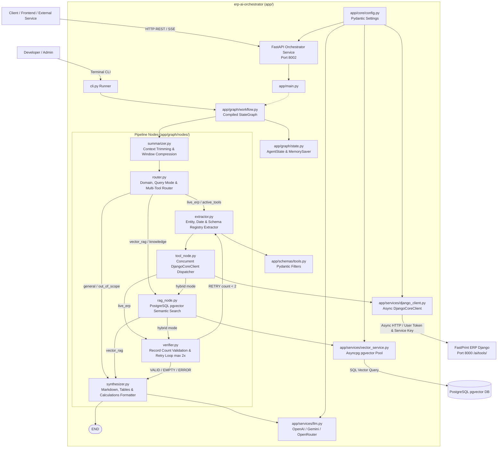

# FastPrint ERP: AI Orchestrator Service

Service orchestrator berbasis FastAPI dan LangGraph untuk integrasi agen AI dengan FastPrint ERP (layer `ai_tools`).

---

## Arsitektur Sistem

Pipeline pemrosesan kueri dibangun di atas compiled `StateGraph` LangGraph yang terdiri dari 7 node deterministik, percabangan kondisional, dan loop verifikasi adaptif.



### Pipeline Nodes

1. **`summarizer_node` (`app/graph/nodes/summarizer.py`)**
   Memeriksa panjang riwayat percakapan. Jika melebihi batas ambang (`SUMMARIZATION_THRESHOLD_MESSAGES`), pesan lama diringkas menjadi rangkuman terstruktur dan pesan aktif dipangkas untuk menjaga batas konteks token LLM.

2. **`router_node` (`app/graph/nodes/router.py`)**
   Mengklasifikasikan kueri ke dalam domain (`accounting`, `inventory`, `sales`, `knowledge`, `general`, `out_of_scope`) dan mode eksekusi (`live_erp`, `vector_rag`, `hybrid`). Memiliki guardrail negatif untuk memisahkan entitas vendor dan pelanggan, penanganan infleksi bahasa Indonesia, serta perencanaan multi-tool (`active_tools`).

3. **`extractor_node` (`app/graph/nodes/extractor.py`)**
   Mengekstrak parameter filter, ID entitas, dan rentang tanggal ke format ISO 8601 (`YYYY-MM-DD`). Memvalidasi setiap payload terhadap skema Pydantic di `app/schemas/tools.py` dan menerapkan instruksi relaksasi filter saat siklus retry berjalan.

4. **`tool_node` (`app/graph/nodes/tool_node.py`)**
   Mengeksekusi panggilan tool ke Django Core (`POST /ai/tools/<domain>/<tool_name>/`) via `DjangoCoreClient`. Mendukung eksekusi konkuren multi-tool, kueri paralel multi-company (`company_ids`), resolusi lokasi gudang 2-tahap, dan preservasi blok data kalkulasi.

5. **`rag_node` (`app/graph/nodes/rag_node.py`)**
   Menjalankan pencarian semantik dokumen kualitatif (SOP, spesifikasi barang, kebijakan perusahaan) ke database PostgreSQL pgvector menggunakan model embedding Gemini.

6. **`verifier_node` (`app/graph/nodes/verifier.py`)**
   Memeriksa kelengkapan data dan jumlah record hasil tool (`records_count`). Jika hasil kosong (0 data) dan `retry_count < 2`, verifier menaikkan counter retry, menghasilkan instruksi pelonggaran filter, dan mengarahkan alur kembali ke `extractor_node`. Jika batas retry tercapai, status ditetapkan menjadi `EMPTY`.

7. **`synthesizer_node` (`app/graph/nodes/synthesizer.py`)**
   Menyusun jawaban akhir dalam format Markdown terstruktur dengan format mata uang Rupiah (`Rp`), tabel perbandingan, rincian kalkulasi, penanganan status `EMPTY` atau `ERROR`, serta daftar rekomendasi pertanyaan lanjutan (`suggested_followups`).

---

## Modul & Tool Native FastPrint ERP

Service ini terhubung dengan layer `/ai/tools/` pada Django Core FastPrint ERP dan mencakup 22 tool operasional serta 1 modul pencarian dokumen RAG:

### 1. Accounting

| Tool Name | Fungsi & Parameter Utama |
|---|---|
| `fetch_vendor_invoices` | Menelusuri faktur tagihan vendor, status pembayaran, nomor referensi, dan rincian item. |
| `get_account_balance` | Mengambil saldo akun COA, mutasi debit/kredit periode berjalan, dan posisi saldo akhir. |
| `get_journal_entries` | Mengambil entri jurnal umum dengan filter rentang tanggal, status posting, buku jurnal, dan akun. |
| `get_general_ledger` | Menampilkan buku besar akun tertentu dengan baris transaksi mutasi debit, kredit, dan saldo berjalan. |
| `get_profit_and_loss` | Menghitung laporan laba rugi untuk periode tertentu (pendapatan, HPP, beban operasional, dan laba bersih). |
| `get_balance_sheet` | Menampilkan neraca keuangan per tanggal cut-off tertentu (aset, liabilitas, dan ekuitas). |
| `get_vendor_bills` | Mengambil daftar tagihan pemasok dengan filter status jatuh tempo (`all`, `overdue`, `due_soon`). |
| `get_bank_reconciliation_summary` | Menyajikan ringkasan status rekonsiliasi kas dan bank berdasarkan buku jurnal tertentu. |

### 2. Inventory

| Tool Name | Fungsi & Parameter Utama |
|---|---|
| `get_stock_level` | Mengambil kuantitas fisik on-hand barang per perusahaan dan lokasi gudang. Mendukung resolusi nama gudang 2-tahap. |
| `get_product_info` | Mengambil data katalog master barang (SKU, barcode, varian, harga jual, dan estimasi HPP). |
| `get_locations` | Menampilkan daftar master lokasi penyimpanan, rak, dan gudang internal yang aktif. |
| `get_stock_history` | Menelusuri riwayat pergerakan stok barang per gudang, tipe operasi, atau nomor referensi transaksi. |
| `get_transfers` | Mengambil dokumen perpindahan barang (penerimaan barang, delivery order, internal transfer) beserta baris item. |
| `get_low_stock_alerts` | Menampilkan daftar produk dengan stok yang berada di bawah ambang batas minimum. |
| `get_stock_adjustments` | Mengambil catatan transaksi penyesuaian stok fisik (stock opname) berdasarkan status dan tanggal. |
| `get_scrap_records` | Mengambil catatan barang rusak, kadaluarsa, atau scrap beserta lokasi asal dan alasan pembuangan. |
| `get_warehouses` | Menampilkan master data gudang beserta daftar lokasi internal di bawahnya. |
| `get_product_categories` | Mengambil daftar kategori produk beserta metode kalkulasi biaya (costing method). |

### 3. Sales

| Tool Name | Fungsi & Parameter Utama |
|---|---|
| `get_top_selling_products` | Mengambil daftar produk dengan penjualan tertinggi berdasarkan kuantitas atau nominal pada periode tertentu. |
| `get_sales_orders` | Menelusuri daftar sales order berdasarkan rentang tanggal, status order, nama pelanggan, atau sales channel. |
| `get_sales_order_detail` | Mengambil rincian item baris sales order berdasarkan nomor SO, invoice marketplace, atau resi kurir. |
| `get_sales_summary` | Menghitung ringkasan total omzet penjualan, jumlah order, dan rata-rata nilai order per channel penjualan. |

### 4. Knowledge & Policy (RAG)

| Modul | Fungsi & Parameter Utama |
|---|---|
| `search_knowledge` | Pencarian semantik SOP internal perusahaan, spesifikasi teknis produk, dan kebijakan operasional via PostgreSQL pgvector. |

### Sequential 2-Step Location Resolution
Ketika pengguna menanyakan stok pada lokasi atau gudang spesifik menggunakan nama teks (contoh: *"berapa stok kertas glossy di gudang cabang bandung"*):
1. **Langkah 1**: `tool_node` memanggil `inventory.get_locations(search="cabang bandung")` untuk mencari ID lokasi yang valid dari database ERP.
2. **Langkah 2**: `tool_node` mengeksekusi `inventory.get_stock_level(code="...", location_id=...)` menggunakan ID lokasi hasil Langkah 1, sehingga kuantitas stok yang disajikan tepat untuk lokasi tersebut.

---

## API Endpoints

FastAPI berjalan secara default pada port `8002`.

### Health & Monitoring

- `GET /health`
  Liveness probe sederhana. Mengembalikan `{"status": "healthy"}`.

- `GET /health/ready`
  Readiness probe yang memverifikasi konfigurasi provider LLM, URL ERP Django, status modul RAG, dan koneksi pool PostgreSQL pgvector tanpa mengekspos kredensial rahasia.

### Chat & Streaming

- `POST /api/v1/chat`
  Endpoint inferensi sinkron. Menerima payload `ChatRequest` dan mengembalikan `ChatResponse` lengkap setelah seluruh pipeline StateGraph selesai dieksekusi.

- `POST /api/v1/chat/stream`
  Endpoint streaming Server-Sent Events (SSE). Mengalirkan progres eksekusi StateGraph secara bertahap:
  - `event: step` — Transisi status antar-node pipeline (`summarizer`, `router`, `extractor`, `tool_node`, `verifier`, `synthesizer`).
  - `event: tool_start` — Nama tool ERP dan parameter filter yang telah divalidasi.
  - `event: tool_end` — Durasi eksekusi tool, status keberhasilan, dan jumlah data record yang ditemukan.
  - `event: token` — Potongan token teks dari node synthesizer untuk efek pengetikan bertahap.
  - `event: complete` — Payload final `ChatResponse`.
  - `event: error` — Diagnostik error jika terjadi kegagalan pipeline.
  - `: ping` — Heartbeat komentar setiap 15 detik untuk menjaga koneksi reverse proxy tetap aktif.

---

## Struktur Direktori

```text
erp-langgraph/
├── app/
│   ├── __init__.py
│   ├── main.py                     # FastAPI application, middleware observabilitas, & route chat/stream
│   ├── core/
│   │   ├── __init__.py
│   │   ├── config.py               # Settings konfigurasi aplikasi via pydantic-settings
│   │   └── context.py              # Helper context window, trimming token, dan sanitasi payload
│   ├── schemas/
│   │   ├── __init__.py
│   │   ├── chat.py                 # Pydantic schema ChatRequest, ChatResponse, & SSE stream events
│   │   └── tools.py                # Schema filter input Pydantic, envelope respons ERP, & domain registry
│   ├── services/
│   │   ├── __init__.py
│   │   ├── django_client.py        # Klien HTTP asinkron (httpx.AsyncClient) ke Django Core /ai/tools/
│   │   ├── erp_client.py           # Klien HTTP sinkron (httpx.Client) ke layer ERP
│   │   ├── llm.py                  # Factory multi-provider LLM (OpenAI, Gemini, OpenRouter) & auto-fallback
│   │   ├── tool_registry_service.py# Registri dinamis katalog tool dari ERP dengan RBAC role-filtering
│   │   └── vector_service.py       # Klien PostgreSQL asyncpg & pgvector untuk embedding/pencarian SOP
│   ├── tools/
│   │   ├── __init__.py
│   │   ├── static.py               # Definisi typed static tools LangChain
│   │   └── dynamic.py              # Dynamic tool loader dari endpoint GET /ai/tools/
│   └── graph/
│       ├── __init__.py
│       ├── state.py                # AgentState TypedDict, VerificationStatus, & ToolCallPlan
│       ├── workflow.py             # Kompilasi StateGraph 7-node, routing kondisional, & runner sinkron/asinkron
│       └── nodes/
│           ├── __init__.py
│           ├── summarizer.py       # Node trimming riwayat pesan percakapan & kompresi konteks
│           ├── router.py           # Node hybrid router domain, mode kueri, & perencanaan multi-tool
│           ├── extractor.py        # Node ekstraksi entitas, tanggal ISO 8601, & registri skema tool
│           ├── tool_node.py        # Node eksekusi tool asinkron, resolusi lokasi, & multi-company concurrent
│           ├── rag_node.py         # Node pencarian semantik dokumen SOP via pgvector
│           ├── verifier.py         # Node validasi record count, kontrol siklus retry 2x, & penyesuaian instruksi
│           └── synthesizer.py      # Node sintesis jawaban Markdown, format tabel IDR, & rekomendasi followup
├── tests/                          # 34 berkas unit test (627 test cases)
├── cli.py                          # Runner terminal CLI interaktif
├── prompts/
│   └── erp_system_prompt.md        # Definisi prompt sistem konteks bisnis FastPrint ERP
├── docs/
│   ├── AI_TOOLS_HANDOFF.md         # Spesifikasi teknis integrasi endpoint Django Core
│   └── LANGGRAPH_INTEGRATION.md    # Dokumentasi integrasi arsitektur LangGraph
├── requirements.txt                # Daftar dependensi paket Python
├── .env.example                    # Template konfigurasi variabel environment
└── README.md                       # Dokumentasi teknis proyek
```

---

## Konfigurasi Environment

Konfigurasi dibaca otomatis dari variabel sistem atau berkas `.env` menggunakan `pydantic-settings`:

| Variabel | Tipe | Default | Keterangan |
|---|---|---|---|
| `APP_NAME` | string | `erp-ai-orchestrator` | Nama pengenal service |
| `APP_ENV` | string | `development` | Mode aplikasi (`development`, `production`, `test`) |
| `APP_HOST` | string | `0.0.0.0` | Host binding server FastAPI |
| `APP_PORT` | integer | `8002` | Port listening server FastAPI |
| `LOG_LEVEL` | string | `info` | Level logging sistem (`debug`, `info`, `warning`, `error`) |
| `APP_TIMEZONE` | string | `Asia/Jakarta` | Zona waktu acuan pemrosesan tanggal relatif |
| `REQUIRE_USER_TOKEN` | boolean | `false` | Wajibkan token JWT pengguna pada setiap request |
| `REQUIRE_SERVICE_KEY` | boolean | `false` | Wajibkan header `X-Internal-Service-Key` |
| `INTERNAL_SERVICE_KEY` | string | `None` | Kunci otentikasi internal service orchestrator |
| `MAX_CHECKPOINT_THREADS` | integer | `500` | Batas maksimum thread memori percakapan pada LRU cache |
| `SSE_HEARTBEAT_SECONDS` | float | `15.0` | Interval pengiriman heartbeat comment ping pada SSE |
| `ERP_BASE_URL` | string | `http://127.0.0.1:8000` | URL dasar backend Django ERP (alias: `DJANGO_INTERNAL_API_URL`) |
| `DEFAULT_COMPANY_ID` | integer | `1` | ID default scoping multi-company |
| `ERP_API_TOKEN` | string | `None` | Token akses statis / service key ERP (alias: `DJANGO_INTERNAL_SERVICE_KEY`) |
| `ERP_USERNAME` | string | `admin` | Kredensial username autentikasi otomatis ERP |
| `ERP_PASSWORD` | string | `""` | Kredensial password autentikasi otomatis ERP |
| `REQUEST_TIMEOUT_SEC` | integer | `15` | Batas waktu timeout request HTTP dalam detik |
| `MODEL_PROVIDER` | string | `openai` | Prioritas provider LLM (`openai`, `gemini`, `openrouter`) |
| `OPENAI_API_KEY` | string | `None` | API key provider OpenAI |
| `OPENAI_MODEL` | string | `gpt-4o-mini` | Nama model default OpenAI |
| `GOOGLE_AI_API_KEY` | string | `None` | Kunci API utama Google Gemini (alias: `GEMINI_API_KEY`) |
| `GOOGLE_AI_API_KEY_2` | string | `None` | Kunci API cadangan 1 Google Gemini untuk rotasi quota |
| `GOOGLE_AI_API_KEY_3` | string | `None` | Kunci API cadangan 2 Google Gemini untuk rotasi quota |
| `GEMINI_MODEL` | string | `gemini-2.5-flash` | Nama model default Google Gemini |
| `OPENROUTER_API_KEY` | string | `None` | Kunci API OpenRouter |
| `OPENROUTER_MODEL` | string | `nvidia/nemotron-3.5-super-vl:free` | Nama model default OpenRouter |
| `ENABLE_RAG` | boolean | `true` | Mengaktifkan modul pencarian dokumen semantik pgvector |
| `VECTOR_DB_URL` | string | `None` | URL koneksi PostgreSQL pgvector (alias: `POSTGRES_VECTOR_URL`) |
| `GEMINI_EMBEDDING_MODEL`| string | `gemini-embedding-001` | Model embedding untuk vektor dokumen RAG |
| `DYNAMIC_TOOL_RETRIEVAL_ENABLED` | boolean | `true` | Pengambilan kandidat tool secara dinamis berdasarkan embedding kueri |
| `ENABLE_AUTO_SUMMARIZATION` | boolean | `true` | Peringkasan otomatis riwayat pesan yang melebihi ambang batas |
| `ENABLE_HITL_INTERRUPT` | boolean | `false` | Jeda konfirmasi manual sebelum mengeksekusi operasi penulisan data |

---

## Automated Testing

Pengujian menggunakan framework bawaan Python `unittest`. Seluruh 627 test cases berjalan terisolasi dengan mock HTTP dan koneksi in-memory:

```powershell
.\.venv\Scripts\python.exe -m unittest discover -s tests -p "test_*.py" -v
```

### Cakupan Pengujian (34 Modul Test):
- `tests/test_accounting_tools.py`: Eksekusi tool akuntansi (buku besar, laba rugi, neraca, tagihan vendor, rekonsiliasi bank).
- `tests/test_inventory_tools.py`: Eksekusi tool inventaris (stok barang, transfer, mutasi, peringatan stok menipis, scrap).
- `tests/test_sales_tools.py`: Eksekusi tool penjualan (top selling products, sales orders, detail order, sales summary).
- `tests/test_router_extractor_nodes.py`: Routing domain dan tool, negative guardrails, sufiks bahasa Indonesia, dan registri skema.
- `tests/test_router_fastpath_billing.py`: Fast-path pattern matching untuk dokumen penagihan dan faktur.
- `tests/test_branch_and_vendor_extractor.py`: Ekstraksi entitas cabang dan resolusi nama rekanan vendor.
- `tests/test_product_anaphora_price.py`: Resolusi anafora rujukan produk dan penanganan permintaan harga.
- `tests/test_tool_node.py`: Eksekusi tool asinkron, propagasi token JWT, dan resolusi lokasi 2-tahap.
- `tests/test_verifier_node.py`: Evaluasi record count, transisi status VALID/EMPTY/RETRY/ERROR, dan batas loop retry 2x.
- `tests/test_synthesizer_node.py`: Pemformatan Markdown tabel, mata uang Rupiah, dan penanganan status error/empty.
- `tests/test_workflow.py`: Kompilasi StateGraph, percabangan kondisional, checkpointer memory, dan eksekusi end-to-end.
- `tests/test_multi_company.py`: Penanganan kueri lintas anak perusahaan dan eksekusi paralel multi-company.
- `tests/test_multi_tool_execution.py`: Perencanaan dan orkestrasi pemanggilan multi-tool simultan dalam satu kueri.
- `tests/test_rag_pipeline.py`: Pipeline RAG pencarian dokumen kebijakan dan SOP perusahaan via embedding Gemini.
- `tests/test_vector_service.py`: Operasi koneksi asyncpg pool, inisialisasi tabel skema vektor, dan pencarian cosine distance.
- `tests/test_tool_registry.py`: Sinkronisasi katalog tool dinamis dari backend ERP dan otorisasi berbasis peran (RBAC).
- `tests/test_api_chat.py`: Kontrak endpoint `POST /api/v1/chat`, validasi autentikasi token, dan header request/response.
- `tests/test_api_chat_stream.py`: Kontrak endpoint `POST /api/v1/chat/stream`, streaming SSE event, dan heartbeat ping.
- `tests/test_adversarial_stress.py`: Uji konkurensi (50 request simultan), isolasi thread, dan stabilitas memori.
- `tests/test_adversarial_challenger_2.py`: Pengujian batas input ekstrem, anomali payload, dan skenario kegagalan backend.
- `tests/test_m1_challenger_immutability_scoping.py`: Imutabilitas state dictionary dan penegakan isolasi scoping company ID.
- `tests/test_m2_challenger_extractor.py`: Validasi skema input Pydantic dan normalisasi tanggal format ISO 8601.
- `tests/test_context_management.py`: Trimming riwayat pesan, pemotongan konteks percakapan, dan sanitasi payload.
- `tests/test_billing_guardrail_clarification.py`: Klarifikasi ambiguitas istilah tagihan dan guardrail pemisahan customer-vendor.
- `tests/test_stock_distribution_issue.py`: Verifikasi pelaporan distribusi stok antar gudang transit dan gudang utama.
- `tests/test_config_llm.py`: Singleton Settings, alias variabel environment, dan inisialisasi provider LLM.
- `tests/test_llm_fallbacks.py`: Katalog model gratis, deteksi fitur JSON/tools, dan fallback berantai OpenRouter.
- `tests/test_model_indicator.py`: Pelacakan identitas model LLM aktif pada payload respons.
- `tests/test_django_client.py`: Klien HTTP asinkron, propagasi header otentikasi, dan mapping status HTTP error.
- `tests/test_schemas_tools.py`: Skema input Pydantic, pembatasan pagination, dan envelope respons `ERPResponseEnvelope`.
- `tests/test_graph_state.py`: Struktur `AgentState`, helper `create_initial_state`, dan pembaruan parsial state.
- `tests/test_ui_chat_scenarios.py`: Validasi skenario interaksi pengguna dari antarmuka web ERP FastPrint.
- `tests/test_production_readiness.py`: Kesiapan deployment produksi, penegakan autentikasi ketat, dan timeout handling.
- `tests/test_cli.py`: Interaktivitas CLI runner, parsing argumen, perintah internal (`co`, `token`, `verbose`), dan sinyal interrupt.

---

## Quick Start

### 1. Siapkan Environment Python

Gunakan Python 3.11+:

```powershell
py -3.11 -m venv .venv
.\.venv\Scripts\Activate.ps1
pip install -r requirements.txt
```

### 2. Atur Berkas Konfigurasi

Salin berkas template `.env.example` ke `.env`:

```powershell
cp .env.example .env
```

Isi parameter koneksi ke server ERP FastPrint dan API key provider LLM yang digunakan (`OPENAI_API_KEY`, `GOOGLE_AI_API_KEY`, atau `OPENROUTER_API_KEY`).

### 3. Jalankan Service FastAPI

```powershell
uvicorn app.main:app --host 0.0.0.0 --port 8002 --reload
```

Verifikasi endpoint liveness dan readiness:

```powershell
# Health check
Invoke-RestMethod -Uri "http://127.0.0.1:8002/health" -Method Get

# Readiness check
Invoke-RestMethod -Uri "http://127.0.0.1:8002/health/ready" -Method Get
```

Akses dokumentasi interaktif API melalui peramban web:
- Swagger UI: [http://localhost:8002/docs](http://localhost:8002/docs)
- ReDoc: [http://localhost:8002/redoc](http://localhost:8002/redoc)

### 4. Menjalankan Terminal CLI Interaktif

Gunakan runner CLI untuk menguji alur StateGraph secara langsung dari terminal:

```powershell
python cli.py
```

Perintah interaktif di dalam CLI:
- `co <id>` — Mengganti target scoping `company_id` (contoh: `co 2`).
- `token <jwt>` — Mengatur JWT bearer token otorisasi pengguna.
- `verbose` — Mengaktifkan atau menonaktifkan tampilan detail node dan log kalkulasi.
- `new` — Mereset riwayat percakapan dan memulai thread baru.
- `exit` — Keluar dari aplikasi CLI.
