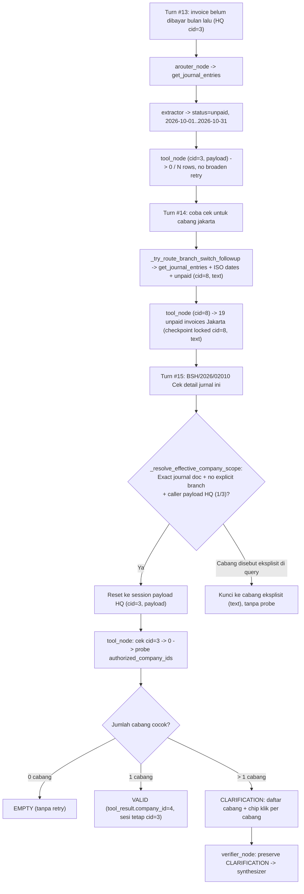

# Rencana Implementasi Stabilisasi Chat ERP (Lanjutan Handover)

## Goal Description

Menyelesaikan sisa pekerjaan stabilisasi chat ERP dari [erp-chat-stabilization-handover.md](file:///Users/programmer/fastprint-project/erp-langgraph/docs/superpowers/plans/erp-chat-stabilization-handover.md) di dua worktree aktif (`codex/chat-stabilization`) untuk memenuhi syarat rilis pada [2026-12-27-erp-chat-stabilization.md](file:///Users/programmer/fastprint-project/erp-langgraph/docs/superpowers/plans/2026-12-27-erp-chat-stabilization.md) dan menutup kegagalan pada [ai_chat_audit_2026_11_27.md](file:///Users/programmer/fastprint-project/erp-langgraph/docs/archive/ai_chat_audit_2026_11_27.md):

| Repo | Worktree | Branch | Status Awal |
|---|---|---|---|
| LangGraph | `/Users/programmer/fastprint-project/erp-langgraph-chat-stabilization` | `codex/chat-stabilization` | 18 file termodifikasi + 2 file tes untracked (belum di-commit) |
| Django ERP | `/Users/programmer/fastprint-project/ERP-chat-stabilization` | `codex/chat-stabilization` | 6 file termodifikasi (belum di-commit) |

Hasil reproduksi read-only terhadap diff saat ini mengonfirmasi empat akar masalah yang masih terbuka:

1. **Routing `legacy_regex` (#13, #14, #15)**:
   - `#13` (`"Mana saja invoice yang belum di bayar di bulan lalu ??"`) jatuh ke `domain="general", tool=None` karena guardrail di [router.py](file:///Users/programmer/fastprint-project/erp-langgraph-chat-stabilization/app/graph/nodes/router.py#L728-L749).
   - `#4` dan `#15` (`BSH/2026/02010` + kata `jurnal`) menghasilkan rencana multi-tool `['fetch_vendor_invoices', 'get_journal_entries']` dengan `fetch_vendor_invoices` di posisi pertama pada `#15` karena pemeriksaan nomor dokumen di [router.py](file:///Users/programmer/fastprint-project/erp-langgraph-chat-stabilization/app/graph/nodes/router.py#L474-L480) berjalan sebelum pola `jurnal`.
   - `#14` (`"coba cek untuk cabang jakarta"`) di `legacy_regex` jatuh ke `out_of_scope` karena [router.py](file:///Users/programmer/fastprint-project/erp-langgraph-chat-stabilization/app/graph/nodes/router.py#L1703-L1711) mengklasifikasi ulang `#13` dan mengisi `effective_sub = user_query` tanpa klausa `unpaid` maupun tanggal ISO sebelumnya.
2. **Pewarisan scope `#13 -> #14 -> #15` & nomor jurnal ganda lintas cabang**:
   - Setelah `#14` mengunci checkpoint ke `company_id=8, company_scope_source="text"`, `_resolve_effective_company_scope` di [workflow.py](file:///Users/programmer/fastprint-project/erp-langgraph-chat-stabilization/app/graph/workflow.py#L437-L448) mewariskan `(8, [8], False, 3, 'text')` ke `#15`, sehingga probe lintas cabang dari HQ di [tool_node.py](file:///Users/programmer/fastprint-project/erp-langgraph-chat-stabilization/app/graph/nodes/tool_node.py#L596-L600) tidak pernah aktif.
   - Jika nomor jurnal yang sama ditemukan di lebih dari satu cabang yang diotorisasi, [tool_node.py](file:///Users/programmer/fastprint-project/erp-langgraph-chat-stabilization/app/graph/nodes/tool_node.py#L631-L635) masih mengambil kecocokan pertama secara diam-diam.
3. **Celah audit P1/P2 yang belum tertutup di kedua worktree** (mengancam syarat rilis minimal 18/19 turn lulus):
   - **P1-1 (`#17`)**: Tool marketplace (`get_fee_and_escrow_anomalies`, dll.) dari HQ (`company_id` 1 atau 3) tanpa penyebutan cabang hanya memindai `company_id=1` yang memiliki 0 akun marketplace.
   - **P1-2 (`#3`)**: [get_account_health.py](file:///Users/programmer/fastprint-project/ERP-chat-stabilization/ai_tools/tools/marketplace/get_account_health.py#L171-L173) memfilter `SystemLogEvent(module_name="marketplace")` tanpa filter `event_category="ERROR"`, sehingga log normal `ACTIVITY`/`INFO` dihitung sebagai error.
   - **P1-4 (`#2`)**: `_sanitize_clarification_options` di [synthesizer.py](file:///Users/programmer/fastprint-project/erp-langgraph-chat-stabilization/app/graph/nodes/synthesizer.py#L2235-L2238) menghapus chip tool mentah tanpa menggantinya dengan `sample_queries[0]`, sehingga bisa menyisakan 0 chip.
   - **P1-5 (`#11`, `#12`)**: [get_balance_sheet.py](file:///Users/programmer/fastprint-project/ERP-chat-stabilization/ai_tools/tools/accounting/get_balance_sheet.py#L424-L440) belum menampilkan daftar jurnal tidak seimbang ketika `is_balanced == False`.
   - **P2-1 (`#18`)**: `_resolve_company_display_label` di [common.py](file:///Users/programmer/fastprint-project/erp-langgraph-chat-stabilization/app/graph/nodes/formatters/common.py#L203-L221) masih menampilkan `Cabang: Kantor Pusat` pada laporan multi-cabang.
   - **P2-2 (`#10`)**: `_build_pnl_analytical_digest` di [synthesizer.py](file:///Users/programmer/fastprint-project/erp-langgraph-chat-stabilization/app/graph/nodes/synthesizer.py#L1799-L1803) masih mengelompokkan akun `52xxx` bertipe `Expenses` ke pos lain-lain.
4. **Latensi & Replay Staging (`P0-8`, Handover #4)**:
   - Tier-1 fast-path di [extractor.py](file:///Users/programmer/fastprint-project/erp-langgraph-chat-stabilization/app/graph/nodes/extractor.py#L252-L326) belum mencakup `get_journal_entries`, `get_account_balance`, dan `get_general_ledger`.
   - Replay 19 turn di staging terisolasi dan pengujian konfigurasi (`NLU_ROUTER_MODEL`, `NLU_ROUTER_REASONING_EFFORT`, `SYNTHESIZER_FAST_DETERMINISTIC`) belum dijalankan.

### Global Constraints

- Operasi ERP tetap **read-only** (`is_write: false`); tidak ada migrasi database, perubahan konfigurasi staging otomatis, maupun akses ke database produksi/aktif selama implementasi lokal.
- Pertahankan judul & urutan kolom tabel eksisting, kontrak API/SSE (`/api/v1/chat`, `/api/v1/chat/stream`), serta pembatasan cabang berdasarkan `authorized_company_ids`.
- Seluruh node StateGraph mengembalikan dict delta tanpa memutasi `state` in-place.
- Pengujian lokal dijalankan melalui `unittest` (LangGraph CI env & Django backend dummy).

---

## User Review Required

> [!IMPORTANT]
> **Cakupan Fase 1 vs Fase 2**: Rencana ini disusun dalam 3 fase berurutan:
> - **Fase 1 (Task 1–3)**: Fokus penuh pada 3 item kode & tes dari handover (`#13/#14/#15`, disambiguasi `CLARIFICATION` untuk nomor jurnal ganda lintas cabang sesuai pilihan Anda, tes checkpoint & anti-fabrikasi tabel `#19`, serta Tier-1 fast-path extractor).
> - **Fase 2 (Task 4–5)**: Menutup 6 celah audit terbuka (`P1-1`, `P1-2`, `P1-4`, `P1-5`, `P2-1`, `P2-2`) yang berdampak langsung pada kelulusan turn `#2`, `#3`, `#10`, `#11`, `#12`, `#17`, `#18` demi mencapai syarat rilis **minimal 18/19 turn lulus**.
> - **Fase 3 (Task 6–7)**: Verifikasi suite penuh kedua worktree + runbook replay 19 turn di staging terisolasi (dijalankan setelah kode lulus verifikasi lokal).
>
> Konfirmasi apakah Anda menyetujui eksekusi **Fase 1 + Fase 2 + Task 6** sekaligus di worktree lokal (lalu Task 7 sebagai runbook staging), atau ingin mengeksekusi **Fase 1 saja terlebih dahulu**.

> [!NOTE]
> **Perilaku Turn `#7` (`Bca dwi`)**: Pada audit staging, `BANK BCA PT.DWI PRINTA JAYA(5122602222)` ada di Makassar (`5`), Bandung (`6`), dan Jakarta (`8`), bukan di Head Office (`3`) maupun Main Store (`4`). Perbaikan tokenisasi `get_account_balance` di Django sudah masuk, tetapi pencarian tanpa cabang dari HQ/Main Store tidak otomatis memindai semua cabang untuk akun COA (agar menjaga scoping saldo per cabang). Setelah `#6` tidak lagi memicu klarifikasi yang salah, `#7` hanya menemukan akun tersebut jika pengguna menyebut cabang atau memilih `semua cabang`. Beri tahu jika Anda juga ingin `get_account_balance` menambahkan HQ fallback lintas cabang saat `search` menghasilkan 0 akun di HQ.

---

## Architecture Flow (Sequence `#13 -> #14 -> #15` & Multi-Branch Disambiguation)



---

## Proposed Changes

### Fase 1 — Prioritas Handover (#1–#3)

---

#### Task 1: Perbaikan Routing `#13`, `#4`/`#15`, dan Follow-Up `#14` (LangGraph)

**Files:**
- #### [MODIFY] [router.py](file:///Users/programmer/fastprint-project/erp-langgraph-chat-stabilization/app/graph/nodes/router.py)
- #### [MODIFY] [router_semantic.py](file:///Users/programmer/fastprint-project/erp-langgraph-chat-stabilization/app/graph/nodes/router_semantic.py)
- #### [MODIFY] [test_chat_stabilization.py](file:///Users/programmer/fastprint-project/erp-langgraph-chat-stabilization/tests/test_chat_stabilization.py)

**Perubahan Spesifik:**
1. **Unpaid invoice routing (`#13`) di `classify_query_rule_based` ([router.py](file:///Users/programmer/fastprint-project/erp-langgraph-chat-stabilization/app/graph/nodes/router.py#L482-L495))**:
   - Tambahkan helper deteksi klausa unpaid invoice generik (tanpa kata pelanggan/customer/penjualan/piutang/kuitansi/bon dan tanpa kata vendor/supplier/pembelian serta tanpa nama entitas spesifik seperti `atas nama <nama>` atau `PT/CV/UD <nama>`):
     ```python
     _UNPAID_INVOICE_STATUS_RE = re.compile(
         r"\b(?:belum\s+(?:di\s*bayar|lunas|terbayar)|unpaid)\b",
         re.IGNORECASE,
     )
     _UNPAID_INVOICE_DOC_RE = re.compile(
         r"\b(?:invoice|faktur|tagihan)\b",
         re.IGNORECASE,
     )
     ```
   - Jika `_UNPAID_INVOICE_DOC_RE.search(cleaned)` dan `_UNPAID_INVOICE_STATUS_RE.search(cleaned)` dan `not has_customer`, `not has_vendor`, `not has_purchase_invoice`, `not is_explicit_customer_billing_query(cleaned)`, tidak ada `PT/CV/UD/atas nama`, serta `not any(c[0] in ("fetch_vendor_invoices", "get_vendor_bills", "get_journal_entries") for c in candidates)`:
     tambahkan `("get_journal_entries", "accounting", match_pos)`.
   - Guardrail pelanggan eksplisit (`"Cek tagihan pelanggan PT Sumber Makmur"`, `"faktur penjualan toko mainstore"`, `"cek tagihan Frendy"`) dan alur tagihan vendor (`"tagihan vendor PT Sumber Makmur yang belum lunas"`, `"Faktur PT Sumber Makmur yang belum dibayar"`) tetap tidak berubah.
2. **Routing nomor dokumen + jurnal (`#4`, `#15`) di [router.py](file:///Users/programmer/fastprint-project/erp-langgraph-chat-stabilization/app/graph/nodes/router.py#L473-L494) dan [router_semantic.py](file:///Users/programmer/fastprint-project/erp-langgraph-chat-stabilization/app/graph/nodes/router_semantic.py#L93-L193)**:
   - Di `router.py`, evaluasi pola `get_journal_entries` (termasuk kata kerja `menjurnal` pada `ACCOUNTING_JOURNAL_PATTERNS` atau cek eksplisit `\b(?:jurnal(?:nya)?|journal|menjurnal)\b`) sebelum blok `doc_match` generik:
     - Jika `doc_match` ditemukan dan belum ada kandidat di `("fetch_vendor_invoices", "get_vendor_bills", "get_journal_entries")`:
       - Pilih `get_journal_entries` apabila `"JE"` ada di `doc_code` **atau** query memuat kata `jurnal`/`journal`/`menjurnal` dan `doc_code` tidak berawalan voucher pembelian eksplisit (`PC/`, `BILL/`, `PB/`) tanpa kata vendor/pembelian.
       - Selain itu pertahankan `fetch_vendor_invoices` (misal `PC/2026/00002`).
     - Dengan urutan ini, `#4` (`"redirect ke nomer jurnal ini  BSH/2026/02010"`) dan `#15` (`"BSH/2026/02010\n\nCek detail dari jurnal ini ?? dia menjurnal apa"`) menghasilkan **satu tool tunggal** `["get_journal_entries"]`, bukan 2 tool.
   - Di `router_semantic.py:match_strict_document_identifier`: tambahkan pola fast-path ketika query memuat satu nomor slash dokumen (`(?:[A-Za-z0-9_\-]+/)+\d{4}/\d+`) yang bukan `WH/`, `SO/`, `PC/`, `BILL/`, `PB/` bersama kata `jurnal`/`journal`/`menjurnal` -> langsung kembalikan `("get_journal_entries", "accounting")`.
3. **Paritas follow-up ganti cabang `#14` di `legacy_regex` ([router.py](file:///Users/programmer/fastprint-project/erp-langgraph-chat-stabilization/app/graph/nodes/router.py#L2296-L2370))**:
   - Di `_legacy_router_node_impl` dan `_alegacy_router_node_impl`, panggil `_try_route_branch_switch_followup(eff_query, state)` tepat setelah `_try_route_contextual_analysis` (sama seperti `check_hard_guardrails` di `router_semantic.py:545`).
   - Di `router.py:1708-1711`, selaraskan `effective_sub = effective_user` agar sub-query tidak kehilangan filter `belum di bayar` dan periode tanggal saat fallback ke Step 1.5.

---

#### Task 2: Urutan Audit `#13 -> #14 -> #15` & Disambiguasi Nomor Jurnal Ganda Lintas Cabang (LangGraph)

**Files:**
- #### [MODIFY] [context.py](file:///Users/programmer/fastprint-project/erp-langgraph-chat-stabilization/app/core/context.py)
- #### [MODIFY] [workflow.py](file:///Users/programmer/fastprint-project/erp-langgraph-chat-stabilization/app/graph/workflow.py)
- #### [MODIFY] [tool_node.py](file:///Users/programmer/fastprint-project/erp-langgraph-chat-stabilization/app/graph/nodes/tool_node.py)
- #### [MODIFY] [verifier.py](file:///Users/programmer/fastprint-project/erp-langgraph-chat-stabilization/app/graph/nodes/verifier.py)
- #### [MODIFY] [test_stabilization_tool_execution.py](file:///Users/programmer/fastprint-project/erp-langgraph-chat-stabilization/tests/test_stabilization_tool_execution.py)

**Perubahan Spesifik:**
1. **Membedakan permintaan nomor jurnal baru dari follow-up cabang sticky ([context.py](file:///Users/programmer/fastprint-project/erp-langgraph-chat-stabilization/app/core/context.py), [workflow.py](file:///Users/programmer/fastprint-project/erp-langgraph-chat-stabilization/app/graph/workflow.py#L436-L460))**:
   - Tambahkan helper `is_standalone_exact_journal_query(user_query: str) -> bool` di `app/core/context.py`:
     - Mengembalikan `True` jika `user_query` memuat tepat 1 nomor dokumen slash (`\b(?:[A-Za-z0-9_\-]+/)+\d{4}/\d+\b`) yang bukan `WH/` atau `SO/`, serta tidak memuat nama cabang eksplisit (`resolve_all_branch_company_ids` kosong dan tidak ada `\bhq\b`).
   - Pada `_resolve_effective_company_scope` langkah `4a` ([workflow.py](file:///Users/programmer/fastprint-project/erp-langgraph-chat-stabilization/app/graph/workflow.py#L437-L448)):
     - Jika `is_standalone_exact_journal_query(user_query)` bernilai `True` **dan** `is_explicit and company_id is not None`: **lewati** pewarisan sticky branch `4a`, lalu jatuh ke langkah `4c` sehingga scope kembali ke `company_id` sesi payload (misal HQ `3`, `company_scope_source="payload"`).
     - Jika pengguna menyebut cabang secara eksplisit pada permintaan baru (misal `"cek jurnal BSH/2026/02010 di jakarta"`), langkah `2` sudah menangkapnya lebih dulu dan mengembalikan `(8, [8], False, ..., "text")` sehingga cabang eksplisit tidak pernah diabaikan.
     - Follow-up non-dokumen setelah `#14` (misal `"kalau yang status draft?"`, `"berapa totalnya?"`) tetap melewati langkah `4a` dan mempertahankan cabang Jakarta (`8`).
2. **Disambiguasi nomor jurnal ganda lintas cabang -> `CLARIFICATION` ([tool_node.py](file:///Users/programmer/fastprint-project/erp-langgraph-chat-stabilization/app/graph/nodes/tool_node.py#L621-L636), [verifier.py](file:///Users/programmer/fastprint-project/erp-langgraph-chat-stabilization/app/graph/nodes/verifier.py#L67-L75))**:
   - Tambahkan helper `_build_duplicate_journal_clarification(exact_number: str, matches: List[Tuple[int, Dict[str, Any]]]) -> Dict[str, Any]` di `tool_node.py`:
     - Mengumpulkan seluruh `(cid, found)` dalam urutan `probe_ids` yang memiliki `entries` cocok secara persis.
     - Jika `len(matches) == 1`: kembalikan `matches[0][1], None` (perilaku normal satu cabang, tanpa mengubah sesi).
     - Jika `len(matches) > 1`: bangun state delta klarifikasi:
       - `query_mode="clarification"`, `needs_clarification=True`, `verification_status="CLARIFICATION"`, `tool_result=None`, `multi_tool_results={}`.
       - `clarification_question`: sebutkan nomor jurnal dan ringkasan setiap cabang yang cocok (`nama cabang`, `tanggal`, `status`, `total_debit` dalam format Rupiah), lalu tanya cabang mana yang ingin diperiksa.
       - `clarification_options`: maksimal 4 chip per cabang dengan `label=branch_name`, `query=f"Cek detail jurnal {exact_number} di {branch_name}"`, `icon="fa-building"`.
   - Di awal `verifier_node` ([verifier.py](file:///Users/programmer/fastprint-project/erp-langgraph-chat-stabilization/app/graph/nodes/verifier.py#L69)):
     - Tambahkan early return jika `state.get("verification_status") == "CLARIFICATION"` atau `state.get("needs_clarification")`: pertahankan `verification_status="CLARIFICATION"` agar `decide_after_verification` langsung menuju `synthesizer` (`_build_clarification_synthesis_output`) tanpa memicu retry atau `EMPTY`.
   - Pada `_build_chat_response` ([main.py](file:///Users/programmer/fastprint-project/erp-langgraph-chat-stabilization/app/main.py#L365-L375)), karena `verification_status_str == "CLARIFICATION"`, `journal_source` tetap `None`, sehingga `resolved_company_id` tetap cabang sesi dan `entity_links` / `table_query_meta` bersih.

---

#### Task 3: Cakupan Checkpoint Scope, Guard Anti-Fabrikasi Tabel `#19`, dan Tier-1 Extractor Fast-Path (LangGraph)

**Files:**
- #### [MODIFY] [synthesizer.py](file:///Users/programmer/fastprint-project/erp-langgraph-chat-stabilization/app/graph/nodes/synthesizer.py)
- #### [MODIFY] [extractor.py](file:///Users/programmer/fastprint-project/erp-langgraph-chat-stabilization/app/graph/nodes/extractor.py)
- #### [MODIFY] [accounting.py](file:///Users/programmer/fastprint-project/erp-langgraph-chat-stabilization/app/graph/nodes/extractors/accounting.py)
- #### [MODIFY] [test_chat_stabilization.py](file:///Users/programmer/fastprint-project/erp-langgraph-chat-stabilization/tests/test_chat_stabilization.py)

**Perubahan Spesifik:**
1. **Guard deterministik anti-fabrikasi tabel `cabang x bulan` (`#19`) di [synthesizer.py](file:///Users/programmer/fastprint-project/erp-langgraph-chat-stabilization/app/graph/nodes/synthesizer.py#L1982-L2039)**:
   - Tambahkan helper `_is_unavailable_branch_month_matrix_request(user_query: str, state: AgentState) -> bool` dan `_format_branch_month_unavailable_response(state: AgentState) -> Tuple[str, List[Dict[str, str]]]`:
     - Aktif saat `query_mode == "contextual_analysis"`, permintaan berupa table-reformat yang menyilangkan cabang dan >=2 nama bulan (mis. `cabang | oktober | november | desember`), dan `prior_tool_result` hanya memiliki `by_branch` (total per cabang) dan `monthly_breakdown` (total per bulan) tanpa matriks `by_branch_month`.
     - Jalankan secara deterministik di `asynthesizer_node` (tanpa LLM call — memangkas latensi `#19` dari 39,7 detik menjadi <50 ms dan menjamin **nol angka karangan**):
       - Kalimat pertama menjelaskan bahwa data ringkasan sebelumnya hanya menyediakan total per cabang dan total per bulan, sehingga rincian per cabang per bulan belum tersedia.
       - Menampilkan ulang tabel total per cabang dan tabel total per bulan secara persis dari `prior_tool_result`.
       - Menyertakan chip follow-up per bulan (maks. 3 chip) untuk mengambil rincian masing-masing bulan dari ERP.
2. **Tier-1 fast-path extraction untuk `P0-8` latensi di [extractor.py](file:///Users/programmer/fastprint-project/erp-langgraph-chat-stabilization/app/graph/nodes/extractor.py#L252-L326) & [accounting.py](file:///Users/programmer/fastprint-project/erp-langgraph-chat-stabilization/app/graph/nodes/extractors/accounting.py#L66-L164)**:
   - `get_journal_entries` (`retry_count == 0` dan `not has_unresolved_temporal`): gunakan `_fallback_extract_journal_entries` saat ditemukan tepat satu nomor dokumen slash **atau** `unpaid_journal` dengan periode tanggal teresolusi (memotong 1 LLM hop pada `#4`, `#13`, `#14`, `#15`). Perbarui `_fallback_extract_journal_entries` agar mengenali `status="unpaid"` untuk frasa `belum di bayar`/`belum lunas`/`unpaid` dan `"post"` untuk `posted`.
   - `get_general_ledger` (`retry_count == 0` dan `not has_unresolved_temporal`): gunakan `_fallback_extract_general_ledger` saat ada kode COA eksplisit, drill-down history, atau kategori generik `kas`/`bank` (`_extract_gl_account_hint` terdeteksi) sehingga prompt seperti `#8` (`"Tampilkan mutasi general ledger untuk kas mainstore"`) selesai tanpa LLM hop dan tidak mungkin mengarang `MAINSTORE_CASH`.
   - `get_account_balance` (`retry_count == 0` dan `not has_unresolved_temporal`): gunakan `_fallback_extract_account_balance` hanya untuk kode COA eksplisit atau kategori bersih (`Bank and Cash` / merek bank tanpa qualifier nama pemilik akun tambahan, agar query multi-kata seperti `"Bca dwi"` tetap mempertahankan seluruh kata pencarian).
3. **Tes checkpoint end-to-end di [test_chat_stabilization.py](file:///Users/programmer/fastprint-project/erp-langgraph-chat-stabilization/tests/test_chat_stabilization.py)**:
   - Urutan penuh 3 turn `#13 -> #14 -> #15` melalui `arun_workflow` + `MemorySaver` pada satu `thread_id`.
   - Pergantian cabang lewat payload (`company_id=4` -> `company_id=8`): memastikan laporan sebelumnya dari `company_id=4` tidak pernah dipakai ulang oleh `contextual_analysis`.
   - Pencabutan otorisasi pada `thread_id` yang sama (`authorized_company_ids=[3, 4, 7]` -> `[3, 7]`): memastikan laporan sebelumnya yang memuat cabang `4` ditolak baik di router maupun di safety-net synthesizer.
   - Replay `#19` atas payload `get_sales_summary` yang hanya berisi `by_branch` dan `monthly_breakdown`: memastikan tidak ada sel `cabang x bulan` karangan yang muncul.

---

### Fase 2 — Penutupan Celah Audit P1/P2 (Untuk Syarat Rilis `>= 18/19`)

---

#### Task 4: Perbaikan LangGraph P1-1 (`#17`), P1-4 (`#2`), P2-1 (`#18`), dan P2-2 (`#10`)

**Files:**
- #### [MODIFY] [tool_node.py](file:///Users/programmer/fastprint-project/erp-langgraph-chat-stabilization/app/graph/nodes/tool_node.py)
- #### [MODIFY] [synthesizer.py](file:///Users/programmer/fastprint-project/erp-langgraph-chat-stabilization/app/graph/nodes/synthesizer.py)
- #### [MODIFY] [common.py](file:///Users/programmer/fastprint-project/erp-langgraph-chat-stabilization/app/graph/nodes/formatters/common.py)
- #### [MODIFY] [test_chat_stabilization.py](file:///Users/programmer/fastprint-project/erp-langgraph-chat-stabilization/tests/test_chat_stabilization.py)
- #### [MODIFY] [test_stabilization_tool_execution.py](file:///Users/programmer/fastprint-project/erp-langgraph-chat-stabilization/tests/test_stabilization_tool_execution.py)

**Perubahan Spesifik:**
1. **P1-1 (`#17` — Marketplace HQ auto-expansion di [tool_node.py](file:///Users/programmer/fastprint-project/erp-langgraph-chat-stabilization/app/graph/nodes/tool_node.py#L1145-L1208))**:
   - Tambahkan helper `_should_expand_marketplace_hq_scope(tool_name, state, target_company_id, user_query) -> Optional[List[int]]`:
     - Aktif saat `TOOL_DOMAIN_MAP.get(tool_name) == "marketplace"`, `target_company_id in (1, 3)`, `not is_multi_company`, `state.get("company_scope_source") != "text"`, `not state.get("company_ids_explicit")`, query tidak menyebut cabang eksplisit maupun `hq`/`kantor pusat`/`head office`, dan `authorized_company_ids` memiliki `> 1` ID valid.
     - Alihkan eksekusi ke `_execute_tool_multi_company` (yang secara native mengirim satu panggilan dengan `company_ids=auth_cids` ke Django), sambil menjaga tes unit tanpa `authorized_company_ids` tetap berjalan single-company.
2. **P1-4 (`#2` — Pemulihan chip klarifikasi tool mentah di [synthesizer.py](file:///Users/programmer/fastprint-project/erp-langgraph-chat-stabilization/app/graph/nodes/synthesizer.py#L2221-L2255))**:
   - Di `_sanitize_clarification_options`: ketika `raw_query` cocok pola snake_case (`[a-z][a-z0-9]*(?:_[a-z0-9]+)+`), periksa `get_tool_registry_service().get_tool_by_name(clean_name)`. Jika terdaftar dan memiliki `sample_queries`, ganti `raw_query` dengan `sample_queries[0]`; hanya buang jika tidak terdaftar atau memuat placeholder `=..._ID` / `<...>`.
3. **P2-1 (`#18` — Label multi-cabang di [common.py](file:///Users/programmer/fastprint-project/erp-langgraph-chat-stabilization/app/graph/nodes/formatters/common.py#L203-L222))**:
   - Di `_resolve_company_display_label`: cek daftar `company_ids` pada `tool_result` atau `extracted_params` (dan panjang `tool_result.get("by_branch")`) sebelum fallback ke `company_name`/`company_id` tunggal.
   - Jika terdapat `> 3` cabang -> kembalikan `"Semua Cabang"`; jika `2..3` cabang -> gabungkan nama cabang dari `COMPANY_NAME_MAP` dengan koma.
4. **P2-2 (`#10` — Keselarasan bucket digest P&L di [synthesizer.py](file:///Users/programmer/fastprint-project/erp-langgraph-chat-stabilization/app/graph/nodes/synthesizer.py#L1799-L1803))**:
   - Ubah filter `other_income_accounts` menjadi hanya `"other" in a["type"].lower()`, menghapus `or a["code"].startswith("41") or a["code"].startswith("52")` agar akun `52000HO`/`52001HO`/`52002HO` bertipe `Expenses` tidak tampil ganda di *"Pos Pendapatan / Beban Lain-Lain Terbesar"*.

---

#### Task 5: Perbaikan Django ERP P1-2 (`#3`) & P1-5 (`#11`, `#12`) + Formatter Neraca LangGraph

**Files:**
- #### [MODIFY] [get_account_health.py](file:///Users/programmer/fastprint-project/ERP-chat-stabilization/ai_tools/tools/marketplace/get_account_health.py)
- #### [MODIFY] [get_balance_sheet.py](file:///Users/programmer/fastprint-project/ERP-chat-stabilization/ai_tools/tools/accounting/get_balance_sheet.py)
- #### [MODIFY] [tests.py](file:///Users/programmer/fastprint-project/ERP-chat-stabilization/ai_tools/tests.py)
- #### [MODIFY] [accounting.py](file:///Users/programmer/fastprint-project/erp-langgraph-chat-stabilization/app/graph/nodes/formatters/accounting.py)
- #### [MODIFY] [synthesizer.py](file:///Users/programmer/fastprint-project/erp-langgraph-chat-stabilization/app/graph/nodes/synthesizer.py)

**Perubahan Spesifik:**
1. **P1-2 (`#3` — Filter error nyata pada [get_account_health.py](file:///Users/programmer/fastprint-project/ERP-chat-stabilization/ai_tools/tools/marketplace/get_account_health.py#L171-L174))**:
   - Tambahkan filter `event_category="ERROR"` dan `level__in=("ERROR", "CRITICAL")` pada `err_qs` agar log aktivitas normal (`ACTIVITY`/`INFO`) tidak lagi masuk perhitungan `total_error_events` dan `error_ratio`.
   - Tambahkan unit test mock di `ai_tools/tests.py` yang memastikan `SystemLogEvent.objects.filter` dipanggil dengan `module_name="marketplace"`, `event_category="ERROR"`, `level__in=("ERROR", "CRITICAL")`.
2. **P1-5 (`#11`, `#12` — Diagnostik jurnal tidak seimbang di [get_balance_sheet.py](file:///Users/programmer/fastprint-project/ERP-chat-stabilization/ai_tools/tools/accounting/get_balance_sheet.py#L418-L440))**:
   - Hanya ketika `not is_balanced` (nol overhead untuk neraca seimbang):
     - Agregasi `je_item_qs` per `(journal_entry_id, journal_entry__number, journal_entry__date, journal_entry__status, journal_entry__accounting_journals__name)` dengan `Sum("debit")` dan `Sum("credit")`.
     - Saring entri dengan `abs(debit - credit) > 0.01`, urutkan berdasarkan `abs(diff)` menurun, simpan maksimal 10 entri terbesar ke `unbalanced_entries`, serta tambahkan `unbalanced_entries_count` dan `unbalanced_entries_net_diff` ke `summary["net_balance_check"]` (murni aditif, tidak mengubah kontrak field atau kolom lama).
   - Di LangGraph:
     - Perbarui `format_get_balance_sheet` ([accounting.py](file:///Users/programmer/fastprint-project/erp-langgraph-chat-stabilization/app/graph/nodes/formatters/accounting.py#L328-L345)) agar menampilkan tabel ringkas *"Jurnal Tidak Seimbang Terbesar"* bila `unbalanced_entries` tidak kosong.
     - Perbarui `_build_analytical_data_context` ([synthesizer.py](file:///Users/programmer/fastprint-project/erp-langgraph-chat-stabilization/app/graph/nodes/synthesizer.py#L2007-L2038)) agar ringkasan `net_balance_check` dan `unbalanced_entries` ditempatkan di bagian paling atas konteks sebelum pemotongan `max_chars=12000`, sehingga follow-up `#12` (*"Faktor yang membuat tidak seimbang apa ??"*) langsung menunjuk daftar jurnal tidak seimbang.

---

### Fase 3 — Verifikasi Akhir & Runbook Replay Staging (Handover #3 & #4)

---

#### Task 6: Verifikasi Suite Penuh & Audit Diff Kedua Worktree
- Jalankan seluruh suite LangGraph dan seluruh 115+ tes mock-only Django ERP, plus pemeriksaan `git diff --check`.

#### Task 7: Runbook Replay 19 Turn di Staging Terisolasi & Tuning Latensi Bertahap
- Susun protokol replay deterministik di staging terisolasi (akun uji, 4 thread terisolasi, pencatatan baseline model/router/config sebelum mengubah `NLU_ROUTER_MODEL`/`NLU_ROUTER_REASONING_EFFORT` dan `SYNTHESIZER_FAST_DETERMINISTIC` satu per satu).

---

## Review Focus (Edge Cases yang Wajib Dipin dengan Tes)

1. **Cabang eksplisit pada query nomor jurnal baru** (`"cek detail jurnal BSH/2026/02010 di jakarta"`): langkah `2` di `_resolve_effective_company_scope` harus mengunci `company_id=8, company_scope_source="text"` sehingga `tool_node` memanggil Django tepat 1 kali di Jakarta tanpa fallback lintas cabang.
2. **Guardrail tagihan pelanggan & penagihan non-vendor bernamakan orang** (`"Cek tagihan pelanggan PT Sumber Makmur"`, `"faktur penjualan toko mainstore"`, `"coba cek tagihan Frendy Krisnata di mainstore"`, `"tolong periksa invoice atas nama Hendra"`): harus tetap jatuh ke `domain="general", tool=None` setelah penambahan aturan `#13`.
3. **Alur faktur pembelian & vendor** (`"Faktur PT Sumber Makmur yang belum dibayar"`, `"tagihan vendor PT Sumber Makmur yang belum lunas"`, `"cek detail PC/2026/00002"`): harus tetap ke `fetch_vendor_invoices` tanpa tergeser oleh aturan `#13` atau `#15`.
4. **Klik chip disambiguasi jurnal ganda** (`"Cek detail jurnal BSH/2026/02010 di Main Store"`): tidak boleh ditimpa `_embed_active_branch_in_chip_query` dan harus langsung menghasilkan 1 respons `VALID` tunggal dengan `resolved_company_id=4`, `entity_links` ber-`company_id=4`, dan `table_query_meta.company_id=4`.
5. **Pencabutan otorisasi di tengah thread** (`authorized_company_ids` menyempit dari `[3, 4, 7]` menjadi `[3, 7]` pada `thread_id` yang sama): `is_prior_report_in_company_scope` wajib mengembalikan `False` dan memblokir pemakaian ulang laporan sebelumnya pada router maupun synthesizer.

---

## Verification Plan

### Automated Tests

1. **LangGraph — Tes terfokus (selama pengembangan per task)**:
   ```bash
   cd /Users/programmer/fastprint-project/erp-langgraph-chat-stabilization
   source ../erp-langgraph/.venv/bin/activate
   APP_ENV=test FASTPRINT_TEST_ENV=true OPENAI_API_KEY=dummy-key-for-testing \
   ERP_BASE_URL=http://127.0.0.1:8000 PYTHONDONTWRITEBYTECODE=1 \
   python -m unittest \
     tests/test_chat_stabilization.py \
     tests/test_stabilization_tool_execution.py \
     tests/test_router_fastpath_billing.py \
     tests/test_router_extractor_nodes.py \
     tests/test_semantic_nlu_router.py \
     tests/test_workflow.py \
     tests/test_eval_nlu_router.py
   ```
2. **LangGraph — Suite penuh CI (~882+ tes) & whitespace check**:
   ```bash
   cd /Users/programmer/fastprint-project/erp-langgraph-chat-stabilization
   source ../erp-langgraph/.venv/bin/activate
   APP_ENV=test FASTPRINT_TEST_ENV=true OPENAI_API_KEY=dummy-key-for-testing \
   ERP_BASE_URL=http://127.0.0.1:8000 PYTHONDONTWRITEBYTECODE=1 \
   python -m unittest discover tests
   git -c core.whitespace=cr-at-eol diff --check
   ```
3. **Django ERP — Suite mock-only (115+ tes dengan backend database dummy) & diff check**:
   ```bash
   cd /Users/programmer/fastprint-project/ERP-chat-stabilization
   ../ERP/venv/bin/python -B -c '
   import os, unittest
   from unittest.mock import patch
   import decouple, django
   from django.conf import settings
   overrides = {
       "SECRET_KEY": "local-unit-test-key", "BASE_URL": "http://testserver",
       "DB_NAME": "unit-test", "DB_USER": "unit-test", "DB_PASSWORD": "unit-test",
       "DB_HOST": "", "DB_PORT": "",
   }
   with patch.dict(os.environ, overrides, clear=True):
       decouple.config = decouple.Config(decouple.RepositoryEmpty())
       from erp import settings as project_settings
       config = {k: getattr(project_settings, k) for k in dir(project_settings) if k.isupper()}
       config["DATABASES"] = {"default": {"ENGINE": "django.db.backends.dummy"}}
       settings.configure(**config)
       django.setup()
       from django.urls import set_urlconf
       from ess.urls import urlpatterns
       set_urlconf(tuple(urlpatterns))
       suite = unittest.defaultTestLoader.loadTestsFromNames([
           "modules.aiassistant.test_proxy_unit", "ai_tools.tests",
       ])
       result = unittest.TextTestRunner(verbosity=1).run(suite)
   raise SystemExit(not result.wasSuccessful())
   '
   git diff --check
   ```

### Manual Verification (Replay 19 Turn di Staging Terisolasi)

1. Siapkan akun uji staging terisolasi dengan akses cabang terkontrol dan 4 thread bersih yang mereplikasi urutan 19 turn pada [ai_chat_audit_2026_11_27.md](file:///Users/programmer/fastprint-project/erp-langgraph/docs/archive/ai_chat_audit_2026_11_27.md#4-complete-turn-by-turn-ledger-all-19-persisted-turns):
   - Thread A: `#1` (`halo`), `#2` (`saya mau cek data marketplace`), `#3` (klik chip kesehatan akun — pastikan bukan raw `get_account_health` dan hanya menghitung error nyata).
   - Thread B: `#4` (`redirect ke nomer jurnal ini BSH/2026/02010` — pastikan ketemu di Main Store dengan badge/link benar dan sesi tetap HO).
   - Thread C: `#5` s/d `#16` berurutan, terutama `#13 -> #14 -> #15` (unpaid Oct HO -> unpaid Oct Jakarta -> `BSH/2026/02010` ketemu di Main Store) dan uji putus koneksi SSE + Undo pada `#16`.
   - Thread D: `#17` (Shopee fee >20% menemukan anomali Bandung), `#18` (omzet Q4 semua cabang berlabel `Semua Cabang`), `#19` (table reformat tidak blank dan tidak mengarang angka per cabang per bulan).
2. Catat baseline konfigurasi aktif (commit SHA kedua repo, `NLU_ROUTER_MODE`, model aktif, `OPENAI_REASONING_EFFORT`, `SYNTHESIZER_FAST_DETERMINISTIC`), hasil lulus/gagal per turn, kecocokan angka terhadap Django, median, dan p95.
3. Jika median baseline > 10 detik, uji perubahan konfigurasi **satu per satu** dan ukur ulang 19 turn setelah setiap perubahan:
   - Tahap 1: atur `NLU_ROUTER_MODEL` ke model non-reasoning cepat atau `NLU_ROUTER_REASONING_EFFORT=low`.
   - Tahap 2: aktifkan `SYNTHESIZER_FAST_DETERMINISTIC=true` dan verifikasi turn analitis (`#10`, `#12`, `#19`) tetap akurat.
4. Uji tambahan rilis: rekonsiliasi lampiran PDF, akses akun terbatas (cabang tak diotorisasi ditolak 403), klik `entity_links`, dan tombol buka tabel lengkap (`table_query_meta`).
5. **Syarat rilis dinyatakan lulus** bila seluruh P0 tertutup, minimal **18 dari 19 turn lulus**, median respons **maksimal 10 detik**, p95 tercatat, dan 0 turn kosong/tanpa jawaban.
