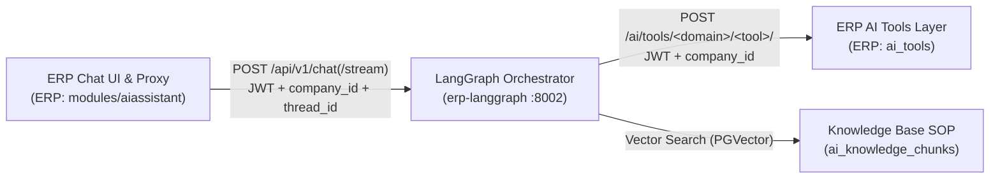

# Kapabilitas AI Agent FastPrint ERP

Dokumentasi ini merangkum seluruh kemampuan aktif AI Agent FastPrint ERP (mode **Read-Only**), cakupan cabang, fitur UI Chat & Orchestrator, serta batasan dan roadmap yang belum tersedia per **27 November 2026**.

Isi dokumen ini disinkronkan dengan tab **`Kapabilitas AI`** pada Google Sheet `Checklist_AI_Agent_ERP`.

---

## Arsitektur Singkat

- **UI Chat & Proxy** (`ERP/modules/aiassistant`, branch `origin/dev`): Menangani sesi login superuser, riwayat thread per user, streaming SSE, modal tabel Tabulator/export Excel, quick prompts kontekstual, dan `/undo`.
- **Orchestrator** (`erp-langgraph`): Menjalankan pipeline `StateGraph` (`summarizer -> router -> extractor -> tool_node / rag_node -> verifier -> synthesizer`), multi-cabang, multi-pertanyaan paralel, disambiguasi klarifikasi, dan failover LLM.
- **Tools Layer** (`ERP/ai_tools`, branch `origin/dev`): Menyediakan **35 tool native** (ditambah alias `fetch_vendor_invoices`) yang semuanya bersifat **Read-Only** (`is_write=False`) dengan validasi akses cabang (`validate_company_access`).

---

## Cakupan Cabang / Perusahaan (`COMPANY_NAME_MAP`)

AI Agent mendukung pencarian per cabang tertentu maupun lintas cabang (*"semua cabang"*), sesuai hak akses akun di ERP:

| ID | Nama Cabang / Entitas | ID | Nama Cabang / Entitas |
| :---: | :--- | :---: | :--- |
| `1` | Kantor Pusat | `9` | Toko Fast Print Surabaya |
| `2` | Toko Pusat | `10` | Medan |
| `3` | Head Office (`HO`) | `11` | HR (hanya jika disebut eksplisit sebagai cabang) |
| `4` | Main Store (`MS` / `Mainstore`) | `12` | Sandy (hanya jika disebut eksplisit sebagai cabang) |
| `5` | Makassar | `13` | Bekasi |
| `6` | Bandung | `14` | Tangerang |
| `7` | Surabaya (`SBY`) | `15` | Malang |
| `8` | Jakarta (`JKT`) | `17` | Fastmart |

---

## Rekap Kapabilitas

| Kategori / Domain | Jumlah | Status |
| :--- | :---: | :--- |
| Accounting | 7 tool (+1 alias) | Aktif (Read-Only) |
| Inventory | 12 tool | Aktif (Read-Only) |
| Sales | 5 tool | Aktif (Read-Only) |
| Marketplace | 11 tool | Aktif (Read-Only) |
| Knowledge / SOP (RAG) | 1 modul | Aktif (Read-Only) |
| Fitur UI Chat & Orchestrator | 9 fitur | Aktif |
| Batasan / Out-of-Scope & Roadmap | 6 item | Ditolak / Pending |

---

## Bagian A: Kapabilitas Aktif Saat Ini

### 1. Accounting (7 Tool + 1 Alias)

| Fitur / Kemampuan | Deskripsi & Cakupan Data | Contoh Prompt | Batasan / Catatan | Referensi Teknis |
| :--- | :--- | :--- | :--- | :--- |
| **Saldo Akun Kas, Bank & COA** | Ringkasan saldo awal, debit, kredit, dan saldo akhir akun pada Chart of Accounts (COA). | *"Berapa saldo rekening Bank BCA dan kas kecil hari ini?"* | Read-only; filter per `company_id`, kode akun, tipe akun, atau non-zero. | `accounting.get_account_balance` |
| **Entri Jurnal Umum & Faktur Pembelian** | Penelusuran jurnal umum, voucher debit/kredit, dan rincian baris faktur pembelian (`PC/...`). | *"Cek jurnal umum JE/2026/00012"* / *"Detail faktur pembelian PC/2026/00002"* | `fetch_vendor_invoices` di LangGraph diarahkan ke endpoint jurnal ERP; maks 200 baris/halaman. | `accounting.get_journal_entries` (`fetch_vendor_invoices`) |
| **Buku Besar (General Ledger)** | Mutasi transaksi debit/kredit per akun lengkap dengan saldo awal dan saldo berjalan (*running balance*). | *"Tampilkan buku besar akun kas kecil bulan ini"* | Default status `post`; mendukung drill-down dari laporan P&L. | `accounting.get_general_ledger` |
| **Laporan Laba Rugi (P&L)** | Ringkasan Pendapatan, HPP/COGS, Laba Kotor, Beban Operasional, Laba Bersih, dan Gross Margin (%). | *"Tampilkan laporan Laba Rugi tahun berjalan dan persentase gross margin"* | Mendukung `include_breakdown` hierarki grup/tipe/akun; tidak mengubah data jurnal. | `accounting.get_profit_and_loss` |
| **Laporan Neraca (Balance Sheet)** | Posisi total Aset, Liabilitas, dan Ekuitas per tanggal cut-off (`as_of_date`). | *"Lihat neraca keuangan cabang Bandung akhir bulan lalu"* | Read-only; mendukung rincian hierarki akun jika diminta. | `accounting.get_balance_sheet` |
| **Tagihan & Hutang Vendor (AP)** | Daftar tagihan pemasok (*Vendor Bills*), status bayar, dan filter jatuh tempo (`overdue` / `due_soon`). | *"Cek daftar tagihan vendor yang overdue bulan ini"* | Khusus hutang ke vendor/supplier, bukan tagihan piutang customer. | `accounting.get_vendor_bills` |
| **Rekonsiliasi Bank** | Ringkasan rekonsiliasi saldo buku vs rekening koran bank dan transaksi yang belum cocok. | *"Cek status rekonsiliasi Bank BCA bulan ini"* | Read-only; membutuhkan nama bank/jurnal yang sesuai di ERP. | `accounting.get_bank_reconciliation_summary` |

### 2. Inventory (12 Tool)

| Fitur / Kemampuan | Deskripsi & Cakupan Data | Contoh Prompt | Batasan / Catatan | Referensi Teknis |
| :--- | :--- | :--- | :--- | :--- |
| **Katalog & Harga Produk** | Detail master produk, SKU, barcode, varian, kategori, satuan (UoM), dan harga jual/estimasi HPP. | *"Berapa harga jual kertas stiker vinyl A4?"* | Maks 50 produk per halaman; tidak untuk cek kuantitas stok fisik. | `inventory.get_product_info` |
| **Cek Stok Fisik & Tersedia** | Jumlah stok fisik (*on-hand*) dan tersedia (*available*) per SKU, barcode, gudang, atau rak. | *"Berapa stok Tinta Epson 664 di gudang Surabaya?"* | Mendukung batch multi-SKU dan resolusi lokasi gudang 2 tahap. | `inventory.get_stock_level` |
| **Daftar Lokasi & Rak Gudang** | Daftar sub-lokasi penyimpanan internal, rak, lorong, atau bin di dalam gudang. | *"Tampilkan daftar lokasi rak internal gudang Mainstore"* | Maks 100 lokasi per panggilan. | `inventory.get_locations` |
| **Kartu Stok & Mutasi Barang** | Riwayat pergerakan keluar-masuk stok (*Stock Moves*) per produk, gudang, dan periode. | *"Cek kartu stok tinta art paper bulan ini"* | Maks 200 baris per halaman; berbeda dari buku besar akuntansi. | `inventory.get_stock_history` |
| **Surat Jalan & Transfer Gudang** | Daftar dokumen perpindahan barang antar gudang/cabang (`WH/OUT/...`, `WH/IN/...`, `WH/INT/...`). | *"Cek surat jalan WH/OUT/00123"* | Read-only; tidak memproses validasi atau penerimaan transfer. | `inventory.get_transfers` |
| **Alert Stok Menipis (Low Stock)** | Peringatan produk dengan stok paling sedikit, habis, atau di bawah ambang minimum (*reorder point*). | *"Barang apa saja yang stoknya menipis di cabang Surabaya?"* | Mendukung pagination modal tabel remote di UI chat. | `inventory.get_low_stock_alerts` |
| **Dokumen Stock Opname** | Daftar dokumen penyesuaian stok (*Stock Adjustments*) dan selisih fisik vs sistem. | *"Cek daftar dokumen stok opname bulan ini"* | Read-only; untuk modul FastPOS opname harian masih Pending (Phase 3). | `inventory.get_stock_adjustments` |
| **Catatan Barang Rusak / Scrap** | Riwayat pencatatan barang rusak, cacat, expired, atau pemusnahan (*Scrap Records*). | *"Lihat catatan barang rusak atau scrap di gudang Surabaya"* | Read-only; tidak membuat dokumen scrap baru. | `inventory.get_scrap_records` |
| **Daftar Master Gudang** | Daftar seluruh gudang fisik perusahaan, kode warehouse, alamat, dan cabang terkait. | *"Tampilkan daftar semua gudang fisik cabang FastPrint"* | Hanya master gudang tingkat atas beserta opsi daftar lokasi. | `inventory.get_warehouses` |
| **Kategori Produk** | Hierarki kategori produk dan metode kalkulasi biaya (*costing*) di master inventori. | *"Tampilkan semua kategori produk yang ada di ERP"* | Tidak mengembalikan daftar SKU di dalamnya. | `inventory.get_product_categories` |
| **Velocity & Forecast Restock** | Analisis *fast-moving*, *slow-moving*, *dead stock*, *days of supply*, dan saran restock. | *"Produk apa yang masuk dead stock 90 hari terakhir?"* | Estimasi berbasis histori penjualan & lead time, bukan order PO otomatis. | `inventory.get_inventory_velocity_forecast` |
| **Riwayat Perubahan Harga** | Kronologi perubahan harga produk dari Pricelist (`LogEntry`), Marketplace (`PriceUpdateLog`), dan PCLS. | *"Cek riwayat perubahan harga produk tinta DTF 1 liter"* | Default jendela 90 hari; hanya menampilkan riwayat historis (tidak mengubah harga). | `inventory.get_price_history` |

### 3. Sales (5 Tool)

| Fitur / Kemampuan | Deskripsi & Cakupan Data | Contoh Prompt | Batasan / Catatan | Referensi Teknis |
| :--- | :--- | :--- | :--- | :--- |
| **Produk Terlaris (Top Selling)** | Ranking produk dengan volume atau nominal penjualan tertinggi per cabang dan periode. | *"10 produk paling laris bulan ini di Mainstore"* | Berdasarkan data penjualan ERP, bukan analisis perputaran stok gudang. | `sales.get_top_selling_products` |
| **Daftar Sales Order & Quotation** | Pencarian daftar SO dan penawaran (*Quotation*) berdasarkan tanggal, status, pelanggan, atau channel. | *"Tampilkan daftar Sales Order berstatus confirmed bulan ini"* | Read-only; tidak bisa membuat atau mengubah status SO/Quotation. | `sales.get_sales_orders` |
| **Detail Sales Order & Lacak Resi** | Rincian item, kuantitas, diskon, kurir, nomor resi AWB, dan invoice dari satu SO spesifik. | *"Cek detail pesanan MS/SO/0585308"* | Membutuhkan nomor SO, resi AWB, atau nomor invoice marketplace. | `sales.get_sales_order_detail` |
| **Ringkasan Omzet Penjualan** | Total omzet terealisasi, jumlah transaksi, AOV, pipeline quotation, dan breakdown per channel. | *"Berapa total omzet penjualan semua cabang bulan ini?"* | Khusus omzet penjualan, bukan laporan laba rugi/HPP akuntansi. | `sales.get_sales_summary` |
| **Pencarian Kontak Pelanggan & Vendor** | Detail kontak (nama, HP/WA, email, alamat, PIC sales) dan ringkasan transaksi ordernya. | *"Cari kontak dan nomor WA pelanggan bernama Hendra"* | Mendukung filter channel (`WA`, `Shopee`, dll.) serta ranking belanja. | `sales.get_contacts` |

### 4. Marketplace (11 Tool)

| Fitur / Kemampuan | Deskripsi & Cakupan Data | Contoh Prompt | Batasan / Catatan | Referensi Teknis |
| :--- | :--- | :--- | :--- | :--- |
| **Kesehatan Akun & Token OAuth** | Status toko Shopee/TikTok/Tokopedia/Lazada, masa berlaku token OAuth, dan log error fetch Celery. | *"Toko marketplace mana saja yang tokennya mau expired atau gagal fetch order?"* | Token/secret rahasia otomatis disaring (tidak pernah ditampilkan). | `marketplace.get_account_health` |
| **Monitoring Order & SLA Marketplace** | Order telat kirim (*overdue SLA*), resi AWB kosong, alasan batal, dan selisih status ERP vs platform. | *"Cek order Shopee yang lewat batas kirim overdue SLA"* | Read-only; tidak memproses pengiriman atau pembatalan. | `marketplace.get_marketplace_orders` |
| **Diagnosa Pesanan Kilat Shopee** | Melacak reservasi Pesanan Kilat yang `invoice_updated=false`, duplikat draft, dan kandidat SO. | *"Cek pesanan kilat Shopee yang nyangkut hari ini"* | Khusus diagnosa; tidak menggabungkan (*merge*) atau menghapus order kilat. | `marketplace.get_kilat_order_diagnostics` |
| **Audit Mapping SKU Marketplace** | SKU yang belum ter-mapping (*unmapped*), duplikat mapping, aturan `qty_multiplier`, dan `ExceptionProduct`. | *"Produk Shopee mana saja yang SKU-nya belum di-mapping ke ERP?"* | Read-only; tidak mengubah mapping SKU. | `marketplace.get_product_mapping_status` |
| **Simulasi Hitung Push Stok (Dry-Run)** | Simulasi perhitungan stok push (*Onhand*, *Forecast*, *Split*, `shared_stock_companies`) vs `StockUpdateLog`. | *"Simulasi hitung stok push marketplace untuk SKU KRT-A4"* | Hanya simulasi dry-run; tidak melakukan push stok live ke marketplace. | `marketplace.get_stock_sync_simulation` |
| **Log Eksekusi Sync Stok & Harga** | Inspeksi log `StockUpdateLog`, `PriceUpdateLog`, dan `InventoryUpdatePriceLog` yang gagal/skip. | *"Cek log update stok marketplace yang gagal hari ini"* | Hanya membaca log eksekusi job. | `marketplace.get_sync_execution_logs` |
| **Perbandingan Harga ERP vs Marketplace** | Membandingkan harga Pricelist/WholesaleMP ERP terhadap harga tayang di marketplace (selisih margin). | *"Bandingkan harga ERP pricelist vs harga tayang di Shopee"* | Opsi pengecekan live read-only dibatasi maksimal 20 SKU per permintaan. | `marketplace.get_price_comparison` |
| **Anomali Fee & Escrow** | Deteksi order dengan `negative_fee`, `high_fee` di atas persentase tertentu, `zero_income`, atau `erp_mp_mismatch`. | *"Cek anomali potongan marketplace di atas 20% bulan ini"* | Read-only; untuk investigasi order bermasalah. | `marketplace.get_fee_and_escrow_anomalies` |
| **Rekap Potongan & Settlement** | Total pendapatan kotor (*gross*), potongan per kategori, pendapatan bersih (*nett*), dan settlement belum posting. | *"Rekap potongan komisi, biaya layanan, dan voucher Shopee bulan ini"* | Read-only; tidak melakukan posting jurnal settlement. | `marketplace.get_deduction_and_settlement_summary` |
| **Saldo Dompet Seller & Cashflow** | Saldo dompet tersedia (`available_balance`), pending escrow, dan riwayat penarikan dana (*withdrawal*). | *"Berapa saldo dompet seller dan pending escrow di Shopee?"* | Khusus dompet marketplace, bukan saldo rekening bank COA ERP. | `marketplace.get_cashflow_and_balance_summary` |
| **Insight Harga & Velocity Kompetitor** | Pergerakan harga kompetitor, kecepatan jual (`delta_sold_qty`), dan daftar pantauan kompetitor yang usang (*stale*). | *"Kompetitor mana saja yang menurunkan harga minggu ini?"* | Berdasarkan data pantauan kompetitor di ERP. | `marketplace.get_competitor_insights` |

### 5. Knowledge / SOP (RAG)

| Fitur / Kemampuan | Deskripsi & Cakupan Data | Contoh Prompt | Batasan / Catatan | Referensi Teknis |
| :--- | :--- | :--- | :--- | :--- |
| **Pencarian Semantik SOP & Kebijakan (RAG)** | Mencari informasi SOP internal, syarat retur barang cetak, garansi, spesifikasi GSM kertas, dan termin (termasuk mode *Hybrid* bersama data ERP). | *"Bagaimana syarat dan alur pengajuan retur barang cetak yang rusak?"* | Terbatas pada dokumen yang sudah di-ingest ke PGVector (`ai_knowledge_chunks`, saat ini mis. `sop_retur_barang_cetak.md`). | `rag_node.py` / `vector_service.py` (`/ai/tools/knowledge/search/`) |

### 6. Fitur UI Chat & Orchestrator

| Fitur / Kemampuan | Deskripsi & Manfaat | Contoh Penggunaan | Referensi Teknis |
| :--- | :--- | :--- | :--- |
| **Multi-Cabang & Override Cabang via Chat** | Menjalankan query ke 1 cabang tertentu, mengganti cabang di tengah percakapan, atau agregasi *"semua cabang"* secara paralel. | *"Coba cek di Mainstore"* / *"Bandingkan stok SKU X di semua cabang"* | `app/core/branches.py`, `app/graph/workflow.py` |
| **Multi-Pertanyaan & Multi-Tool Paralel** | Memecah 1 prompt majemuk menjadi beberapa sub-query dan mengeksekusi beberapa tool ERP sekaligus. | *"Cek stok Tinta A di Surabaya dan tampilkan tagihan vendor yang overdue"* | `router_decomposer.py`, `tool_node.py` |
| **Analisis Kontekstual & Proyeksi Run-Rate** | Menjawab pertanyaan analitis lanjutan (*"kenapa rugi?"*, *"apakah target tercapai?"*) dari laporan sebelumnya tanpa memanggil ulang tool. | *"Kenapa laba bersih bulan ini minus?"* / *"Apakah omzet bisa tembus target 6M?"* | `synthesizer.py` (`contextual_analysis`, `_build_evaluative_verdict`) |
| **Klarifikasi / Disambiguasi Interaktif** | Saat pertanyaan ambigu (misal tagihan vendor vs SO, atau order ERP vs marketplace), AI menampilkan pertanyaan singkat beserta 2–4 chip pilihan. | *"Cek order minggu ini"* -> pilih chip *"Order Penjualan (SO)"* atau *"Order Marketplace"* | `router_semantic.py`, `synthesizer.py` (`CLARIFICATION`), `chatProxyView.py` |
| **Streaming Jawaban Real-Time (SSE)** | Menampilkan progres tiap node pipeline, lifecycle tool (`tool_start`/`tool_end`), badge model AI aktif, dan efek ketik token demi token. | Otomatis aktif di side drawer & fullpage chat AI Assistant | `POST /api/v1/chat/stream`, `chatProxyView.py`, `sse_client.js` |
| **Modal Tabel Interaktif & Export Excel** | Untuk hasil data besar yang terpotong, pengguna dapat membuka modal tabel Tabulator dengan pencarian, paginasi server-side, dan export Excel. | Klik tombol *"Lihat Semua Data / Export"* di bawah tabel hasil chat | `tableDataView.py` (`/aiassistant/table-data/`), `fullpage.js` |
| **Quick Prompts Kontekstual** | Menampilkan saran prompt siap klik yang menyesuaikan halaman ERP yang sedang dibuka pengguna (Sales, Inventory, Accounting, Marketplace). | Buka widget AI saat berada di halaman `/sales/` atau `/inventory/` | `quickPromptsView.py`, `ai_tools/core/prompt_catalog.py` |
| **Riwayat Thread per User & `/undo`** | Menyimpan percakapan terisolasi per akun user, mendukung multi-thread, serta membatalkan giliran chat terakhir dengan `/undo`. | Ketik `/undo` atau pilih riwayat percakapan di sidebar | `threadView.py`, `AiConversationThread`, `AiChatMessage` |
| **Auto-Failover LLM & Fallback Deterministik** | Failover otomatis antar provider (OpenAI -> Gemini multi-key -> OpenRouter) dengan circuit breaker, serta formatter deterministik jika LLM tidak tersedia. | Berjalan otomatis di background saat terjadi error kuota/429 | `app/services/llm.py`, `synthesizer.py` |

---

## Bagian B: Batasan & Fitur Belum Tersedia (Out-of-Scope & Roadmap)

| Kategori | Fitur / Topik | Kondisi Saat Ini | Status |
| :--- | :--- | :--- | :--- |
| **Operasi Tulis / Transaksi** | Membuat, mengubah, menghapus, atau menyetujui Sales Order, Purchase Order, Jurnal, Transfer Stok, serta push stok/harga atau merge Pesanan Kilat ke marketplace. | Diblokir di proxy UI (`WRITE_OPERATION_PATTERNS`) dan router (`is_hard_write_block_query`); seluruh 35 tool berstatus `is_write=False`. Pengguna diarahkan ke form resmi ERP. | `Ditolak (Read-Only)` |
| **Modul HR & Penggajian** | Slip gaji, data payroll, cuti karyawan, absensi, dan lembur. | Tidak ada tool HR di `ai_tools` dan query terkait langsung ditolak oleh `OUT_OF_SCOPE_PATTERNS`. | `Out-of-Scope` |
| **Tagihan & Piutang Customer** | Pengecekan piutang / tagihan faktur pelanggan (AR). | Ditolak/diarahkan ke modul Penjualan/Invoicing ERP (jika nama entitas ambigu tanpa kata *"customer"*, diarahkan ke klarifikasi Vendor Bills vs Sales Orders). | `Out-of-Scope (Guardrail)` |
| **Modul Helpdesk** | Rekap komplain tiket (`get_complaints`) dan daftar retur/refund barang (`get_product_returns`). | Tercatat sebagai **Phase 2** pada [PROJECT_PROGRESS.md](../PROJECT_PROGRESS.md); belum diimplementasikan di `ai_tools` maupun `erp-langgraph`. | `Pending (Roadmap Phase 2)` |
| **Modul FastPOS** | Analitik performa produk FastPOS (`get_product_performance`), alert stok FastPOS (`get_stock_alerts`), `get_list_orders`, dan `get_stock_opname` harian. | Tercatat sebagai **Phase 3** pada [PROJECT_PROGRESS.md](../PROJECT_PROGRESS.md); belum diimplementasikan di `ai_tools` maupun `erp-langgraph`. | `Pending (Roadmap Phase 3)` |
| **Akses Non-Superuser** | Penggunaan widget dan workspace AI Assistant oleh user staf/non-superuser. | Seluruh endpoint `modules/aiassistant` dibatasi oleh `SuperuserRequiredApiMixin` / pengecekan `is_superuser`. | `Dibatasi (Superuser Only)` |
