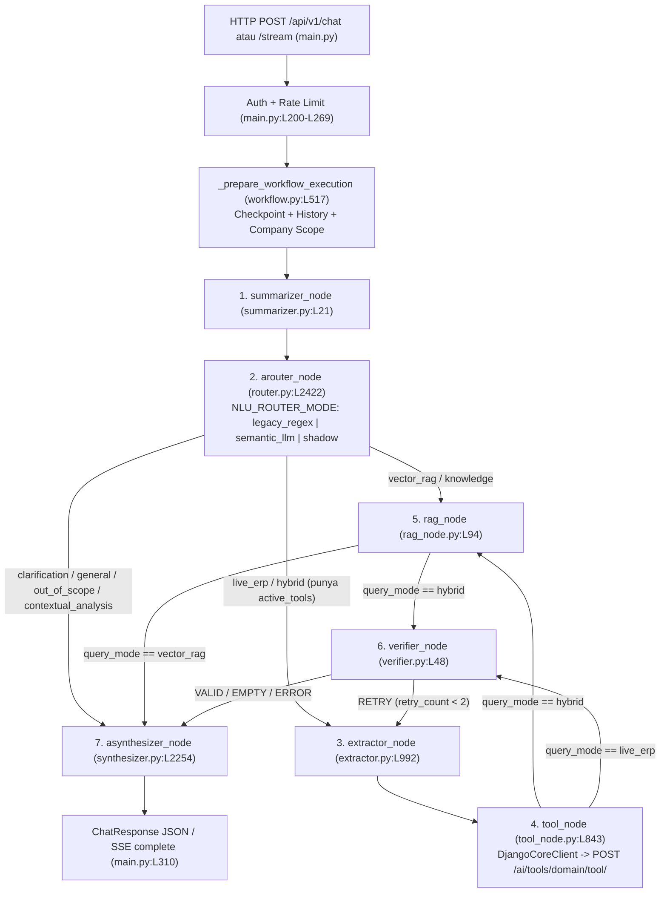

# Architecture & Trace Map — `erp-langgraph`

**Peta mental tunggal** untuk memahami alur kode aktual `erp-langgraph` tanpa harus membaca puluhan file sekaligus.  
**Snapshot diverifikasi pada:** `HEAD 0c46131` (`app/`: **44 file / 25.750 LOC**, `tests/`: **50 file / 20.558 LOC**, **36 tool read-only** di 4 domain + RAG).

---

## 1. Gambaran Besar: 4 Zona Codebase (`app/`)

Seluruh 44 file di `app/` terbagi tegas menjadi dua kubu: **27,2% (`6.999 LOC`)** adalah cangkang infrastruktur & kontrak yang sudah stabil, sedangkan **72,8% (`18.751 LOC`)** berada di dalam `app/graph/` (pusat kompleksitas).

| Zona | Peran | Jumlah File | Total LOC | Porsi | Status |
|---|---|---:|---:|---:|---|
| **Zona A — Cangkang API & Infrastruktur** | FastAPI, auth, rate limit, config, registry cabang, klien Django, LLM factory, PGVector | 13 | 3.261 | 12,7% | Stabil & reusable |
| **Zona B — Kontrak 36 Tool & Context Helper** | Skema Pydantic, katalog 36 tool (RRF+RBAC), sanitasi payload & penghitung record | 3 | 3.738 | 14,5% | Stabil & reusable |
| **Zona C — Mesin Orkestrasi 7-Node** | `StateGraph`, `AgentState`, semantic router, 3-tier extractor, eksekutor, verifier, formatter, entity links | 26 | 15.730 | 61,1% | Pusat kompleksitas |
| **Zona D — Router Legacy Regex** | Classifier regex 2.500+ baris + pola regex per-tool (jalur `legacy_regex` & wrapper transisi) | 2 | 3.021 | 11,7% | Kandidat decommission |
| **Total `app/`** | | **44** | **25.750** | **100%** | |

### Daftar Lengkap 44 File `app/` per Zona

Klik untuk melihat rincian seluruh 44 file beserta LOC dan fungsinya

#### Zona A — Cangkang API & Infrastruktur (`3.261 LOC`)
| File | LOC | Fungsi Utama |
|---|---:|---|
| [app/main.py](file:///D:/erp-fastprint/erp-langgraph/app/main.py) | 529 | FastAPI app, `lifespan`, auth (`_resolve_and_validate_auth`), rate limit, `/api/v1/chat`, `/api/v1/chat/stream` |
| [app/schemas/chat.py](file:///D:/erp-fastprint/erp-langgraph/app/schemas/chat.py) | 128 | Kontrak `ChatRequest`, `ChatResponse`, `FollowupSuggestion`, batas input P0-1 |
| [app/schemas/__init__.py](file:///D:/erp-fastprint/erp-langgraph/app/schemas/__init__.py) | 58 | Re-export schema publik |
| [app/core/config.py](file:///D:/erp-fastprint/erp-langgraph/app/core/config.py) | 195 | `Settings` (`pydantic-settings`), deteksi test runtime, flag `NLU_ROUTER_MODE` & `SYNTHESIZER_FAST_DETERMINISTIC` |
| [app/core/rate_limit.py](file:///D:/erp-fastprint/erp-langgraph/app/core/rate_limit.py) | 116 | In-process sliding-window rate limiter (LRU 10.000 bucket) |
| [app/core/branches.py](file:///D:/erp-fastprint/erp-langgraph/app/core/branches.py) | 348 | Registry 17 cabang FastPrint (`BRANCH_COMPANY_MAP`), deteksi multi-cabang & sticky branch dari history |
| [app/services/django_client.py](file:///D:/erp-fastprint/erp-langgraph/app/services/django_client.py) | 602 | `DjangoCoreClient` asinkron (`httpx.AsyncClient` per loop), auto-login, retry 401, auto-binding `fetch_*` |
| [app/services/llm.py](file:///D:/erp-fastprint/erp-langgraph/app/services/llm.py) | 819 | Factory LLM (`OpenAI -> Gemini multi-key -> OpenRouter`), `CircuitBreakerChatOpenAI`, support reasoning model |
| [app/services/vector_service.py](file:///D:/erp-fastprint/erp-langgraph/app/services/vector_service.py) | 351 | Pool `asyncpg` per loop, embedding Gemini 768-dim + LRU cache, pencarian cosine `ai_knowledge_chunks` |
| [app/scripts/seed_tools.py](file:///D:/erp-fastprint/erp-langgraph/app/scripts/seed_tools.py) | 91 | CLI seeding 36 tool ke tabel PGVector `ai_tool_catalog` |
| [app/services/__init__.py](file:///D:/erp-fastprint/erp-langgraph/app/services/__init__.py), [app/core/__init__.py](file:///D:/erp-fastprint/erp-langgraph/app/core/__init__.py), [app/__init__.py](file:///D:/erp-fastprint/erp-langgraph/app/__init__.py) | 24 | Package exports |

#### Zona B — Kontrak 36 Tool & Context Helper (`3.738 LOC`)
| File | LOC | Fungsi Utama |
|---|---:|---|
| [app/schemas/tools.py](file:///D:/erp-fastprint/erp-langgraph/app/schemas/tools.py) | 1.391 | 36 Pydantic filter schema, `TOOL_DOMAIN_MAP` (Accounting 8, Inventory 12, Sales 5, Marketplace 11), `ERPResponseEnvelope` |
| [app/services/tool_registry_service.py](file:///D:/erp-fastprint/erp-langgraph/app/services/tool_registry_service.py) | 1.513 | `CORE_TOOL_DEFINITIONS` (36 tool cards dengan `sample_queries` & `negative_hints`), hybrid search PGVector+FTS RRF, Conditional RBAC, fallback in-memory |
| [app/core/context.py](file:///D:/erp-fastprint/erp-langgraph/app/core/context.py) | 834 | Trimming pesan, `sanitize_erp_payload`, `resolve_tool_record_count` kanonik, helper anafora & tanggal ERP |

#### Zona C — Mesin Orkestrasi 7-Node (`15.730 LOC`)
| File | LOC | Fungsi Utama |
|---|---:|---|
| [app/graph/state.py](file:///D:/erp-fastprint/erp-langgraph/app/graph/state.py) | 232 | `AgentState` (50+ field), `ToolCallPlan`, `create_initial_state` |
| [app/graph/workflow.py](file:///D:/erp-fastprint/erp-langgraph/app/graph/workflow.py) | 1.173 | Kompilasi `StateGraph` 7-node, `MemorySaver` LRU, thread lock, company scope resolver, runner `arun_workflow` & SSE `astream_workflow_events` |
| [app/graph/nodes/summarizer.py](file:///D:/erp-fastprint/erp-langgraph/app/graph/nodes/summarizer.py) | 100 | Node 1: ringkas history jika melebihi `SUMMARIZATION_THRESHOLD_MESSAGES` |
| [app/graph/nodes/router_semantic.py](file:///D:/erp-fastprint/erp-langgraph/app/graph/nodes/router_semantic.py) | 1.013 | Node 2 (jalur `semantic_llm`): hard guardrails, per-clause hybrid retrieval, scoped LLM router, clarification |
| [app/graph/nodes/router_decomposer.py](file:///D:/erp-fastprint/erp-langgraph/app/graph/nodes/router_decomposer.py) | 194 | Pemecah kueri majemuk per klausa + deteksi retry |
| [app/graph/nodes/extractor.py](file:///D:/erp-fastprint/erp-langgraph/app/graph/nodes/extractor.py) | 1.300 | Node 3: 3-tier extraction (fast-path regex -> LLM structured output -> fallback), peer backfill, retry relaxation |
| `app/graph/nodes/extractors/` (6 file) | 2.450 | Extractor & fallback deterministik per domain (`accounting.py` 403, `inventory.py` 672, `sales.py` 472, `marketplace.py` 454, `common.py` 295, `__init__.py` 154) |
| [app/graph/nodes/tool_node.py](file:///D:/erp-fastprint/erp-langgraph/app/graph/nodes/tool_node.py) | 1.195 | Node 4: eksekusi paralel multi-tool & multi-company, resolusi lokasi 2-tahap, GL pre-resolution, HQ auto-probe (3 tool sales) |
| [app/graph/nodes/rag_node.py](file:///D:/erp-fastprint/erp-langgraph/app/graph/nodes/rag_node.py) | 218 | Node 5: pencarian dokumen SOP via `VectorService` dengan fallback ke Django `/ai/tools/knowledge/search/` |
| [app/graph/nodes/verifier.py](file:///D:/erp-fastprint/erp-langgraph/app/graph/nodes/verifier.py) | 368 | Node 6: cek `records_count`, transisi `VALID` / `RETRY` (maks 2x) / `EMPTY` / `ERROR` |
| [app/graph/nodes/synthesizer.py](file:///D:/erp-fastprint/erp-langgraph/app/graph/nodes/synthesizer.py) | 2.531 | Node 7: orkestrasi jawaban deterministik, LLM polish/analitis, clarification fast-path, follow-up chips |
| `app/graph/nodes/formatters/` (8 file) | 4.884 | Formatter Markdown deterministik (`entity_links.py` 1.305, `multi_company.py` 877, `inventory.py` 770, `marketplace.py` 602, `accounting.py` 455, `common.py` 400, `sales.py` 385, `__init__.py` 90) |
| [app/graph/__init__.py](file:///D:/erp-fastprint/erp-langgraph/app/graph/__init__.py), [app/graph/nodes/__init__.py](file:///D:/erp-fastprint/erp-langgraph/app/graph/nodes/__init__.py) | 72 | Package exports |

#### Zona D — Router Legacy Regex & Patterns (`3.021 LOC`)
| File | LOC | Catatan Keterkaitan |
|---|---:|---|
| [app/graph/nodes/router.py](file:///D:/erp-fastprint/erp-langgraph/app/graph/nodes/router.py) | 2.533 | Menampung classifier regex legacy (`classify_query_rule_based`), **sekaligus** dispatcher `arouter_node` (`_arouter_node_impl`) dan helper shared (`_compute_company_scope`, `_try_route_contextual_analysis`) |
| [app/graph/nodes/router_patterns.py](file:///D:/erp-fastprint/erp-langgraph/app/graph/nodes/router_patterns.py) | 488 | Kumpulan regex per-tool (mayoritas legacy; sebagian kecil hard-guardrail masih dipakai `router_semantic.py`) |

---

## 2. Alur StateGraph 7-Node Aktual

Seluruh request dari `POST /api/v1/chat`, `POST /api/v1/chat/stream`, dan `cli.py` masuk lewat satu graf terkompilasi di [create_workflow_graph](file:///D:/erp-fastprint/erp-langgraph/app/graph/workflow.py#L129-L210):

### 4 Fungsi Percabangan (Conditional Edges) yang Menentukan Arah
1. [decide_after_router](file:///D:/erp-fastprint/erp-langgraph/app/graph/workflow.py#L47-L104):
   - Prioritas 0: `query_mode == "clarification"` atau `needs_clarification=True` → langsung `synthesizer`.
   - Prioritas 1: `contextual_analysis` / `general` / `out_of_scope` (tanpa sub-pertanyaan lain) → langsung `synthesizer`.
   - Prioritas 2: ada `active_tools` (atau `detected_tool` valid) → `extractor`.
   - Prioritas 3: `vector_rag` / `knowledge` / `rag_queries` → `rag_node`.
   - Fallback: `synthesizer`.
2. [decide_after_tool](file:///D:/erp-fastprint/erp-langgraph/app/graph/workflow.py#L107-L115): `hybrid` → `rag_node`, selain itu → `verifier`.
3. [decide_after_rag](file:///D:/erp-fastprint/erp-langgraph/app/graph/workflow.py#L118-L126): `hybrid` → `verifier`, selain itu → `synthesizer`.
4. [decide_after_verification](file:///D:/erp-fastprint/erp-langgraph/app/graph/nodes/verifier.py#L348-L368): `verification_status == "RETRY"` → kembali ke `extractor` (maks `retry_count < 2`), selain itu → `synthesizer`.

---

## 3. Peta `AgentState` (50+ Field → 6 Kelompok)

[AgentState](file:///D:/erp-fastprint/erp-langgraph/app/graph/state.py#L61-L138) terlihat berat karena menyimpan **bentuk legacy single-tool** dan **bentuk modern multi-tool/multi-company** secara bersamaan. Kelompokkan seperti ini saat membaca kode:

| Kelompok | Field Utama | Penulis Utama | Pembaca Utama | Catatan |
|---|---|---|---|---|
| **1. Identitas, Auth & Memori** | `messages`, `user_query`, `user_token`, `user_id`, `user_roles`, `conversation_summary` | `main.py`, `workflow.py`, `summarizer` | Semua node | `auth_token` adalah alias legacy untuk `user_token` |
| **2. Company Scoping (17 Cabang)** | `company_id`, `company_ids`, `authorized_company_ids`, `payload_company_id`, `company_scope_source`, `is_multi_company` | `_resolve_effective_company_scope` (`workflow.py:L364`), `router` | `extractor`, `tool_node`, `synthesizer` | `authorized_company_ids` dibuang ke `[]` jika `X-Internal-Service-Key` tidak valid |
| **3. Routing & Rencana Eksekusi** | `query_mode`, `active_tools` (`List[ToolCallPlan]`), `available_tools`, `sub_questions`, `non_tool_questions`, `rag_queries` | `arouter_node` (`router.py` / `router_semantic.py`) | `decide_after_router`, `extractor`, `tool_node`, `rag_node`, `synthesizer` | **Legacy scalar** yang ikut diisi sinkron: `detected_domain`, `detected_tool`, `extracted_params`, `is_multi_tool`, `detected_domains`, `detected_tools`, `rag_query` |
| **4. Hasil Data & Konteks Turn Sebelumnya** | `tool_result`, `multi_tool_results`, `multi_company_results`, `unauthorized_companies`, `rag_context`, `rag_sources`, `rag_results_by_query` | `tool_node`, `rag_node` | `verifier`, `synthesizer` | Snapshot turn sebelumnya (`prior_tool_result`, `prior_detected_tool`, `prior_detected_domain`, `prior_extracted_params`) diisi oleh `_prepare_workflow_execution` (`workflow.py:L589-L611`) dari checkpoint |
| **5. Verifikasi & Siklus Retry** | `verification_status`, `multi_verification_status`, `retry_count`, `retry_instruction` | `verifier_node` | `decide_after_verification`, `extractor`, `synthesizer` | `retry_count` naik maks 2 (`0 -> 1 -> 2`) |
| **6. Output UI, Klarifikasi & SSE** | `final_answer`, `deterministic_answer`, `error_message`, `suggested_followups`, `active_model`, `table_query_meta`, `entity_links`, `needs_clarification`, `clarification_question`, `clarification_options` | `router_semantic` (klarifikasi), `synthesizer` | `_build_chat_response` (`main.py:L310`), `astream_workflow_events` | Dipetakan 1:1 ke [ChatResponse](file:///D:/erp-fastprint/erp-langgraph/app/schemas/chat.py#L83-L128) |

---

## 4. Lima Trace End-to-End Konkret

Gunakan 5 trace ini sebagai jalur baca saat membuka editor.

### Trace 1 — Single-Tool Live ERP *(contoh: "Tampilkan laporan laba rugi bulan kemarin")*
1. **Entry & Guard:** [chat_stream_endpoint](file:///D:/erp-fastprint/erp-langgraph/app/main.py#L403-L514) memanggil `_resolve_and_validate_auth` ([main.py:L200-L236](file:///D:/erp-fastprint/erp-langgraph/app/main.py#L200-L236)) → `_enforce_chat_rate_limit` ([L239-L269](file:///D:/erp-fastprint/erp-langgraph/app/main.py#L239-L269)) → `_build_workflow_kwargs` ([L272-L307](file:///D:/erp-fastprint/erp-langgraph/app/main.py#L272-L307)).
2. **State & Thread Lock:** [astream_workflow_events](file:///D:/erp-fastprint/erp-langgraph/app/graph/workflow.py#L854-L1019) mengunci `thread_id` lalu memanggil [_prepare_workflow_execution](file:///D:/erp-fastprint/erp-langgraph/app/graph/workflow.py#L517-L612) untuk membaca checkpoint `MemorySaver`, hidrasi `history` (maks 30 pesan), dan resolve `company_id`.
3. **Node 1 (`summarizer`):** [summarizer_node](file:///D:/erp-fastprint/erp-langgraph/app/graph/nodes/summarizer.py#L21-L100) langsung lolos (0 LLM call) jika jumlah pesan `<= SUMMARIZATION_THRESHOLD_MESSAGES` (default 10).
4. **Node 2 (`router`):** [_arouter_node_impl](file:///D:/erp-fastprint/erp-langgraph/app/graph/nodes/router.py#L2422-L2468) mengecek `settings.NLU_ROUTER_MODE`:
   - Jika `semantic_llm`: masuk [aroute_semantic_nlu](file:///D:/erp-fastprint/erp-langgraph/app/graph/nodes/router_semantic.py#L876-L945) → `check_hard_guardrails` (`L374`) → `aretrieve_candidate_tools` (`L524`, Top-8 PGVector+FTS) → 1 LLM call structured output → `_build_state_from_semantic_decision` (`L698`).
   - Jika `legacy_regex` (default kode): masuk [classify_query_rule_based](file:///D:/erp-fastprint/erp-langgraph/app/graph/nodes/router.py#L380-L821) (regex dulu, baru fallback LLM jika tak cocok).
   - Jika `shadow`: jalankan `legacy_regex` untuk user + task background `semantic_llm` untuk log diff.
5. **Node 3 (`extractor`):** [extractor_node](file:///D:/erp-fastprint/erp-langgraph/app/graph/nodes/extractor.py#L992-L1216) menjalankan 3 tier per tool di `active_tools`: Tier-1 fast-path (`extractors/accounting.py`), jika tidak cukup → Tier-2 LLM structured output sesuai skema `app/schemas/tools.py`, jika gagal → Tier-3 fallback + validasi Pydantic.
6. **Node 4 (`tool_node`):** [tool_node](file:///D:/erp-fastprint/erp-langgraph/app/graph/nodes/tool_node.py#L843-L1160) → [_execute_single_tool](file:///D:/erp-fastprint/erp-langgraph/app/graph/nodes/tool_node.py#L444-L720) → `DjangoCoreClient.execute_tool("accounting", "get_profit_and_loss", ...)` (`POST /ai/tools/accounting/get_profit_and_loss/`), lalu membersihkan payload via `sanitize_erp_payload`.
7. **Node 6 (`verifier`):** [verifier_node](file:///D:/erp-fastprint/erp-langgraph/app/graph/nodes/verifier.py#L48-L345) menghitung record lewat `resolve_tool_record_count` → `records_count > 0` → `verification_status = "VALID"`.
8. **Node 7 (`synthesizer`):** [asynthesizer_node](file:///D:/erp-fastprint/erp-langgraph/app/graph/nodes/synthesizer.py#L2254-L2379):
   - Bangun tabel deterministik lewat [format_deterministic_answer](file:///D:/erp-fastprint/erp-langgraph/app/graph/nodes/synthesizer.py#L491-L842) (`formatters/accounting.py`).
   - [_build_synthesis_plan](file:///D:/erp-fastprint/erp-langgraph/app/graph/nodes/synthesizer.py#L2118-L2171) menentukan apakah LLM dipanggil lagi (polish/follow-up) atau dilewati (`SYNTHESIZER_FAST_DETERMINISTIC=true`).
   - [_finalize_synthesis_output](file:///D:/erp-fastprint/erp-langgraph/app/graph/nodes/synthesizer.py#L2089-L2115) memasang `table_query_meta`, `entity_links` (`formatters/entity_links.py`), dan `suggested_followups`.

> **Kenapa latensi di audit bisa 20–45 detik?** Karena setiap hop yang memanggil LLM (`router_semantic` + `extractor` Tier-2 + retry `extractor` + `synthesizer` polish) berjalan **sekuensial**. Jika model default adalah reasoning model (`gpt-6-luna`) tanpa `reasoning_effort=low` dan `SYNTHESIZER_FAST_DETERMINISTIC=false`, 1 turn melakukan 2–4 reasoning call beruntun, sementara Django API hanya ~128 ms.

---

### Trace 2 — Multi-Company & Branch Switch *(contoh: "omzet semua cabang" lalu "coba cek cabang jakarta")*
1. **Resolusi Scope Cabang:** [_resolve_effective_company_scope](file:///D:/erp-fastprint/erp-langgraph/app/graph/workflow.py#L364-L469) mengevaluasi 5 lapis prioritas:
   - (1) `payload.company_ids` eksplisit → (2) teks user lewat `resolve_all_branch_company_ids()` di [branches.py](file:///D:/erp-fastprint/erp-langgraph/app/core/branches.py) (jika `"semua cabang"`, di-clamp ke `authorized_company_ids`) → (3) follow-up anafora/channel mempertahankan multi-company → (4a) *thread-sticky text override* agar cabang yang disebut di chat tidak tertimpa `company_id` top-bar Django yang tetap sama → (4b–4e) recovery history / explicit payload / checkpoint / `DEFAULT_COMPANY_ID`.
2. **Eksekusi Multi-Cabang di `tool_node`:** [tool_node](file:///D:/erp-fastprint/erp-langgraph/app/graph/nodes/tool_node.py#L843-L1160) membedakan:
   - Tool yang mendukung `company_ids` native di Django (1 HTTP POST), vs
   - Fan-out paralel per `company_id` dengan `asyncio.Semaphore(ERP_MULTI_COMPANY_CONCURRENCY)` ke `multi_company_results[cid]` (cabang HTTP 403 dicatat di `unauthorized_companies`).
3. **Formatting Multi-Cabang:** `format_deterministic_answer` memanggil `MULTI_COMPANY_FORMATTERS` di [formatters/multi_company.py](file:///D:/erp-fastprint/erp-langgraph/app/graph/nodes/formatters/multi_company.py). **Titik rawan:** jika nama tool belum didaftarkan di dict `MULTI_COMPANY_FORMATTERS`, eksekusi jatuh ke blok `else:` yang hanya mencetak `"Ditemukan N data master / catatan."` (sumber bug Turn `#5`).

---

### Trace 3 — Siklus Retry Verifikasi *(hasil 0 record)*
1. `tool_node` mengembalikan hasil dengan `resolve_tool_record_count(...) == 0`.
2. [verifier_node](file:///D:/erp-fastprint/erp-langgraph/app/graph/nodes/verifier.py#L48-L345) mengecek `retry_count < 2` (dan bukan cek eksistensi harian eksplisit seperti *"apakah ada penjualan hari ini?"*):
   - `retry_count == 0` → return `verification_status="RETRY"`, `retry_count=1`, `retry_instruction` meminta pelonggaran filter.
   - `decide_after_verification` (`verifier.py:L348`) mengembalikan `"extractor"`.
3. `extractor_node` membaca `retry_instruction` & `retry_count`, melonggarkan tanggal/filter, lalu memanggil `tool_node` ulang.
4. Setelah 2 kali retry tetap 0 data (`retry_count >= 2`), `verifier_node` mengembalikan `verification_status="EMPTY"` → masuk `synthesizer` untuk pesan data kosong.

---

### Trace 4 — Clarification & Contextual Analysis Short-Circuit
- **Jalur Clarification (`needs_clarification=True`):**
  1. Pada mode `semantic_llm`, LLM Router ([_build_state_from_semantic_decision](file:///D:/erp-fastprint/erp-langgraph/app/graph/nodes/router_semantic.py#L698-L873)) mengembalikan `query_mode="clarification"`, `clarification_question`, `clarification_options` (maks 4 chip), dan `active_tools=[]`.
  2. [decide_after_router](file:///D:/erp-fastprint/erp-langgraph/app/graph/workflow.py#L77-L78) langsung loncat ke `synthesizer` (0 call ke `extractor` & Django).
  3. [asynthesizer_node](file:///D:/erp-fastprint/erp-langgraph/app/graph/nodes/synthesizer.py#L2262-L2269) masuk fast-path `_build_clarification_synthesis_output` (`L2219-L2251`) tanpa LLM call tambahan, memetakan `clarification_options` menjadi `suggested_followups`.
- **Jalur Contextual Analysis (contoh: *"dari laporan tersebut mana yang rugi?"*):**
  1. `_prepare_workflow_execution` (`workflow.py:L589-L607`) menyalin `tool_result` turn sebelumnya ke `prior_tool_result`.
  2. Router mendeteksi pertanyaan analitis lanjutan (`_try_route_contextual_analysis` di `router.py`, dipanggil juga oleh `check_hard_guardrails` di `router_semantic.py:L374`) → `query_mode="contextual_analysis"`.
  3. `decide_after_router` (`workflow.py:L81-L82`) langsung loncat ke `synthesizer`.
  4. `_build_synthesis_plan` (`synthesizer.py:L2155-L2167`) merakit `_build_analytical_data_context` dari `prior_tool_result` dan memanggil LLM untuk menjawab tanpa memukul Django lagi.

---

### Trace 5 — Hybrid ERP + RAG & Konversi Event SSE
- **Jalur Hybrid (`query_mode="hybrid"`, contoh: *"cek stok barang X dan bagaimana SOP returnya"*):**
  `router` (`active_tools` + `rag_queries`) → `extractor` → `tool_node` → `decide_after_tool` (`workflow.py:L113` mengarahkan ke `rag_node`) → [rag_node](file:///D:/erp-fastprint/erp-langgraph/app/graph/nodes/rag_node.py#L94-L198) mencari chunk PGVector via `VectorService` → `decide_after_rag` (`workflow.py:L124` mengarahkan ke `verifier`) → `verifier` → `synthesizer` menggabungkan data ERP + kutipan SOP.
- **Konversi ke SSE Stream ([astream_workflow_events](file:///D:/erp-fastprint/erp-langgraph/app/graph/workflow.py#L952-L1007) → [chat_stream_endpoint](file:///D:/erp-fastprint/erp-langgraph/app/main.py#L444-L505)):**
  - `on_custom_event` (`name="token"`): token deterministik/klarifikasi/polished yang di-dispatch `asynthesizer_node` → `event: token`.
  - `on_chat_model_stream` (hanya node `synthesizer` tanpa tag `internal_no_stream`) → `event: token`.
  - `on_chain_end` per node → `_build_node_completion_events` menghasilkan `event: step`, `event: tool_start`, dan `event: tool_end`.
  - Selesai graf → `event: complete` berisi JSON [ChatResponse](file:///D:/erp-fastprint/erp-langgraph/app/schemas/chat.py#L83-L128); jika idle > 15s, generator mengirim `: ping\n\n`.

---

## 5. Peta Keterkaitan Bug Audit 2026-11-27 ke Titik Kode

Agar hasil audit lapangan di [docs/archive/ai_chat_audit_2026_11_27.md](file:///D:/erp-fastprint/erp-langgraph/docs/archive/ai_chat_audit_2026_11_27.md) (12/19 turn gagal, median 20,1s) langsung terhubung ke peta kode di atas:

| Masalah Audit (2026-11-27) | Node / Layer Penyebab | Lokasi Kode Spesifik | Akar Struktural |
|---|---|---|---|
| **Latensi 20–45 detik (P0-8)** | `llm.py` + `router_semantic` + `extractor` + `synthesizer` | [config.py](file:///D:/erp-fastprint/erp-langgraph/app/core/config.py#L77-L85), [synthesizer.py:L2138-L2147](file:///D:/erp-fastprint/erp-langgraph/app/graph/nodes/synthesizer.py#L2138-L2147) | Reasoning model (`gpt-6-luna`) dipakai di 2–4 hop sekuensial + `SYNTHESIZER_FAST_DETERMINISTIC=false` |
| **Jawaban kosong `""` Turn `#19` (P0-1)** | `router_semantic` → `workflow` → `synthesizer` | [router_semantic.py:L773-L836](file:///D:/erp-fastprint/erp-langgraph/app/graph/nodes/router_semantic.py#L773-L836), [synthesizer.py:L2143-L2147](file:///D:/erp-fastprint/erp-langgraph/app/graph/nodes/synthesizer.py#L2143-L2147) | `query_mode="live_erp"` lolos dengan `active_tools=[]`; `synthesizer` gagal fallback karena `status=None` |
| **Stub tanpa angka Turn `#5` (P0-3)** | `synthesizer` (`formatters/multi_company.py`) | [multi_company.py](file:///D:/erp-fastprint/erp-langgraph/app/graph/nodes/formatters/multi_company.py) (`MULTI_COMPANY_FORMATTERS`) | `get_bank_reconciliation_summary` tidak terdaftar di dict formatter multi-company |
| **False `EMPTY` jurnal `BSH/2026/02010` (P0-4)** | `tool_node` | [tool_node.py:L843-L1160](file:///D:/erp-fastprint/erp-langgraph/app/graph/nodes/tool_node.py#L843-L1160) | HQ Auto-Probe hanya mencakup 3 tool `sales`, tidak mencakup dokumen `accounting` |
| **Halusinasi `MAINSTORE_CASH` 3x (P0-5)** | `extractor` | [extractor.py](file:///D:/erp-fastprint/erp-langgraph/app/graph/nodes/extractor.py) | Extractor LLM membuat kode COA sintetis tanpa validasi pola kode COA FastPrint |
| **Invalid `status="unpaid"` & salah bulan (P0-6)** | `extractor` + Django `get_journal_entries` | [extractor.py](file:///D:/erp-fastprint/erp-langgraph/app/graph/nodes/extractor.py) | Prompt extractor menginstruksikan `status="unpaid"` yang tidak ada di `accounting_journal_entry` & tidak menimpa bulan halusinasi LLM |
| **Klarifikasi berlebihan + chip `BCA_ID` / raw tool name (P0-7, P1-4)** | `router_semantic` + `synthesizer` + `tool_node` | [router_semantic.py:L677-L745](file:///D:/erp-fastprint/erp-langgraph/app/graph/nodes/router_semantic.py#L677-L745), [synthesizer.py:L2187-L2216](file:///D:/erp-fastprint/erp-langgraph/app/graph/nodes/synthesizer.py#L2187-L2216) | Sanitizer chip belum menolak raw tool name (`get_account_health`) / placeholder `=BCA_ID`; tidak ada dedupe panggilan identik di `tool_node` |
| **Shopee anomaly 0 di `company_id=1` (P1-1)** | `extractor` / `router` | [extractor.py](file:///D:/erp-fastprint/erp-langgraph/app/graph/nodes/extractor.py), [workflow.py:L364-L469](file:///D:/erp-fastprint/erp-langgraph/app/graph/workflow.py#L364-L469) | Query marketplace dari HQ tanpa menyebut cabang tetap menembak `company_id=1` yang punya 0 toko marketplace |

---

## 6. Developer Cheat Sheet & Indeks Dokumen

### "Kalau Mau Debug X, Buka File Ini Saja"

| Gejala / Kebutuhan | File yang Dibuka Pertama |
|---|---|
| HTTP 401/403, 422 payload, 429 rate limit, SSE putus | [app/main.py](file:///D:/erp-fastprint/erp-langgraph/app/main.py), [app/schemas/chat.py](file:///D:/erp-fastprint/erp-langgraph/app/schemas/chat.py), [app/core/rate_limit.py](file:///D:/erp-fastprint/erp-langgraph/app/core/rate_limit.py) |
| Salah cabang (`company_id` / `company_ids`) | [app/core/branches.py](file:///D:/erp-fastprint/erp-langgraph/app/core/branches.py), [workflow.py:L364-L469](file:///D:/erp-fastprint/erp-langgraph/app/graph/workflow.py#L364-L469) |
| Salah pilih tool / salah minta klarifikasi | Cek `NLU_ROUTER_MODE` di `.env`: jika `semantic_llm` → [router_semantic.py](file:///D:/erp-fastprint/erp-langgraph/app/graph/nodes/router_semantic.py) & [tool_registry_service.py](file:///D:/erp-fastprint/erp-langgraph/app/services/tool_registry_service.py); jika `legacy_regex` → [router.py](file:///D:/erp-fastprint/erp-langgraph/app/graph/nodes/router.py) |
| Salah parameter / tanggal / filter kosong | [extractor.py](file:///D:/erp-fastprint/erp-langgraph/app/graph/nodes/extractor.py), `app/graph/nodes/extractors/<domain>.py`, [app/schemas/tools.py](file:///D:/erp-fastprint/erp-langgraph/app/schemas/tools.py) |
| Error HTTP ke Django Core / token expired / timeout | [app/services/django_client.py](file:///D:/erp-fastprint/erp-langgraph/app/services/django_client.py), [app/graph/nodes/tool_node.py](file:///D:/erp-fastprint/erp-langgraph/app/graph/nodes/tool_node.py) |
| Angka benar di Django tapi tampilan tabel / link salah | [synthesizer.py](file:///D:/erp-fastprint/erp-langgraph/app/graph/nodes/synthesizer.py), `app/graph/nodes/formatters/<domain>.py`, [multi_company.py](file:///D:/erp-fastprint/erp-langgraph/app/graph/nodes/formatters/multi_company.py), [entity_links.py](file:///D:/erp-fastprint/erp-langgraph/app/graph/nodes/formatters/entity_links.py) |
| Latensi lambat / fallback model OpenAI ↔ Gemini | [app/services/llm.py](file:///D:/erp-fastprint/erp-langgraph/app/services/llm.py), [app/core/config.py](file:///D:/erp-fastprint/erp-langgraph/app/core/config.py) |
| RAG SOP kosong / error koneksi PGVector | [app/services/vector_service.py](file:///D:/erp-fastprint/erp-langgraph/app/services/vector_service.py), [app/graph/nodes/rag_node.py](file:///D:/erp-fastprint/erp-langgraph/app/graph/nodes/rag_node.py) |

### Indeks Status Seluruh Dokumen Repo

| Dokumen | Lokasi | Status | Kapan Dibaca |
|---|---|---|---|
| **Architecture & Trace Map** *(file ini)* | [docs/ARCHITECTURE_MAP.md](file:///D:/erp-fastprint/erp-langgraph/docs/ARCHITECTURE_MAP.md) | **Aktif (Utama)** | Titik mulai tunggal untuk memahami sistem & debugging |
| **README & Panduan Agent** | [README.md](file:///D:/erp-fastprint/erp-langgraph/README.md), [.agents/GEMINI.md](file:///D:/erp-fastprint/erp-langgraph/.agents/GEMINI.md) | **Aktif** | Quick start lokal, env vars, aturan coding & verifikasi |
| **Kontrak Integrasi Django** | [docs/AI_TOOLS_HANDOFF.md](file:///D:/erp-fastprint/erp-langgraph/docs/AI_TOOLS_HANDOFF.md), [docs/LANGGRAPH_INTEGRATION.md](file:///D:/erp-fastprint/erp-langgraph/docs/LANGGRAPH_INTEGRATION.md) | **Aktif (Referensi API)** | Saat koordinasi endpoint `/ai/tools/` dengan repo Django ERP |
| **Rencana Scaling Enterprise** | [docs/ENTERPRISE_SCALING_PLAN.md](file:///D:/erp-fastprint/erp-langgraph/docs/ENTERPRISE_SCALING_PLAN.md) | **Ditahan (Freeze)** | Baru dibuka setelah arsitektur inti disederhanakan & stabil |
| **Audit Chat Staging 2026-11-27** | [docs/archive/ai_chat_audit_2026_11_27.md](file:///D:/erp-fastprint/erp-langgraph/docs/archive/ai_chat_audit_2026_11_27.md) | **Arsip (Bukti QA)** | Daftar 19 turn nyata sebagai benchmark sebelum/sesudah refactor |
| **Plan Cutover NLU & Blueprint** | [docs/archive/nlu_architecture_fix_plan.md](file:///D:/erp-fastprint/erp-langgraph/docs/archive/nlu_architecture_fix_plan.md), [docs/archive/nlu_architecture_blueprint.md](file:///D:/erp-fastprint/erp-langgraph/docs/archive/nlu_architecture_blueprint.md) | **Arsip (Historis)** | Referensi jika memilih Opsi 2 (pertahankan 7-node) |
| **Analisis, Roadmap, & Audit Lama** | [docs/archive/PROJECT_ANALYSIS.md](file:///D:/erp-fastprint/erp-langgraph/docs/archive/PROJECT_ANALYSIS.md), [docs/archive/ROADMAP_PROGRESS.md](file:///D:/erp-fastprint/erp-langgraph/docs/archive/ROADMAP_PROGRESS.md), [docs/archive/PROJECT_PROGRESS.md](file:///D:/erp-fastprint/erp-langgraph/docs/archive/PROJECT_PROGRESS.md), [docs/archive/codebase_audit_report.md](file:///D:/erp-fastprint/erp-langgraph/docs/archive/codebase_audit_report.md), [docs/archive/SECURITY_AUDIT_REPORT.md](file:///D:/erp-fastprint/erp-langgraph/docs/archive/SECURITY_AUDIT_REPORT.md) | **Arsip (Historis)** | Riwayat audit & pekerjaan selesai/tertunda sebelum freeze |

---

## 7. Checklist Keputusan Langkah Berikutnya

Setelah membaca peta di atas, jawab 5 pertanyaan ini untuk menentukan fase eksekusi kode selanjutnya:

1. **Apakah format tabel Markdown dari `formatters/` (`4.884 LOC`) wajib 100% identik kolom-per-kolom di UI**, atau cukup rapi & akurat selama angka 100% berasal dari JSON Django dan `entity_links` / `table_query_meta` tetap berjalan?
2. **Apakah tim/kamu siap merawat 7 node (`18.751 LOC` di `app/graph/`)** setiap kali ada penambahan domain baru (FastPOS / Helpdesk), atau ingin mengganti jantungnya ke **Thin Agent V2 (2–3 node native tool-calling, ~1.000 LOC)** lewat Strangler flag sambil mempertahankan Zona A & Zona B (`6.999 LOC`)?
3. **Berapa lama sisa waktu di staging sebelum user produksi mulai memakai harian?**
   - Ruang >= 2–3 minggu → **Opsi 1 (Thin Agent V2 Strangler)** memberi rasio jangka panjang terbaik (kode menyusut ~75%, 36 tools langsung aktif lewat 1 factory wrapper).
   - Deadline < 2 minggu & format V1 terkunci → **Opsi 2 (Simplify In-Place)**: bereskan Wave 1–2 audit (`ai_chat_audit_2026_11_27.md`) + hapus Zona D (`3.021 LOC` legacy regex).
4. **Sudahkah model default staging dipindahkan dari `gpt-6-luna` ke model cepat non-reasoning** (atau `reasoning_effort=low`) untuk memotong latensi 20 detik hari ini juga?
5. **Fitur mana yang resmi di-freeze dulu** (rekomendasi: tahan total FastPOS & Helpdesk sampai 4 domain eksisting lulus minimal 90%+ pada 19 kasus audit staging)?
