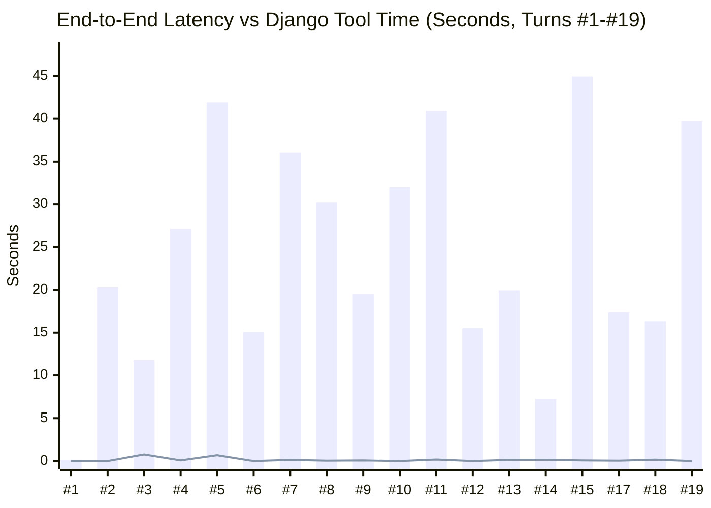

# AI Assistant QA Audit & Latency Report — 2026-11-27 (Asia/Jakarta)

**Database Audited**: `erp_production` (`163.53.194.206:54321`, strictly `default_transaction_read_only=on`)  
**Snapshot Extracted**: `2026-11-27 16:11:16+07:00`  
**Audit Script**: [audit_ai_chats.py](file:///Users/programmer/.gemini/antigravity-cli/brain/ac0935d4-a41c-4705-9959-873bb32f8f72/scratch/audit_ai_chats.py) | **Raw JSON**: [audit_2026_11_27.json](file:///Users/programmer/.gemini/antigravity-cli/brain/ac0935d4-a41c-4705-9959-873bb32f8f72/scratch/audit_2026_11_27.json)

---

## 1. Executive Summary & Data Reconciliation

Every AI chat stream request, undo event, message row, and backend tool invocation on `2026-11-27` reconciled **100%** with zero unmapped logs:

| Reconciliation Metric | Count | Notes |
| :--- | :---: | :--- |
| Active Threads (`aiassistant_thread`) | **4** | 3 threads by `super@super`, 1 thread by `aji@it` (all logged into `HEAD OFFICE`) |
| Persisted Messages (`aiassistant_message`) | **37** | **19** user prompts + **18** assistant responses (**1 unanswered turn**) |
| Stream Requests (`ess_system_log_event`) | **24** | **19** matched persisted prompts + **5** rolled-back prompts (**5 `/undo/`** events) |
| Backend Tool Calls (`/ai/tools/...`) | **23** | **23/23 mapped** (0 unmapped); includes **1 `WARNING`** (`[DUPLICATE SUBMIT 144ms]`) |

### Verdict Breakdown (19 Persisted Turns)

| Verdict Category | Turns | % of 19 | Turn Numbers |
| :--- | :---: | :---: | :--- |
| **PASS (Accurate)** | **2** | 10.5% | `#1` (greeting), `#9` (P&L Oct HO — slow) |
| **PASS WITH MINOR UX / DATA NOISE** | **3** | 15.8% | `#3` (raw chip prompt + false error inflation), `#10` (accurate P&L analysis — fallback to Gemini 32s), `#18` (accurate Q4 numbers — wrong header label) |
| **PARTIAL / MISLEADING ANALYSIS** | **2** | 10.5% | `#11` (363 entity links, doesn't pinpoint unbalanced JEs), `#12` (blames negative-balance accounts instead of 39 unbalanced JEs) |
| **FAILED / BROKEN / INCORRECT / FALSE EMPTY** | **12** | **63.2%** | `#2` (bad clarification chips + 20.3s), `#4` (false empty `BSH/2026/02010`), `#5` (stub hid all numbers!), `#6` (unnecessary clarification + fake `BCA_ID` chips), `#7` (false empty `Bca dwi` + 6 duplicate calls), `#8` (hallucinated `MAINSTORE_CASH` 3x), `#13` (wrong month Aug + invalid `status=unpaid`), `#14` (dropped unpaid/Oct filter -> 2,630 mixed Nov journals), `#15` (false empty `BSH/2026/02010`, 44.9s), `#16` (**unanswered**), `#17` (false zero Shopee >20% fee due to `company_id=1`), `#19` (**blank `""` response after 39.7s**) |

> [!CAUTION]
> **63.2% (12/19) of persisted turns failed or produced wrong/incomplete answers**, and **88.9% (16/18) of answered turns breached the >10s Slow SLA** (with **50.0% breaching the >20s Critical Slow SLA**).

---

## 2. Response Time & Latency Breakdown

### 2.1 Overall Latency Distribution (18 Answered Turns)

| Metric | Min | Median | Average | P95 | Max |
| :--- | :---: | :---: | :---: | :---: | :---: |
| **Reported Orchestrator (`execution_time_ms`)** | 145.9 ms | **20,139.3 ms (20.1s)** | **24,226.0 ms (24.2s)** | **42,368.0 ms (42.4s)** | **44,932.1 ms (44.9s)** |
| **Wall-Clock (`asst.created_at - user.created_at`)** | 242.2 ms | **20,217.0 ms (20.2s)** | **24,349.9 ms (24.3s)** | **42,447.7 ms (42.4s)** | **45,015.4 ms (45.0s)** |
| **Django `/ai/tools/` Sum (12 tool turns)** | 40.8 ms | **127.9 ms** | **207.7 ms** | 720.1 ms | 766.7 ms |
| **LangGraph + LLM Overhead (`exec - tools`)** | 145.9 ms | **20,074.7 ms (20.1s)** | **24,087.6 ms (24.1s)** | 41,777.4 ms | 44,859.6 ms |
| **Django Proxy Stream Overhead (`wall - exec`)** | ~65 ms | ~79 ms | ~124 ms | ~475 ms | 474.9 ms |

### 2.2 SLA Compliance & Model Distribution

| SLA Bucket | Turns | Share | Models Used (Persisted Turns) |
| :--- | :---: | :---: | :--- |
| **OK (`<= 10s`)** | **2** | 10.5% | `#1` (`145.9ms`, fast guardrail), `#14` (`7,245.8ms`, single-tool fast path) |
| **SLOW (`10s – 20s`)** | **7** | 36.8% | `#3` (11.8s), `#6` (15.1s), `#12` (15.5s), `#18` (16.3s), `#17` (17.4s), `#9` (19.5s), `#13` (19.9s) |
| **CRITICAL SLOW (`> 20s`)** | **9** | **47.4%** | `#2` (20.3s), `#4` (27.1s), `#8` (30.2s), `#10` (32.0s, `gemini-2.5-flash`), `#7` (36.0s), `#19` (39.7s), `#11` (40.9s), `#5` (41.9s), `#15` (44.9s) |
| **UNKNOWN (Unanswered)** | **1** | 5.3% | `#16` (no assistant reply persisted) |

- **Model Split**: **`gpt-6-luna`**: 17 turns | **`gemini-2.5-flash`**: 1 turn (Turn `#10`, fallback after OpenAI failure/timeout, took 32.0s) | **`None`**: 1 turn (Turn `#16`, unanswered).
- **Primary Latency Bottleneck**: Django ERP tool queries averaged **207.7 ms (<1% of latency)**. Over **99.4%** of response time occurred inside `erp-langgraph` LLM hops because `gpt-6-luna` (an OpenAI reasoning model matched by `_OPENAI_OMIT_TEMPERATURE_MODEL_RE` in [llm.py](file:///Users/programmer/fastprint-project/erp-langgraph/app/services/llm.py#L514-L522)) is invoked with default reasoning effort across sequential pipeline hops (Semantic Router -> LLM Extractor -> Retry 1 -> Retry 2 -> Synthesizer Polish/Followups). Even **0-tool turns** took **15.1s (`#6`), 20.3s (`#2`), and 39.7s (`#19`)**.



---

## 3. Prioritized Problem List (Root Causes Traced to Code)

### P0 — Critical Failures (Broken Output, Dropped Turns, Major False Negatives)

---

#### P0-1: Completely Blank Assistant Response (`""`) After 39.7s on Table Reformat Follow-Up
- **Affected Turn**: **Turn `#19`** (Msg `542` -> `543`, Thread `252114cf`, `aji@it`)
- **Prompt**: `buat table nya begini\ncabang | oktober | november | desember` (follow-up to Turn `#18` Q4 2026 omzet)
- **Observed Result**: `content = ""` (empty string), `detected_domain = "accounting"`, `query_mode = "live_erp"`, `verification_status = None`, **0 tool calls**, `execution_time_ms = 39,678.7ms`, generic accounting follow-up chips (`Posisi Kas & Bank`, `Cek Neraca Keuangan`).
- **Root Cause**:
  1. In [router_semantic.py](file:///Users/programmer/fastprint-project/erp-langgraph/app/graph/nodes/router_semantic.py#L773-L836), the LLM misclassified a table-reformatting follow-up as `domain="accounting"`, `query_mode="live_erp"` with `active_tools=[]` (either emitting `tool=None` or an unregistered tool name dropped at lines 779–781). Lines 829–835 only normalize `query_mode == "hybrid"` when `active_tools` is empty, leaving `query_mode="live_erp"` + `active_tools=[]` unguarded.
  2. [workflow.py](file:///Users/programmer/fastprint-project/erp-langgraph/app/graph/workflow.py#L90-L104) (`decide_after_router`) sees no active tools and jumps directly to `synthesizer`, skipping `extractor`, `tool_node`, and `verifier` (leaving `verification_status = None`).
  3. [synthesizer.py](file:///Users/programmer/fastprint-project/erp-langgraph/app/graph/nodes/synthesizer.py#L835-L842) (`format_deterministic_answer`) falls through to `_format_single_tool_presentation(tool=None, tool_result={})` which returns `""`, and `_build_synthesis_plan` ([synthesizer.py](file:///Users/programmer/fastprint-project/erp-langgraph/app/graph/nodes/synthesizer.py#L2143-L2147)) skips LLM synthesis because `status != "VALID"` and `query_mode != "contextual_analysis"`.
  4. [chatProxyView.py](file:///Users/programmer/fastprint-project/ERP/modules/aiassistant/views/chatProxyView.py#L835-L842) persists the blank string without a non-empty guard.
- **Recommended Fix**:
  - Guard `router_semantic.py:829-836`: if `query_mode == "live_erp"` and `not active_tools`, convert to `contextual_analysis` (if prior report exists) or fallback/clarification rather than passing an empty `live_erp` state.
  - Add an invariant guard in `synthesizer.py:_finalize_synthesis_output` ensuring `final_answer` is never blank, and recognize table-reshape prompts (`buat table nya...`) as `contextual_analysis` / `get_sales_summary` branch×month breakdown.

---

#### P0-2: Unanswered / Silently Dropped Chat Turn (No Assistant Message or Error Persisted)
- **Affected Turn**: **Turn `#16`** (Msg `537`, Thread `b94df6d7`, `super@super` @ `15:51:21`)
- **Prompt**: `tolong di rekonsil bank bca LIM A TJUA 5120627653\ndi rekening koran \nMUTASI CR : 189,053,054.72\nMUTASI DB : 195,312,500.00\ncek apakah sudah sesuai dengan yang ada di erp`
- **ERP Ground Truth**: Account **exists** in `HEAD OFFICE` (`company_id=3`) as `id=2974`, `account_code='11250HO'`, `account_name='BANK BCA - LIM A TJUA(5120627653)'`. In October 2026 (`2026-10`, status `post`, 12 lines), ERP recorded `total_dr = Rp 205,553,072.72` (bank CR inflow, diff `+Rp 16,500,018.00` vs user's `189,053,054.72`) and `total_cr = Rp 195,312,500.00` (**exact match** to user's `MUTASI DB`).
- **Observed Result**: User message saved (`id=537`), `POST /aiassistant/chat/stream/` logged (`36.5ms`), **0 `/ai/tools/` calls**, **0 assistant messages** persisted.
- **Root Cause**: In [chatProxyView.py](file:///Users/programmer/fastprint-project/ERP/modules/aiassistant/views/chatProxyView.py#L867-L869), if the client disconnects/navigates away while waiting on a slow (>30s) `gpt-6-luna` router response, `GeneratorExit` exits silently without persisting a cancelled/error status; similarly, an upstream worker kill leaves an orphaned user message.
- **Recommended Fix**: Persist an explicit cancelled/interrupted status message (or client-side retryable indicator) on `GeneratorExit` if no assistant reply was saved, and fix the underlying `gpt-6-luna` latency (P0-8) so turns don't stall 30–45s before the first tool call.

---

#### P0-3: Multi-Company `get_bank_reconciliation_summary` Discards All Numbers Behind Generic Stub
- **Affected Turn**: **Turn `#5`** (Msg `513` -> `514`, Thread `b94df6d7`, `super@super`, **41.9s**)
- **Prompt**: `berapa total rekonsil dari bank shopee bulan oktober di mainstore dan surabaya`
- **Correlated Tool Calls (Both Succeeded with Full Data)**:
  - `company_id=7` (`FP SURABAYA (MT)`, `63.9ms`): `11204SBY BANK SHOPEE SBY` — `bank_statement_balance: 0.0`, `erp_book_balance: -112,963.0`, `difference: 112,963.0`
  - `company_id=4` (`MAIN STORE`, `618.2ms`): `11207MS BANK SHOPEE MS` — `bank_statement_balance: 1,120,754,191.0`, `erp_book_balance: 92,305,773.0`, `difference: 1,028,448,418.0`
- **Observed Result**:
  ```markdown
  ### Laporan Multi-Perusahaan (`get_bank_reconciliation_summary`)
  - **Main Store**: Ditemukan 1 data master / catatan.
  - **Surabaya**: Ditemukan 1 data master / catatan.
  ```
- **Root Cause**: `MULTI_COMPANY_FORMATTERS` in [multi_company.py](file:///Users/programmer/fastprint-project/erp-langgraph/app/graph/nodes/formatters/multi_company.py#L827-L866) registers 12 tools but **omits `get_bank_reconciliation_summary`** (as well as `get_journal_entries` and `get_general_ledger`). Execution falls into the generic `else:` block at lines 856–866, printing only `Ditemukan {cnt} data master / catatan.` and discarding every financial metric.
- **Recommended Fix**: Add dedicated `_format_mc_get_bank_reconciliation_summary` (and fallback delegation to `_format_single_tool_presentation` per branch instead of a raw count stub for any unregistered multi-company tool).

---

#### P0-4: False `EMPTY` on Exact Journal Document `BSH/2026/02010` (No Cross-Branch Probing for Accounting)
- **Affected Turns**:
  - **Turn `#4`** (Msg `511` -> `512`, **27.1s**): `redirect ke nomer jurnal ini  BSH/2026/02010`
  - **Turn `#15`** (Msg `535` -> `536`, **44.9s** — slowest turn of the day!): `BSH/2026/02010\n\nCek detail dari jurnal ini ?? dia menjurnal apa`
- **ERP Ground Truth**: **`BSH/2026/02010` EXISTS** in `accounting_journal_entry`:
  - `id=2857700`, `company_id=4` (`MAIN STORE`), `date=2026-08-13`, `status='post'`, `journal='BANK SHOPEE'`, `ref='SLS/2026/00536 Incoming Payment'`
  - **5 Journal Lines**:
    - `11207MS BANK SHOPEE MS`: Debit `Rp 149,260.00` (`Incoming Payment for 2608138AB8DCS3`)
    - `40006MS HPP JASA`: Debit `Rp 16,530.00` (Commission) + `Rp 6,960.00` (Service) + `Rp 1,250.00` (Order Processing)
    - `11400MS PIUTANG AFILIASI`: Credit `Rp 174,000.00` (`Pelunasan Piutang Usaha MS/SO/0580732`)
- **Observed Result**: Both turns sent only **1** tool call to `/ai/tools/accounting/get_journal_entries/` with **`company_id=3` (`HEAD OFFICE`)**, got `total_count: 0`, and returned `EMPTY` (`Data Tidak Ditemukan` / `0 Catatan Ditemukan`).
- **Root Cause**: The Hybrid HQ Auto-Probe in [tool_node.py](file:///Users/programmer/fastprint-project/erp-langgraph/app/graph/nodes/tool_node.py#L1088-L1125) is hard-restricted to 3 sales tools (`get_contacts`, `get_sales_orders`, `get_top_selling_products`). Accounting tools (`get_journal_entries`, `get_account_balance`, `get_vendor_bills`) have **zero cross-branch probing** even when the user is logged into Head Office (`company_id=3`) with `authorized_company_ids` spanning all branches and provides a strict document number (`BSH/2026/02010`).
- **Recommended Fix**: Extend HQ Auto-Probe in `tool_node.py` (or add native `company_ids` support in `ERP/ai_tools/tools/accounting/get_journal_entries.py`) when querying by strict document identifier (`entry_number` / slash-code `search`) from HQ (`1`/`3`) with no explicit branch pinned.

---

#### P0-5: Hallucinated `account_code: "MAINSTORE_CASH"` Repeated 3x Identically (30.2s -> False `EMPTY`)
- **Affected Turn**: **Turn `#8`** (Msg `519` -> `520`, Thread `b94df6d7`, `super@super`, **30.2s**)
- **Prompt**: `Tampilkan mutasi general ledger untuk kas mainstore`
- **ERP Ground Truth**: `MAIN STORE` (`company_id=4`) has **`11200MS-A` (`KAS MS`, 760 posted GL lines, balance `-Rp 1,294,000.00`)** and `11200MS-B` (`KAS BON SEMENTARA`, 2 lines).
- **Observed Result**: Fired 3 identical calls (`14.8ms`, `13.5ms`, `12.6ms`) to `/ai/tools/accounting/get_general_ledger/` with `company_id=4, account_code="MAINSTORE_CASH"` -> returned `EMPTY`.
- **Root Cause**:
  1. LLM extractor hallucinated a synthetic English constant `"MAINSTORE_CASH"` for `account_code` instead of leaving `account_code=None` so [tool_node.py](file:///Users/programmer/fastprint-project/erp-langgraph/app/graph/nodes/tool_node.py#L659-L681) (`_resolve_and_execute_gl_category`) could automatically pre-resolve `KAS` accounts at `company_id=4`.
  2. Although [extractor.py](file:///Users/programmer/fastprint-project/erp-langgraph/app/graph/nodes/extractor.py#L789-L817) and [extractor.py](file:///Users/programmer/fastprint-project/erp-langgraph/app/graph/nodes/extractor.py#L881-L885) have guards to strip unmentioned `account_code` on generic queries / retry 2, `"MAINSTORE_CASH"` STILL appeared on ALL 3 attempts in production — indicating either (a) production/staging was running an image predating commit `3096205` (or `_extract_gl_account_hint` failed to strip before `account_code` validation), AND (b) `account_code` validation lacks a strict format check rejecting synthetic non-COA identifiers (`MAINSTORE_CASH` contains no digits, whereas all FastPrint COA codes start with digits like `11200MS-A`).
- **Recommended Fix**: Enforce a deterministic COA-code pattern check in `extractor.py` (reject any LLM-invented `account_code` containing no digits or not appearing verbatim in the user query/history), and verify the deployed staging container matches latest `master`.

---

#### P0-6: Extractor Prompt Instructs Invalid `status="unpaid"` & Fails to Override Hallucinated Month (`2026-08` for `"bulan lalu"`)
- **Affected Turn**: **Turn `#13`** (Msg `531` -> `532`, Thread `b94df6d7`, `super@super`, **19.9s**)
- **Prompt**: `Mana saja invoice yang belum di bayar di bulan lalu ??`
- **ERP Ground Truth**: Today is **`2026-11-27`**, so `"bulan lalu"` is **October 2026 (`2026-10-01`..`2026-10-31`)**. Valid `accounting_journal_entry.status` values are **`draft`, `post`, `partial`, `paid`, `cancel`** (there is **NO `unpaid`** status). In Oct 2026, `HEAD OFFICE` (`company_id=3`) actually has **15 unpaid vendor bills** (`12 post` + `3 partial`), `FP JAKARTA` (`company_id=8`) has **19 unpaid sales invoices** (`18 draft` + `1 partial`), and across all branches there are **108+ non-paid invoices/bills**.
- **Observed Result**:
  - Call #1 (`45.9ms`): `get_journal_entries(status="unpaid", date_from="2026-08-01", date_to="2026-08-31", company_id=3)` -> `0`
  - Call #2 (`34.2ms`): `get_journal_entries(status="unpaid", company_id=3)` -> `0`
  - Call #3 (`49.2ms`): `get_journal_entries(status="unpaid", limit=200, company_id=3)` -> `0` -> returned `EMPTY`.
- **Root Cause**:
  1. **System Prompt Bug**: [extractor.py](file:///Users/programmer/fastprint-project/erp-langgraph/app/graph/nodes/extractor.py#L343) literally tells the LLM: *"For accounting journal/invoice/bill tools, valid status values are only 'draft', 'posted', 'paid', 'unpaid', or 'cancel'."* Meanwhile [get_journal_entries.py](file:///Users/programmer/fastprint-project/ERP/ai_tools/tools/accounting/get_journal_entries.py#L326-L327) runs an exact `qs.filter(status__iexact=params['status'])`, which guarantees 0 matches for `'unpaid'` and `'posted'`!
  2. **Relative Date Override Bug**: [extractor.py](file:///Users/programmer/fastprint-project/erp-langgraph/app/graph/nodes/extractor.py#L385-L389) only fills `rel_date_from`/`rel_date_to` when `not extracted_dict.get("date_from")`. Because `gpt-6-luna` hallucinated August 2026 (`2026-08-01..2026-08-31`), deterministic October bounds were ignored!
  3. **Status Not Relaxed / Mapped**: Even on Retry #2 (`TOOL #3`), `status="unpaid"` remained in the payload (either pre-fix deployed container or unmapped alias).
- **Recommended Fix**:
  - Fix `extractor.py:343` to separate valid statuses per tool (`get_journal_entries`: `draft`/`post`/`partial`/`paid`/`cancel`; `get_vendor_bills`: `unpaid`/`partial`/`paid`), AND map `status="unpaid"` in `get_journal_entries.py` to `status__in=['draft', 'post', 'partial']` (and `'posted'` -> `'post'`).
  - Always prefer deterministic `resolve_relative_dates()` over LLM dates when a relative expression (`bulan lalu`, `bulan ini`, `kemarin`) is unambiguously matched.

---

#### P0-7: Unnecessary Clarification with Broken Placeholder Chips (`account_id=BCA_ID`) + Follow-Up `Bca dwi` Lost Branch, Fired Duplicate Calls (6x), and Failed Substring Match
- **Affected Turns**:
  - **Turn `#6`** (Msg `515` -> `516`, **15.1s**): `Berapa saldo rekening Bank BCA dan kas kecil hari ini di mainstore` -> `CLARIFICATION`: *"Silakan sertakan ID akun atau kode akun untuk Bank BCA dan kas kecil di mainstore."* with chips `account_code=BCA`, `account_id=BCA_ID`, `account_code=KAS`, `account_id=KAS_ID`.
  - **Turn `#7`** (Msg `517` -> `518`, **36.0s**): `Bca dwi` -> **6 tool calls** (3 retry rounds × **2 identical calls per round**!), all to `company_id=3` (`HEAD OFFICE`), triggering `WARNING: [DUPLICATE SUBMIT 144ms]` -> returned `EMPTY`.
- **ERP Ground Truth**:
  - For Turn `#6`: `MAIN STORE` (`company_id=4`) has **17** matching Kas/BCA accounts including `11200MS-A KAS MS` (`-Rp 1,294,000`), `11217MS BANK BCA (5121222681)-MS` (`Rp 978,392,722.45`), `11218MS`, `11219MS`, `11220MS`, `11222MS-A`.
  - For Turn `#7`: **`BANK BCA PT.DWI PRINTA JAYA(5122602222)`** exists in **3 branches**: `FP MAKASAR` (`11207MKS`, `Rp 965.93M`), `FP BANDUNG` (`11210BDG`, `-Rp 3.11B`), and `FP JAKARTA` (`11211JKT`, `Rp 2.07B`).
- **Root Causes (4 Compounding Bugs)**:
  1. **Over-Eager Clarification & Unvalidated Chip Queries** ([router_semantic.py](file:///Users/programmer/fastprint-project/erp-langgraph/app/graph/nodes/router_semantic.py#L677-L745)): `get_account_balance` does NOT require `account_id`/`account_code` (`search` + `account_type="Bank and Cash"` are optional!). Yet the semantic router demanded IDs and passed unvalidated synthetic queries (`account_id=BCA_ID`, `get_account_health` in Turn `#2`) straight into `suggested_followups`.
  2. **Lost Branch Context (`company_id=3` instead of `4` or cross-branch)** ([extractor.py](file:///Users/programmer/fastprint-project/erp-langgraph/app/graph/nodes/extractor.py#L1200-L1215)): Because Turn `#6` returned `CLARIFICATION`, `"di mainstore"` was never persisted into `company_id`, so Turn `#7` fell back to `HEAD OFFICE` (`3`) and had no cross-branch probing.
  3. **Duplicate `active_tools` Execution (2x per retry = 6 calls)**: Semantic router emitted 2 planned `get_account_balance` items (one for BCA, one for kas kecil from Turn `#6` context) without deduplicating identical `(tool, params)` pairs before executing in `tool_node.py` -> fired 2 identical HTTP POSTs 144ms apart on Attempt 0 (`WARNING: [DUPLICATE SUBMIT 144ms]`), and again on Retries 1 & 2.
  4. **Contiguous Substring `icontains` Fails Multi-Token Names** ([get_account_balance.py](file:///Users/programmer/fastprint-project/ERP/ai_tools/tools/accounting/get_account_balance.py#L181-L188)): `Q(account_name__icontains="BCA dwi")` **cannot match** `"BANK BCA PT.DWI PRINTA JAYA(5122602222)"` because `"PT."` separates `"BCA"` and `"DWI"`.
- **Recommended Fix**:
  - Tokenize `search` in `get_account_balance.py` (AND-match each whitespace token across `account_code | account_alias_code | account_name`).
  - Reject clarification options whose `query` matches snake_case tool names (`^[a-z]+_[a-z_]+$`) or key=placeholder syntax (`=.*_ID`).
  - Deduplicate identical `(tool, company_id, params)` calls in `tool_node.py` before dispatching.
  - Explicitly state in `router_semantic.py` prompt that `get_account_balance` NEVER requires `account_id`/`account_code`.

---

#### P0-8: Systemic Latency Crisis — 89% Slow (>10s), 50% Critical Slow (>20s), Peak 44.9s (99.4% LLM Overhead)
- **Affected Turns**: **16 of 18 answered turns** (`#2–#13, #15, #17–#19`); **9 turns > 20s** (`#2, #4, #5, #7, #8, #10, #11, #15, #19`)
- **Root Cause**:
  - Today's commit `e7c5a75` enabled OpenAI reasoning models ([llm.py](file:///Users/programmer/fastprint-project/erp-langgraph/app/services/llm.py#L514-L542,L725-L748)), and the running service is configured with **`gpt-6-luna`** as the default model for **every** node (Router, Extractor, Retry Extractor, Synthesizer Polish/Followups).
  - With `NLU_ROUTER_MODEL` / `NLU_ROUTER_REASONING_EFFORT` unset (or medium/high) and `SYNTHESIZER_FAST_DETERMINISTIC=false`, simple single-tool turns run **2–3 sequential heavy reasoning LLM calls** (12–42s) while Django `/ai/tools/` executes in **13–767ms**.
  - On Turn `#10`, `gpt-6-luna` timed out/failed and failed over to `gemini-2.5-flash` at **32.0s**.
- **Recommended Fix**:
  1. Configure a fast, non-reasoning (or `low` reasoning effort) model specifically for `NLU_ROUTER_MODEL` & Extractor (e.g., `gpt-4.1-mini` / `gpt-4.1-nano` or `reasoning_effort=low`).
  2. Enable `SYNTHESIZER_FAST_DETERMINISTIC=true` for non-analytical tabular reports (cuts ~5–15s per turn with zero accuracy loss).
  3. Expand Tier-1 deterministic fast-path extractors in [extractor.py](file:///Users/programmer/fastprint-project/erp-langgraph/app/graph/nodes/extractor.py#L244-L315) to cover `get_journal_entries` (especially exact slash document numbers like `BSH/2026/02010`), `get_account_balance`, and `get_general_ledger` (bypassing LLM extraction completely on simple queries).

---

### P1 — High-Impact Functional & Accuracy Bugs

---

#### P1-1: False Zero Anomalies on Marketplace Shopee Fee >20% (Queried Empty `company_id=1` Only)
- **Affected Turn**: **Turn `#17`** (Msg `538` -> `539`, Thread `252114cf`, `aji@it`, **17.4s**)
- **Prompt**: `Cek anomali potongan marketplace shopee di atas 20% bulan ini.`
- **ERP Ground Truth**: `KANTOR PUSAT` (`company_id=1`) owns **0 marketplace accounts**. All 18 marketplace accounts belong to branches `4, 5, 6, 7, 8, 10, 13, 14, 15`. In November 2026, there are **2,087 non-cancelled Shopee orders** across 8 branches, and **`FP BANDUNG` (`company_id=6`) has 1 order with fee >= 20%** (`Rp 4,338` fee leakage).
- **Observed Result**: Tool payload passed ONLY `company_id: 1` (without `company_ids`), scanned 0 orders, and confidently reported **0 anomalies** across `"bulan ini"`.
- **Root Cause**: Unlike `get_account_health` (Turn `#3`), `get_fee_and_escrow_anomalies` was NOT given multi-company `company_ids` when invoked from `HEAD OFFICE`/`KANTOR PUSAT` with no branch specified ([extractor.py](file:///Users/programmer/fastprint-project/erp-langgraph/app/graph/nodes/extractor.py#L1190-L1215) fell back to single-company `session_cid=1`), and `tool_node.py:1088-1095` HQ Auto-Probe ignores marketplace tools.
- **Recommended Fix**: Default all native multi-company marketplace tools (`TOOL_DOMAIN_MAP[tool] == "marketplace"`) to expand to `authorized_company_ids` (all branches) when called from HQ (`1`/`3`) without an explicit branch mention.

---

#### P1-2: `get_account_health` Counts Normal `INFO / ACTIVITY` Logs as "Error Fetch Order" (15.88% False Error Rate)
- **Affected Turn**: **Turn `#3`** (Msg `509` -> `510`, Thread `199b21bc`, `super@super`, **11.8s**)
- **Observed Result**: Reported **`Error Fetch Order: 27` (`Rasio Error: 15.88%`)**, listing `EXECUTE_MARKETPLACE: EXECUTE (Query/Check) on /marketplace/account/api/` under *"Rincian Error Penarikan"*.
- **ERP Ground Truth**: In `ess_system_log_event`, all 33 `EXECUTE_MARKETPLACE` rows on `/marketplace/account/api/` have **`event_category = 'ACTIVITY'`** and **`level = 'INFO'`** — they are normal API query audit logs, NOT errors! Only **2 actual ERROR rows** occurred in the marketplace module over the last 24h (`1 HTTP_500_ServerError` on `/marketplace/api/account/filter/order-list/` + `1 ConsoleError`).
- **Root Cause**: [get_account_health.py](file:///Users/programmer/fastprint-project/ERP/ai_tools/tools/marketplace/get_account_health.py#L171-L173) filters `SystemLogEvent.objects.filter(module_name="marketplace")` **without filtering `event_category="ERROR"` or `level__in=["ERROR", "CRITICAL"]`**!
- **Recommended Fix**: Add `.filter(event_category="ERROR")` (or `level__in=["ERROR", "CRITICAL"]`) to `err_qs` in `get_account_health.py:171`.

---

#### P1-3: Branch-Switch Follow-Up Dropped Prior Intent ("Unpaid Invoices Last Month") -> Returned 2,630 Mixed Current-Month Journals
- **Affected Turn**: **Turn `#14`** (Msg `533` -> `534`, Thread `b94df6d7`, `super@super`, **7.2s**)
- **Prompt**: `coba cek untuk cabang jakarta` (immediate follow-up to Turn `#13`: *"Mana saja invoice yang belum di bayar di bulan lalu ??"*)
- **Observed Result**: Called `get_journal_entries(company_id=8, date_from="2026-11-01", date_to="2026-11-30")` with **no status filter** and **no invoice filter**. Returned **2,630 mixed journals from November** including `INVENTORY VALUATION`, `B-JK1` bank entries, `CANCEL`, and `PAID` invoices.
- **ERP Ground Truth**: Jakarta (`company_id=8`) in October 2026 (`bulan lalu`) has **19 unpaid sales invoices** (`18 draft` + `1 partial`).
- **Root Cause**: When a follow-up switches branches after an `EMPTY` turn, `extractor.py` does not inherit the prior turn's temporal window (`2026-10-01..2026-10-31`) or invoice/unpaid filter intent, defaulting instead to all general journal entries for the current month.
- **Recommended Fix**: Inherit prior turn's date range and non-empty semantic intent filters on pure branch-switch follow-ups (`coba cek untuk cabang X`), and route `"invoice yang belum dibayar"` to a dedicated invoice/receivable filter rather than unfiltered `get_journal_entries`.

---

#### P1-4: Clarification Chips Emit Raw Internal Tool Names (`get_account_health`) Instead of Natural Prompts
- **Affected Turns**: **Turn `#2`** -> **Turn `#3`** (Thread `199b21bc`, `super@super`)
- **Observed Result**: Turn `#2` (`saya mau cek data marketplace`, **20.3s**) produced chips with raw snake_case tool names: `{"label": "Detail order", "query": "get_marketplace_orders"}`, `{"label": "Kesehatan akun", "query": "get_account_health"}`, `{"label": "Saldo dompet", "query": "get_cashflow_and_balance_summary"}`. When the user clicked `"Kesehatan akun"`, Turn `#3` literally sent `"get_account_health"` as the user message.
- **Root Cause**: [router_semantic.py](file:///Users/programmer/fastprint-project/erp-langgraph/app/graph/nodes/router_semantic.py#L725-L743) and [synthesizer.py](file:///Users/programmer/fastprint-project/erp-langgraph/app/graph/nodes/synthesizer.py#L2187-L2216) do not sanitize or map raw tool identifiers in `clarification_options[].query` back to human-readable sample prompts from the tool registry.
- **Recommended Fix**: If a clarification option `query` matches a registered tool name (or contains `=` placeholder tokens), replace it automatically with the tool's human-readable `sample_prompts[0]` (localized to the active branch).

---

#### P1-5: Balance Sheet Imbalance Analysis (`#11` & `#12`) Misses True Root Cause (39 Unbalanced Journal Entries)
- **Affected Turns**: **Turn `#11`** (40.9s) and **Turn `#12`** (15.5s), Thread `b94df6d7`, `super@super`
- **Prompts**: `#11`: *"dari balance sheet bisa di cek mana yang sekiranya tidak balance di bulan ini"* (retried immediately after **Undone `#5`**, which had the exact same prompt and was undone after 50.9s!); `#12`: *"Faktor yang membuat tidak seimbang apa ??"*
- **ERP Ground Truth**: Head Office (`company_id=3`) Balance Sheet IS genuinely unbalanced (`get_balance_sheet` reported `Rp 369,665,128.73`; raw posted JEs in DB show **39 unbalanced `post` journal entries** with `ABS(SUM(debit) - SUM(credit)) > 0.01`, summing to `Rp 372,538,471.73`).
- **Observed Issue**:
  1. Turn `#11` dumped a 209-line table with **363 `entity_links`** (including duplicate trailing-space codes like `11224` vs `11224 `) without answering *"mana yang sekiranya tidak balance"*.
  2. Turn `#12` ran `contextual_analysis` over a **truncated** Balance Sheet (`max_chars=12000` in [synthesizer.py](file:///Users/programmer/fastprint-project/erp-langgraph/app/graph/nodes/synthesizer.py#L1982)) and pointed to negative-balance accounts (`11213HO`, `11503HO-SJI`, `11206HO`) — which in double-entry accounting do **not** cause `Assets != Liabilities + Equity`! It had no tool to list unbalanced journal entries (`SUM(debit) != SUM(credit)`).
- **Recommended Fix**: Add an `unbalanced_only=True` filter to `get_journal_entries` (or include `top_unbalanced_entries` summary inside `get_balance_sheet` whenever `is_balanced == False`) so the AI pinpoints the exact 39 unbalanced journal entries directly.

---

### P2 — Medium / UX & Data Presentation Issues

---

#### P2-1: Misleading Header `(Cabang: Kantor Pusat)` on Multi-Branch Q4 Sales Summary
- **Affected Turn**: **Turn `#18`** (Msg `540` -> `541`, Thread `252114cf`, `aji@it`, **16.3s**)
- **Observed Result**: Numbers were **100% accurate** across all 16 branches (`Rp 2,938,450,685.00`, `7,402` confirmed orders matching live `sales_quotation` ground truth), but the heading rendered:
  `### Ringkasan Eksekutif Penjualan & Omzet (Cabang: Kantor Pusat, Periode 2026-10-01 s/d 2026-12-31)`
- **Root Cause**: `_resolve_company_display_label()` in [formatters/common.py](file:///Users/programmer/fastprint-project/erp-langgraph/app/graph/nodes/formatters/common.py#L203-L221) checks `tool_result.get("company_id")` (`1` -> `"Kantor Pusat"`) without first checking `len(tool_result.get("company_ids") or []) > 1` -> `"Semua Cabang"`!
- **Recommended Fix**: In `_resolve_company_display_label`, if `len(company_ids) > 1`, return `"Semua Cabang"` (or comma-joined branch names when `<= 3`).

---

#### P2-2: P&L Summary Classification Anomaly (`52000HO`/`52001HO`/`52002HO` Account Type vs Analytical Digest)
- **Affected Turns**: **Turn `#9`** (19.5s) & **Turn `#10`** (32.0s, fallback to `gemini-2.5-flash`)
- **Observed Detail**: Turn `#9`'s P&L figures for Oct 2026 Head Office (`Net Profit: Rp -82,765,375.53`, `OpEx: Rp 82,765,518.02`, `Other Net: Rp 142.49`) accurately reflect the ERP DB, where `52000HO` (`BEBAN BUNGA PINJAMAN LAINNYA`), `52001HO` (`BEBAN ADM BANK`), and `52002HO` (`BEBAN PAJAK BUNGA BANK`) have `accounting_type = 'Expenses'` (not `Other Expenses`). However, `_build_pnl_analytical_digest` in `synthesizer.py` grouped `52xxx` under *"Pos Pendapatan / Beban Lain-Lain Terbesar"*, causing Turn `#10` to flag an internal inconsistency between the main table and its own digest.
- **Recommended Fix**: Align `_build_pnl_analytical_digest` bucketing strictly with `get_profit_and_loss`'s exact `type`/`sub_type` categories so the digest never contradicts the main P&L table.

---

#### P2-3: Undone Testing Prompts Reveal Early Friction & Slow-Response Abandonment (5 Undone Streams)
Recovered from `ess_system_log_event` (`/aiassistant/chat/stream/` paired with `/undo/`):

| Undone # | Time (WIB) | Thread / User | Prompt | Tools Triggered | Undo After | Likely Reason |
| :---: | :---: | :--- | :--- | :--- | :---: | :--- |
| **U1** | `14:08:29` | `199b21bc` (`super@super`) | `saya mau cek data marketplace` | None | 122.7s | Clarification / bad chips (retried in Turn `#2`) |
| **U2** | `14:10:05` | `199b21bc` (`super@super`) | `/scope` | None (local) | 26.8s | Cleanup/undo batch at `14:10:31` |
| **U3** | `14:10:14` | `199b21bc` (`super@super`) | `Tampilkan daftar Sales Order berstatus confirmed bulan ini` | None | 17.1s | Aborted/undone before tool executed (retried 1s later in U4) |
| **U4** | `14:10:32` | `199b21bc` (`super@super`) | `Tampilkan daftar Sales Order berstatus confirmed bulan ini` | `get_sales_orders` (`99.9ms` @ `14:10:48` — **15.7s** router+extractor wait!) | 757.3s | Undone at `14:23:09` before testing marketplace |
| **U5** | `15:37:13` | `b94df6d7` (`super@super`) | `dari balance sheet bisa di cek mana yang sekiranya tidak balance di bulan ini` | **None** | **50.9s** | Stalled >50s with **0 tool calls**; user undid at `15:38:04` and immediately resent exact prompt as Turn `#11` (which then took 40.9s!) |

---

## 4. Complete Turn-by-Turn Ledger (All 19 Persisted Turns)

| Turn | Time (WIB) | Thread / User | Prompt (Summary) | Domain / Mode | Status | Model | Reported ms | Wall ms | Tools (ms) | LLM Overhead | SLA | Verdict |
| :---: | :---: | :--- | :--- | :--- | :---: | :--- | :---: | :---: | :--- | :---: | :---: | :--- |
| **#1** | `14:08:14` | `199b21bc` `super@super` | `halo` | `general` / `general` | `None` | `gpt-6-luna` | `145.9` | `242.2` | `0` | `145.9` | **OK** | **PASS** |
| **#2** | `14:23:31` | `199b21bc` `super@super` | `saya mau cek data marketplace` | `clarification` | `CLARIFICATION` | `gpt-6-luna` | `20,332.9` | `20,404.6` | `0` | `20,332.9` | **CRIT** | **FAIL** (P1-4 raw tool-name chips, P0-8 20.3s) |
| **#3** | `14:23:59` | `199b21bc` `super@super` | `get_account_health` *(from chip)* | `marketplace` / `live_erp` | `VALID` | `gpt-6-luna` | `11,803.6` | `11,883.2` | `1` (`766.7`) | `11,037.0` | **SLOW** | **PARTIAL** (P1-2 27 INFO logs counted as errors) |
| **#4** | `15:00:21` | `3e7c8804` `super@super` | `redirect ke nomer jurnal ini BSH/2026/02010` | `accounting` / `live_erp` | `EMPTY` | `gpt-6-luna` | `27,142.3` | `27,213.1` | `1` (`74.9`) | `27,067.4` | **CRIT** | **FAIL** (P0-4 false empty; exists in Main Store `cid=4`) |
| **#5** | `15:04:14` | `b94df6d7` `super@super` | `berapa total rekonsil dari bank shopee bulan oktober di mainstore dan surabaya` | `accounting` / `live_erp` | `VALID` | `gpt-6-luna` | `41,915.5` | `41,994.6` | `2` (`682.0`) | `41,233.5` | **CRIT** | **FAIL** (P0-3 stub hid all numbers despite valid tool data) |
| **#6** | `15:21:22` | `b94df6d7` `super@super` | `Berapa saldo rekening Bank BCA dan kas kecil hari ini di mainstore` | `clarification` | `CLARIFICATION` | `gpt-6-luna` | `15,060.7` | `15,138.2` | `0` | `15,060.7` | **SLOW** | **FAIL** (P0-7 unnecessary clarification + fake `BCA_ID` chips) |
| **#7** | `15:22:02` | `b94df6d7` `super@super` | `Bca dwi` | `accounting` / `live_erp` | `EMPTY` | `gpt-6-luna` | `36,022.7` | `36,100.3` | `6` (`126.5`, **1 WARN**) | `35,896.2` | **CRIT** | **FAIL** (P0-7 false empty, wrong `cid=3`, 6 duplicate calls, contiguous search bug) |
| **#8** | `15:31:24` | `b94df6d7` `super@super` | `Tampilkan mutasi general ledger untuk kas mainstore` | `accounting` / `live_erp` | `EMPTY` | `gpt-6-luna` | `30,232.4` | `30,308.9` | `3` (`40.8`) | `30,191.6` | **CRIT** | **FAIL** (P0-5 hallucinated `MAINSTORE_CASH` 3x; real `11200MS-A` has 760 lines) |
| **#9** | `15:34:18` | `b94df6d7` `super@super` | `Tampilkan laporan laba rugi bulan kemarin` | `accounting` / `live_erp` | `VALID` | `gpt-6-luna` | `19,518.1` | `19,993.0` | `1` (`67.1`) | `19,451.0` | **SLOW** | **PASS (SLOW)** (Accurate Oct HO P&L) |
| **#10** | `15:35:41` | `b94df6d7` `super@super` | `Dari laporan tersebut mana yang mengalami kerugian` | `accounting` / `contextual_analysis` | `VALID` | `gemini-2.5-flash` | `31,965.5` | `32,046.8` | `0` | `31,965.5` | **CRIT** | **PASS (SLOW)** (Fallback to Gemini; P2-2 digest classification mismatch) |
| **#11** | `15:38:04` | `b94df6d7` `super@super` | `dari balance sheet bisa di cek mana yang sekiranya tidak balance di bulan ini` | `accounting` / `live_erp` | `VALID` | `gpt-6-luna` | `40,906.5` | `41,006.7` | `1` (`180.4`) | `40,726.1` | **CRIT** | **PARTIAL** (P1-5 dumps 209 lines + 363 links; doesn't show 39 unbalanced JEs) |
| **#12** | `15:39:32` | `b94df6d7` `super@super` | `Faktor yang membuat tidak seimbang apa ??` | `accounting` / `contextual_analysis` | `VALID` | `gpt-6-luna` | `15,521.7` | `15,605.5` | `0` | `15,521.7` | **SLOW** | **PARTIAL** (P1-5 blames negative balances; misses 39 unbalanced JEs) |
| **#13** | `15:40:36` | `b94df6d7` `super@super` | `Mana saja invoice yang belum di bayar di bulan lalu ??` | `accounting` / `live_erp` | `EMPTY` | `gpt-6-luna` | `19,945.7` | `20,029.5` | `3` (`129.2`) | `19,816.5` | **SLOW** | **FAIL** (P0-6 queried Aug 2026 + invalid `status=unpaid`; 15 unpaid in HO, 108+ overall) |
| **#14** | `15:41:32` | `b94df6d7` `super@super` | `coba cek untuk cabang jakarta` | `accounting` / `live_erp` | `VALID` | `gpt-6-luna` | `7,245.8` | `7,318.8` | `1` (`139.8`) | `7,106.0` | **OK** | **FAIL** (P1-3 dropped unpaid+Oct intent; returned 2,630 mixed Nov journals) |
| **#15** | `15:48:51` | `b94df6d7` `super@super` | `BSH/2026/02010 Cek detail dari jurnal ini ?? dia menjurnal apa` | `accounting` / `live_erp` | `EMPTY` | `gpt-6-luna` | `44,932.1` | `45,015.4` | `1` (`72.5`) | `44,859.6` | **CRIT** | **FAIL** (P0-4 false empty; exists in Main Store `cid=4`; slowest turn) |
| **#16** | `15:51:21` | `b94df6d7` `super@super` | `tolong di rekonsil bank bca LIM A TJUA 5120627653 ...` | `None` | `UNANSWERED` | `None` | `-` | `-` | `0` | `-` | **UNK** | **FAIL** (P0-2 no assistant response or error persisted; `11250HO` exists) |
| **#17** | `15:51:37` | `252114cf` `aji@it` | `Cek anomali potongan marketplace shopee di atas 20% bulan ini.` | `marketplace` / `live_erp` | `VALID` | `gpt-6-luna` | `17,370.9` | `17,448.0` | `1` (`50.4`) | `17,320.5` | **SLOW** | **FAIL** (P1-1 queried empty `cid=1` only; missed 2,087 Shopee orders & 1 >20% anomaly in Bandung) |
| **#18** | `15:56:53` | `252114cf` `aji@it` | `buat q4 tahun 2026 list omzet nya di semua cabang ya` | `sales` / `live_erp` | `VALID` | `gpt-6-luna` | `16,327.5` | `16,397.6` | `1` (`162.0`) | `16,165.5` | **SLOW** | **PASS (UX)** (Numbers exact vs DB; P2-1 wrong header `Cabang: Kantor Pusat`) |
| **#19** | `16:02:00` | `252114cf` `aji@it` | `buat table nya begini\ncabang \| oktober \| november \| desember` | `accounting` / `live_erp` | `None` | `gpt-6-luna` | `39,678.7` | `40,150.8` | `0` | `39,678.7` | **CRIT** | **FAIL** (P0-1 blank `""` response, misrouted to accounting, 0 tools, 39.7s) |

---

## 5. Recommended Remediation Sequence (For Follow-Up Implementation)

| Wave | Priority Items | Target Files | Expected Impact |
| :---: | :--- | :--- | :--- |
| **Wave 1 (Latency & Crashes)** | P0-8 (Router/Extractor model + `reasoning_effort=low` + `SYNTHESIZER_FAST_DETERMINISTIC=true`), P0-1 (empty `live_erp` guard + non-empty `final_answer`), P0-2 (`GeneratorExit` persistence) | `erp-langgraph/.env`, `app/graph/nodes/router_semantic.py`, `app/graph/nodes/synthesizer.py`, `ERP/modules/aiassistant/views/chatProxyView.py` | Cuts median latency from **20.1s -> ~2–5s**; eliminates blank & dropped turns |
| **Wave 2 (Accounting & Multi-Branch Accuracy)** | P0-3 (`get_bank_reconciliation_summary` multi-company formatter), P0-4 (HQ cross-branch probe for accounting doc lookups), P0-5 (COA-code validation guard), P0-6 (fix `status="unpaid"` prompt/mapping + deterministic relative date override), P0-7 (tokenize `get_account_balance` search + dedupe tool calls + stop unnecessary clarification) | `erp-langgraph/app/graph/nodes/formatters/multi_company.py`, `tool_node.py`, `extractor.py`, `router_semantic.py`; `ERP/ai_tools/tools/accounting/get_account_balance.py`, `get_journal_entries.py` | Resolves **8 of 12** failed turns (`#4, #5, #6, #7, #8, #13, #14, #15`) |
| **Wave 3 (Marketplace, Balance Sheet & Polish)** | P1-1 (default marketplace HQ calls to all authorized branches), P1-2 (`get_account_health` filter `event_category="ERROR"`), P1-4 (sanitize raw tool names in clarification chips), P1-5 (surface unbalanced JEs in `get_balance_sheet`), P2-1 (`Semua Cabang` display label), P2-2 (P&L digest alignment) | `erp-langgraph/app/graph/nodes/formatters/common.py`, `synthesizer.py`, `router_semantic.py`; `ERP/ai_tools/tools/marketplace/get_account_health.py`, `accounting/get_balance_sheet.py` | Eliminates false marketplace zeros/errors, raw chip leaks, and misleading labels |
