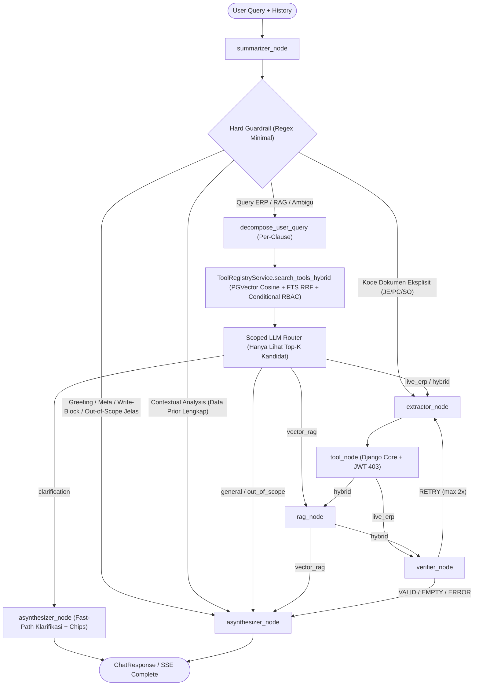

# Blueprint Arsitektur & Implementation Plan: Modernisasi NLU `erp-langgraph`

Dokumen ini merangkum seluruh keputusan desain dari sesi `/grill-me` dan menjabarkannya menjadi rencana implementasi 4 fase untuk mengganti ketergantungan pada 2.200+ baris regex di [router.py](file:///C:/laragon/www/erp-langgraph/app/graph/nodes/router.py) dengan arsitektur **Hybrid Semantic Retrieval + Scoped LLM NLU Router + Conservative Disambiguation**.

---

## 1. Ringkasan Keputusan Arsitektur

| Dimensi | Keputusan Final |
| :--- | :--- |
| **Arsitektur Inti NLU** | Minimal Hard-Guardrail Regex → Hybrid PGVector Top-K Retrieval (`ToolRegistryService`) → Scoped LLM Router (`MultiRouterDecision`) |
| **Struktur Pipeline** | Tetap pisah `Router → Extractor` (`extractor.py` + Tier-1 fast-path + multi-company scoping + `verifier → extractor` retry loop tetap utuh) |
| **Infrastruktur Runtime** | PostgreSQL + PGVector aktif di production + LLM utama berbayar/stabil (`gpt-4o-mini` / `gemini-2.5-flash`) + in-memory hybrid fallback saat offline/unit test |
| **Indexing & Retrieval** | Enriched Tool Card (`description` + `keywords` + 3–5 contoh kalimat natural/singkatan + `negative_hints`) + Hybrid Search (PGVector Cosine + PostgreSQL FTS RRF) + per-clause retrieval lewat [router_decomposer.py](file:///C:/laragon/www/erp-langgraph/app/graph/nodes/router_decomposer.py) |
| **Kebijakan RBAC Retrieval** | Conditional RBAC: filter `required_permission` di PGVector hanya saat `user_roles` terverifikasi (`X-Internal-Service-Key`) dikirim; jika kosong, tampilkan seluruh tool read-only dan serahkan otorisasi final ke Django Core JWT (`HTTP 403`) |
| **Kebijakan Klarifikasi** | Konservatif: berhenti dan bertanya hanya jika intent bentrok antar-tool yang berbeda makna atau objek wajib kosong (cabang & periode tetap memakai default sesi) |
| **Kontrak API & UX Klarifikasi** | Zero breaking change: reuse `final_answer` + `suggested_followups` chips (`{label, query, icon}`) + metadata opsional `needs_clarification` / `query_mode="clarification"` |
| **Strategi Rollout** | Feature flag `NLU_ROUTER_MODE` (`legacy_regex` \| `semantic_llm` \| `shadow`) + Golden Eval benchmark sebelum cleanup regex legacy |

---

## 2. Alur Arsitektur Target



### Batasan Hard Guardrail Regex (Yang Dipertahankan di `router.py`)
Regex routing yang tersisa di jalur `semantic_llm` dibatasi hanya pada 4 kategori deterministik berisiko nol:
1. **Pure Greeting & Help / Session Meta**: `is_pure_greeting`, `is_general_help_inquiry`, `is_meta_question` (hemat biaya LLM & latency < 5ms).
2. **Write-Operation & Out-of-Scope Hard Block**: `MARKETPLACE_WRITE_PATTERNS` (saat bukan pertanyaan diagnostik), mutasi data ERP terlarang, serta topik non-ERP eksplisit.
3. **Strict Document Identifier Fast-Path**: Nomor dokumen terstruktur seperti `JE/2026/...`, `PC/2026/...`, `WH/OUT/...`, `[A-Z]+/SO/\d+` yang pemetaan tool-nya 100% deterministik.
4. **Contextual Analysis Short-Circuit**: `_try_route_contextual_analysis` untuk pertanyaan lanjutan analitis (*"kenapa naik?"*, *"jelaskan selisihnya"*) yang tidak mengubah cabang, periode, atau tool.

---

## 3. Desain Detail per Komponen

### 3.1 Enriched Tool Catalog & Hybrid Search PGVector
Target file: [tool_registry_service.py](file:///C:/laragon/www/erp-langgraph/app/services/tool_registry_service.py), [seed_tools.py](file:///C:/laragon/www/erp-langgraph/app/scripts/seed_tools.py), [config.py](file:///C:/laragon/www/erp-langgraph/app/core/config.py).

#### A. Struktur Enriched Tool Definition
Setiap entri di `CORE_TOOL_DEFINITIONS` diperkaya dengan dua field baru:
- `sample_queries: List[str]` — 3–5 contoh kalimat user bahasa Indonesia natural, singkatan ERP, dan parafrase umum (misal untuk `get_kilat_order_diagnostics`: `["cek pesanan kilat nyangkut", "reservasi kilat belum update invoice", "duplikat draft kilat shopee"]`).
- `negative_hints: str` — batasan eksplisit kapan tool **tidak boleh** dipakai (misal pada `fetch_vendor_invoices`: `"Bukan untuk tagihan/piutang pelanggan (customer) atau sales order"`).

Teks gabungan (`embedding_text`) yang di-embed ke 768-dim `gemini-embedding-001` sekaligus diindeks untuk Full-Text Search:
```text
Tool: {tool_name} ({domain})
Deskripsi: {description}
Kata Kunci: {', '.join(keywords)}
Contoh Pertanyaan: {' | '.join(sample_queries)}
Bukan Untuk: {negative_hints}
```

#### B. Migrasi Skema Tabel `ai_tool_catalog`
Tambahkan kolom idempoten (`ALTER TABLE ... ADD COLUMN IF NOT EXISTS`) di `initialize_catalog()`:
- `search_text TEXT` — menyimpan `embedding_text` tergabung (sekaligus dipakai untuk deteksi perubahan saat seeding incremental).
- `search_tsv tsvector GENERATED ALWAYS AS (to_tsvector('simple', coalesce(search_text, ''))) STORED` — memakai dictionary `'simple'` agar istilah campuran Indonesia, Inggris, dan akronim ERP (`PCLS`, `AWB`, `SLA`, `HPP`, `SO`, `COA`) tidak rusak oleh stemming bahasa Inggris.
- `GIN` index pada `search_tsv` mendampingi `HNSW` index pada `embedding`.

#### C. Query Hybrid Search (Reciprocal Rank Fusion / RRF) + Conditional RBAC
1. **Conditional RBAC (`enforce_rbac: bool`)**:
   - Ditentukan dari keberadaan `user_roles` terverifikasi:
     - Jika `user_roles` non-empty (sudah melewati validasi `X-Internal-Service-Key` di [main.py](file:///C:/laragon/www/erp-langgraph/app/main.py#L250-L255)), filter `required_permission IS NULL OR required_permission = ANY($roles) OR 'admin' = ANY($roles)`.
     - Jika `user_roles` kosong / `None`, **jangan sembunyikan** tool ber-permission; tampilkan semua tool read-only (`is_write = FALSE`) dan serahkan penegakan izin ke Django Core JWT (`HTTP 403`).
2. **RRF Scoring (`k = 60`)**:
   - CTE `vec_ranked`: top-15 kandidat berdasarkan `embedding <=> $query_vec` (`distance <= TOOL_RETRIEVAL_DISTANCE_THRESHOLD`, default dilonggarkan ke `0.72` agar recall terjaga sebelum disaring LLM).
   - CTE `fts_ranked`: top-15 kandidat berdasarkan `ts_rank_cd(search_tsv, websearch_to_tsquery('simple', $query))` atau kecocokan keyword `ILIKE` untuk akronim pendek (`so`, `gl`, `ap`, `ar`).
   - Skor akhir: `rrf_score = COALESCE(1.0 / (60 + vec_rank), 0) + COALESCE(1.0 / (60 + fts_rank), 0)`.
   - Kembalikan Top-K (`TOOL_RETRIEVAL_TOP_K = 8` default pada mode `semantic_llm`) lengkap dengan `description`, `negative_hints`, `domain`, `rrf_score`, dan `distance`.
3. **Per-Clause Retrieval untuk Multi-Intent**:
   - Jika `decompose_user_query(eff_query)` menghasilkan > 1 klausa, jalankan `search_tools_hybrid()` secara paralel (`asyncio.gather`) per klausa, lalu deduplikasi `tool_name` (pertahankan skor tertinggi, maksimal ~12 kandidat gabungan untuk prompt LLM Router).
4. **In-Memory Fallback (Offline / Unit Test)**:
   - Perbarui `search_tools_fallback()` agar juga menghitung skor dari `sample_queries` + `keywords` + `description` dengan Conditional RBAC yang sama, sehingga perilaku offline tetap konsisten.

---

### 3.2 Scoped LLM Router & Conservative Disambiguation
Target file: [router.py](file:///C:/laragon/www/erp-langgraph/app/graph/nodes/router.py), [state.py](file:///C:/laragon/www/erp-langgraph/app/graph/state.py), [workflow.py](file:///C:/laragon/www/erp-langgraph/app/graph/workflow.py).

#### A. Perluasan Schema `MultiRouterDecision`
Tambahkan dukungan eksplisit untuk mode `clarification`:

```python
class ClarificationOption(BaseModel):
    label: str = Field(..., description="Label chip singkat 2-5 kata tanpa emoji")
    query: str = Field(..., description="Prompt lengkap dan spesifik yang langsung bisa dieksekusi saat diklik")
    icon: str = Field(default="fa-arrow-right")

class MultiRouterDecision(BaseModel):
    domain: Literal[
        "accounting", "inventory", "sales", "marketplace",
        "knowledge", "general", "out_of_scope", "clarification"
    ]
    query_mode: Literal[
        "live_erp", "vector_rag", "hybrid", "general",
        "out_of_scope", "contextual_analysis", "clarification"
    ]
    tool: Optional[str] = None
    planned_tools: List[PlannedToolCall] = Field(default_factory=list)
    rag_query: Optional[str] = None
    needs_clarification: bool = False
    clarification_question: Optional[str] = Field(
        None,
        description="Pertanyaan klarifikasi singkat (1-2 kalimat, Bahasa Indonesia) saat intent bentrok antar-tool atau objek wajib tidak ada."
    )
    clarification_options: List[ClarificationOption] = Field(
        default_factory=list,
        description="2 hingga 4 opsi jawaban spesifik yang dapat langsung diklik user."
    )
    reasoning: Optional[str] = None
```

#### B. Prompt Dinamis Berbasis Top-K Kandidat
Alih-alih hardcode 36 deskripsi tool di [router.py](file:///C:/laragon/www/erp-langgraph/app/graph/nodes/router.py#L1724-L1751), system prompt Scoped LLM Router dirakit dinamis dari hasil retrieval:
1. Daftar Top-K kandidat tool (hanya `tool_name`, `domain`, `description`, `negative_hints`, dan daftar nama parameter utamanya — bukan seluruh JSON schema).
2. Aturan **Conservative Disambiguation**:
   - Set `query_mode="clarification"` dan `needs_clarification=True` **HANYA** jika:
     - Query bentrok kuat antara >= 2 kandidat tool berbeda makna (contoh: *"cek order minggu ini"* → `get_sales_orders` vs `get_marketplace_orders`; *"cek mutasi bulan ini"* → `get_stock_history` vs `get_general_ledger`; *"cek tagihan X"* tanpa konteks vendor vs pelanggan).
     - Tool yang dimaksud membutuhkan identifier/objek wajib yang tidak disebutkan di query maupun di `history` (contoh: *"cek kartu stok"* atau *"bandingkan harga produk"* tanpa SKU/nama produk).
   - **DILARANG** meminta klarifikasi hanya karena cabang/company atau tanggal tidak disebutkan — sistem selalu memakai default `company_id` sesi dan periode default tool.
   - Jika `history` sudah memuat jawaban klarifikasi dari turn sebelumnya (user membalas *"yang marketplace"* atau klik chip), langsung selesaikan ke tool target tanpa bertanya ulang.
3. Validator Pydantic `reconcile_and_clean_tools()`:
   - Jika `query_mode == "clarification"` atau `needs_clarification == True`, paksa `tool = None`, `planned_tools = []`, pastikan `clarification_question` tidak kosong, dan batasi `clarification_options` maksimal 4 item (tanpa emoji).
   - Validasi setiap `planned_tools[i].tool` tetap terdaftar di `TOOL_DOMAIN_MAP` atau `ToolRegistryService`.

#### C. Perubahan `AgentState`, `workflow.py`, `synthesizer.py`, & `chat.py`
1. **[state.py](file:///C:/laragon/www/erp-langgraph/app/graph/state.py)**:
   - Perluas `QueryMode` dengan `"clarification"`.
   - Perluas `VerificationStatus` dengan `"CLARIFICATION"` (atau tetap opsional melalui `needs_clarification: Optional[bool]`).
   - Tambah field di `AgentState`:
     - `needs_clarification: Optional[bool]`
     - `clarification_question: Optional[str]`
     - `clarification_options: Optional[List[Dict[str, str]]]`
2. **[workflow.py](file:///C:/laragon/www/erp-langgraph/app/graph/workflow.py#L44-L98)**:
   - Di `decide_after_router(state)`: tambahkan short-circuit paling awal `if query_mode == "clarification" or state.get("needs_clarification"): return "synthesizer"`.
3. **[synthesizer.py](file:///C:/laragon/www/erp-langgraph/app/graph/nodes/synthesizer.py#L2124-L2200)**:
   - Saat `query_mode == "clarification"`:
     - Gunakan `clarification_question` langsung sebagai `final_answer` (zero extra LLM call di synthesizer).
     - Petakan `clarification_options` ke `suggested_followups` (luluskan melalui sanitizer no-emoji & schema `FollowupSuggestion`).
     - Dispatch SSE `token` secara langsung (`< 10ms`) dan simpan `AIMessage(content=clarification_question)` ke `messages` agar turn berikutnya membaca konteks klarifikasi secara stateless lewat `ChatRequest.history`.
4. **[chat.py](file:///C:/laragon/www/erp-langgraph/app/schemas/chat.py#L63-L96)** & **[main.py](file:///C:/laragon/www/erp-langgraph/app/main.py#L259-L286)**:
   - Tambah field opsional backward-compatible di `ChatResponse`: `needs_clarification: bool = False`.
   - Frontend lama tetap menerima `final_answer` + `suggested_followups` chips seperti biasa; frontend baru bisa memakai `needs_clarification` untuk styling khusus bila diinginkan.

---

### 3.3 Feature Flag & Shadow Evaluation
Target file: [config.py](file:///C:/laragon/www/erp-langgraph/app/core/config.py), [router.py](file:///C:/laragon/www/erp-langgraph/app/graph/nodes/router.py).

Tambahkan konfigurasi di `Settings`:
```python
NLU_ROUTER_MODE: str = Field(
    default="legacy_regex",  # "legacy_regex" | "semantic_llm" | "shadow"
    validation_alias="NLU_ROUTER_MODE",
)
NLU_SHADOW_LOG_MISMATCH_ONLY: bool = Field(
    default=True,
    validation_alias="NLU_SHADOW_LOG_MISMATCH_ONLY",
)
TOOL_RETRIEVAL_TOP_K: int = Field(default=8, validation_alias="TOOL_RETRIEVAL_TOP_K")
TOOL_RETRIEVAL_DISTANCE_THRESHOLD: float = Field(default=0.72, validation_alias="TOOL_RETRIEVAL_DISTANCE_THRESHOLD")
```

Perilaku tiap mode:
- `legacy_regex` (default awal selama transisi): perilaku 100% identik saat ini; semua 44 unit test module tetap lulus tanpa perubahan.
- `shadow`: eksekusi `legacy_regex` untuk jawaban user, sekaligus jalankan `semantic_llm` secara async di background (`asyncio.create_task` dengan timeout & silent error catch) untuk mencatat log structured diff (`legacy_tools` vs `semantic_tools`, `needs_clarification`, `latency_ms`) tanpa berdampak pada respons user.
- `semantic_llm`: jalur NLU baru aktif sebagai primary router (fallback otomatis ke `legacy_regex` hanya jika LLM & retrieval sama-sama gagal/offline di production).

---

## 4. Rencana Implementasi Bertahap (4 Fase)

### Fase 1 — Enriched Tool Catalog, Hybrid PGVector Search & Conditional RBAC
- **Scope File**:
  - [tool_registry_service.py](file:///C:/laragon/www/erp-langgraph/app/services/tool_registry_service.py): tambah `sample_queries` & `negative_hints` pada seluruh 36 tool di `CORE_TOOL_DEFINITIONS`; tambah kolom `search_text` + `search_tsv` (GIN index) di `initialize_catalog()`; implementasikan `search_tools_hybrid()` (PGVector Cosine + FTS RRF + Conditional RBAC) dan upgrade `search_tools_fallback()`.
  - [seed_tools.py](file:///C:/laragon/www/erp-langgraph/app/scripts/seed_tools.py): pastikan `--update-existing` menghitung ulang `search_text` & embedding bila `sample_queries`/`negative_hints` berubah.
  - [config.py](file:///C:/laragon/www/erp-langgraph/app/core/config.py): tambah `NLU_ROUTER_MODE`, `NLU_SHADOW_LOG_MISMATCH_ONLY`, dan update default `TOOL_RETRIEVAL_TOP_K` / `TOOL_RETRIEVAL_DISTANCE_THRESHOLD`.
- **Verifikasi Fase 1**:
  - Update & tambah unit test di [test_tool_registry.py](file:///C:/laragon/www/erp-langgraph/tests/test_tool_registry.py): RRF merging, Conditional RBAC (`user_roles=[]` vs `user_roles=["accounting.view_ledger"]` vs `["admin"]`), in-memory fallback, dan kelengkapan 36 tool card.
  - Jalankan `python -m app.scripts.seed_tools --dry-run` (dan `--update-existing` di environment PGVector).
  - Full suite: `.\.venv\Scripts\python.exe -m unittest discover tests`.

### Fase 2 — Scoped LLM Router, Conservative Disambiguation & API Contract
- **Scope File**:
  - [state.py](file:///C:/laragon/www/erp-langgraph/app/graph/state.py): tambah `clarification` ke `QueryMode`, `CLARIFICATION` ke `VerificationStatus`, serta field `needs_clarification`, `clarification_question`, `clarification_options`.
  - [router.py](file:///C:/laragon/www/erp-langgraph/app/graph/nodes/router.py) (atau modul baru `app/graph/nodes/router_semantic.py` agar kode terpisah bersih dari 2.244 baris legacy):
    - Implementasi pipeline `semantic_llm`: Minimal Hard-Guardrail → Per-Clause Hybrid Retrieval → Dynamic Scoped LLM `MultiRouterDecision` → Post-validation & clarification handling.
    - Integrasi dispatcher `NLU_ROUTER_MODE` (`legacy_regex` | `semantic_llm` | `shadow`) di `_arouter_node_impl` / `_router_node_impl`.
  - [workflow.py](file:///C:/laragon/www/erp-langgraph/app/graph/workflow.py): routing `query_mode == "clarification"` di `decide_after_router`.
  - [synthesizer.py](file:///C:/laragon/www/erp-langgraph/app/graph/nodes/synthesizer.py): fast-path rendering klarifikasi (`final_answer` + `suggested_followups` chips + SSE token dispatch tanpa LLM call tambahan).
  - [chat.py](file:///C:/laragon/www/erp-langgraph/app/schemas/chat.py) & [main.py](file:///C:/laragon/www/erp-langgraph/app/main.py): tambah field opsional `needs_clarification: bool = False` pada `ChatResponse` dan mapping di `_build_chat_response`.
- **Verifikasi Fase 2**:
  - Tambah test module baru `tests/test_semantic_nlu_router.py` mencakup: single-intent, multi-intent lintas domain, slang/parafrase, conservative clarification trigger, multi-turn lanjutan setelah user menjawab klarifikasi, hard-guardrail write/greeting/doc-id, dan mode `shadow` non-blocking.
  - Pastikan semua 44 test module existing + test baru 100% hijau.

### Fase 3 — Golden Eval Suite & Shadow Validation di Staging/Production
- **Scope File**:
  - Buat script evaluasi repeatable `scripts/eval_nlu_router.py` beserta dataset golden JSON (`tests/fixtures/nlu_golden_cases.json`) berisi ~80–120 kasus nyata yang dikumpulkan dari:
    - Seluruh kasus regresi QA (`test_qa_history_pass1/pass2_regressions.py`, `test_thread_*_regressions.py`).
    - Kasus bahasa informal/typo/singkatan ERP.
    - Kasus ambigu yang **wajib** trigger klarifikasi vs kasus normal yang **tidak boleh** trigger klarifikasi (cek *false-clarification rate*).
- **Kriteria Kelulusan (Exit Gate sebelum Cutover)**:
  - Retrieval Top-K Recall >= **98%** pada golden dataset.
  - Tool & Domain Routing Accuracy `semantic_llm` >= **95%** dan >= akurasi `legacy_regex`.
  - False-Clarification Rate (meminta klarifikasi pada query yang sebenarnya jelas) <= **3%**.
  - P95 tambahan latency tahap router <= **800ms** (dengan `gpt-4o-mini` / `gemini-2.5-flash`).
  - Zero regresi pada guardrail keamanan (write-block, out-of-scope, customer vs vendor billing).

### Fase 4 — Cutover Default & Cleanup Utang Regex Legacy
- **Scope**:
  - Ubah default `NLU_ROUTER_MODE` ke `"semantic_llm"`.
  - Setelah stabil di production (1–2 minggu tanpa insiden), hapus fungsi regex per-tool di [router.py](file:///C:/laragon/www/erp-langgraph/app/graph/nodes/router.py) dan [router_patterns.py](file:///C:/laragon/www/erp-langgraph/app/graph/nodes/router_patterns.py) yang tidak lagi menjadi hard guardrail.
  - Migrasikan test router offline yang tersisa agar menguji kontrak `router_semantic.py` (dengan mock LLM + in-memory hybrid retrieval) dan hapus dead code.
  - Jalankan `codegraph sync` dan full test suite.

---

## 5. Risiko Utama & Mitigasi

| Risiko | Mitigasi |
| :--- | :--- |
| **Recall miss pada jargon internal baru** | Kombinasi PGVector Cosine + FTS (`'simple'`) RRF + `sample_queries` + `top_k=8` per klausa. Tambah tool baru hanya butuh update `CORE_TOOL_DEFINITIONS` + `seed_tools.py`. |
| **Over-clarification membuat user kesal** | Aturan prompt eksplisit melarang klarifikasi cabang/tanggal + ukur *False-Clarification Rate* <= 3% di Golden Eval Fase 3. |
| **PGVector atau Gemini Embedding API gangguan sesaat** | Automatic graceful fallback ke in-memory hybrid keyword/token scorer di `ToolRegistryService` (`search_tools_fallback`) tanpa crash. |
| **LLM Router timeout atau rate-limit** | Memanfaatkan circuit-breaker multi-provider existing di [llm.py](file:///C:/laragon/www/erp-langgraph/app/services/llm.py) (`OpenAI → Gemini → OpenRouter`), dan selama masa transisi tersedia rollback instan via `NLU_ROUTER_MODE=legacy_regex`. |
