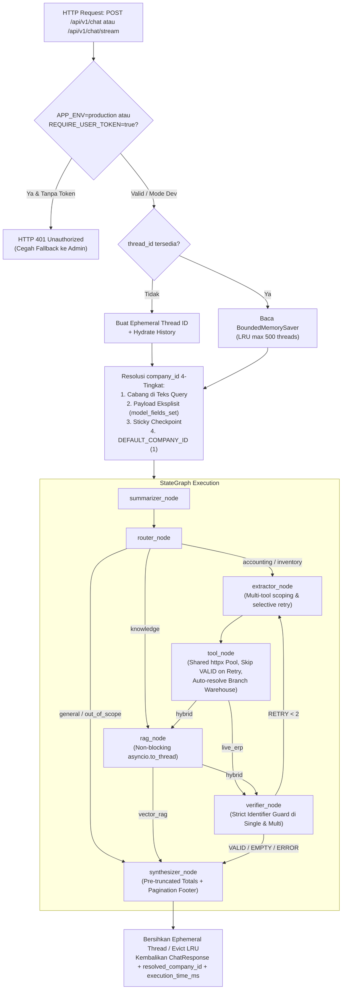

# Implementation Plan: Production-Ready FastPrint ERP AI Orchestrator

Dokumen ini berisi hasil audit teknis menyeluruh dan spesifikasi implementasi detail yang telah diselaraskan dengan seluruh keputusan desain dari sesi `/grill-me`. **Status Progres: D1–D6 selesai diimplementasikan dan terverifikasi.**

---

## 1. Ringkasan Keputusan Desain Hasil `/grill-me`

| # | Area Arsitektur | Status | Keputusan yang Dikunci |
|---|---|---|---|
| **D1** | **Session State & Checkpointer** | **DONE** | **Bounded LRU In-Memory Checkpointer + Stateless History Hydration**. Request tanpa `thread_id` memakai ephemeral ID unik (bebas tabrakan `"default_session"`), otomatis menghidrasi `history`, dan jumlah sesi di RAM dibatasi (`MAX_CHECKPOINT_THREADS=500`) agar bebas OOM. |
| **D2** | **Kebijakan Autentikasi API** | **DONE** | **Strict User JWT di Production**. Mendukung pengambilan token dari body `user_token` maupun header `Authorization: Bearer <token>`. Saat `APP_ENV=production` atau `REQUIRE_USER_TOKEN=true`, endpoint `/api/v1/chat` & `/api/v1/chat/stream` **wajib** memiliki `user_token` (menolak fallback diam-diam ke akun admin/sistem agar RBAC Django ditegakkan). CLI (`cli.py`) dan mode dev/test tetap diizinkan memakai fallback token sistem. |
| **D3** | **Prioritas `company_id` Multi-Turn** | **DONE** | Urutan prioritas tegas: **(1)** Nama cabang eksplisit di teks query (`resolve_branch_company_id`) $\rightarrow$ **(2)** `company_id` eksplisit di payload JSON API (`"company_id" in payload.model_fields_set`, termasuk jika bernilai `1`) $\rightarrow$ **(3)** Sticky `company_id` dari checkpoint turn sebelumnya $\rightarrow$ **(4)** `DEFAULT_COMPANY_ID` (`1`). Berlaku identik di `arun_workflow` dan `astream_workflow_steps`. |
| **D4** | **Kontrak API & Streaming** | **DONE** | Tambahkan endpoint SSE **`POST /api/v1/chat/stream`** untuk progres node real-time, serta tambahkan 2 field opsional pada `ChatResponse`: `resolved_company_id: Optional[int]` dan `execution_time_ms: Optional[float]`. |
| **D5** | **Akurasi Kalkulasi > 50 Baris** | **DONE** | Hitung agregat penuh (`total_amount`, `total_paid`, `total_residual`, `overdue_count`) di `sanitize_erp_payload` **sebelum** list dipotong 50 baris, dan tampilkan catatan kaki paginasi (`*Menampilkan 50 dari N data...*`) pada tabel Markdown di `synthesizer_node`. |
| **D6** | **Query Stok Cabang Tanpa SKU** | **DONE** | Perbaiki regex `location_name` untuk frasa multi-kata (`"Gudang Cabang Jakarta"` $\rightarrow$ `"Jakarta"`). Jika user meminta stok cabang di teks query tanpa SKU (`"Stok barang di Cabang Bandung"`), otomatis cari `warehouse_id` cabang tersebut via `fetch_warehouses`. Jika query kosong tanpa produk/lokasi/cabang (`"Cek stok barang"`), langsung **fail-fast lokal** (`MISSING_PRODUCT_IDENTIFIER`) tanpa membuang HTTP request ke Django. |

---

## 2. Daftar Temuan Audit yang Diselesaikan

1. **[DONE - D1]** **Cross-User State Leakage pada `"default_session"`** ([workflow.py](file:///C:/laragon/www/erp-langgraph/app/graph/workflow.py#L332-L465)): Semua request dengan `thread_id=None` berbagi state yang sama dan gagal menghidrasi `history` setelah request pertama.
2. **[DONE - D3]** **Jebakan `company_id=1` pada Multi-Turn** ([workflow.py](file:///C:/laragon/www/erp-langgraph/app/graph/workflow.py#L332-L413), [main.py](file:///C:/laragon/www/erp-langgraph/app/main.py#L120-L128)): User tidak bisa kembali ke Kantor Pusat (`company_id=1`) setelah sebelumnya bertanya tentang cabang lain (`company_id=6`).
3. **[DONE - D5]** **Salah Hitung Total Hutang Vendor (`get_vendor_bills` > 50 baris)** ([context.py](file:///C:/laragon/www/erp-langgraph/app/core/context.py#L75-L212), [synthesizer.py](file:///C:/laragon/www/erp-langgraph/app/graph/nodes/synthesizer.py#L55-L345)): `sanitize_erp_payload` kini menghitung `calculations` penuh dan menyimpan `total_count`/`total_found` sebelum memotong list ke `max_records=50`, dan `synthesizer_node` memakai agregat tersebut beserta catatan kaki paginasi.
4. **[PENDING]** **Re-eksekusi Tool Valid & Absennya Identifier Guard di Multi-Tool Retry** ([verifier.py](file:///d:/erp-fastprint/erp-langgraph/app/graph/nodes/verifier.py#L236-L255), [extractor.py](file:///d:/erp-fastprint/erp-langgraph/app/graph/nodes/extractor.py#L1235-L1237)): Saat 1 dari 2 tool kosong, tool yang sudah `VALID` ikut dipanggil ulang ke Django, nomor dokumen spesifik tidak di-guard di multi-tool, dan `branch_co_id` hanya masuk ke `active_tools[0]`.
5. **[DONE - D6]** **Regex Lokasi Satu Kata & Gagal Resolve Stok Cabang** ([extractor.py](file:///C:/laragon/www/erp-langgraph/app/graph/nodes/extractor.py#L341-L407), [tool_node.py](file:///C:/laragon/www/erp-langgraph/app/graph/nodes/tool_node.py#L100-L147)): `_fallback_extract_stock_level` kini mendukung frasa multi-kata dengan pemangkasan awalan cabang/toko/kantor, `_is_pure_branch_token` mencegah token cabang bocor ke `code`/`search`, serta `tool_node` otomatis resolve `warehouse_id` via `fetch_warehouses` untuk cabang eksplisit atau langsung fail-fast `MISSING_PRODUCT_IDENTIFIER` bila query kosong tanpa identifier.
6. **[PENDING]** **Timezone Drift UTC vs WIB (`Asia/Jakarta`)** ([extractor.py](file:///d:/erp-fastprint/erp-langgraph/app/graph/nodes/extractor.py#L163), [django_client.py](file:///d:/erp-fastprint/erp-langgraph/app/services/django_client.py#L140)): `date.today()` dan `datetime.now()` mengikuti jam OS container (UTC), menyebabkan melesetnya tanggal `"hari ini"` / `"bulan ini"` pada pukul 00:00–07:00 WIB dan gagalnya MD5 key login ke ERP.
7. **[PENDING]** **Blocking Event Loop & Per-Request HTTP Client/Login** ([vector_service.py](file:///d:/erp-fastprint/erp-langgraph/app/services/vector_service.py#L131), [tool_node.py](file:///d:/erp-fastprint/erp-langgraph/app/graph/nodes/tool_node.py#L144)): `embed_content()` berjalan sinkron di dalam `async def`, serta `DjangoCoreClient` selalu membuat `httpx.AsyncClient` baru dan login ulang di setiap turn.
8. **[PARTIAL: Checkpointer LRU DONE (D1), Lifespan Cleanup PENDING]** **Unbounded RAM Checkpointer & Lifespan Leak** ([workflow.py](file:///C:/laragon/www/erp-langgraph/app/graph/workflow.py#L285-L329), [main.py](file:///d:/erp-fastprint/erp-langgraph/app/main.py#L20-L28)): `MemorySaver` tumbuh tanpa batas di RAM, dan shutdown FastAPI tidak menutup pool `asyncpg` / `httpx`.

---

## 3. Arsitektur Alur Eksekusi Target



---

## 4. Rincian Perubahan Kode per Komponen (Proposed Changes)

### Phase 1: Konfigurasi, Timezone WIB, & Akurasi Sanitasi Payload

#### [MODIFY] [config.py](file:///C:/laragon/www/erp-langgraph/app/core/config.py)
- **[DONE - D1]** `MAX_CHECKPOINT_THREADS: int = Field(default=500, validation_alias="MAX_CHECKPOINT_THREADS")` sudah ditambahkan di [config.py](file:///C:/laragon/www/erp-langgraph/app/core/config.py#L24).
- **[DONE - D2]** `REQUIRE_USER_TOKEN` dan `REQUIRE_SERVICE_KEY` sudah ditambahkan di [config.py](file:///C:/laragon/www/erp-langgraph/app/core/config.py#L22-L23).
- **[PENDING - Timezone]** Tambahkan pengaturan zona waktu operasional `APP_TIMEZONE`:
```python
<<<<<<< SEARCH
    # 0. Service Configuration
    APP_NAME: str = "erp-ai-orchestrator"
    APP_ENV: str = "development"
    APP_HOST: str = "0.0.0.0"
    APP_PORT: int = 8002
    LOG_LEVEL: str = "info"
=======
    # 0. Service Configuration
    APP_NAME: str = "erp-ai-orchestrator"
    APP_ENV: str = "development"
    APP_HOST: str = "0.0.0.0"
    APP_PORT: int = 8002
    LOG_LEVEL: str = "info"
    APP_TIMEZONE: str = Field(default="Asia/Jakarta", validation_alias="APP_TIMEZONE")
    REQUIRE_USER_TOKEN: bool = Field(default=False, validation_alias="REQUIRE_USER_TOKEN")
    REQUIRE_SERVICE_KEY: bool = Field(default=False, validation_alias="REQUIRE_SERVICE_KEY")
    MAX_CHECKPOINT_THREADS: int = Field(default=500, validation_alias="MAX_CHECKPOINT_THREADS")
>>>>>>> REPLACE
```

#### [MODIFY] [context.py](file:///d:/erp-fastprint/erp-langgraph/app/core/context.py)
Tambahkan helper `get_current_erp_date()` berbasis `ZoneInfo(settings.APP_TIMEZONE)` dan pre-kalkulasi agregat pada `sanitize_erp_payload()` sebelum memotong list menjadi `max_records=50`:
```python
<<<<<<< SEARCH
from datetime import date
import re
from typing import Any, Dict, List, Optional, Set
from langchain_core.messages import BaseMessage, SystemMessage, HumanMessage, AIMessage
=======
from datetime import date, datetime
import re
from typing import Any, Dict, List, Optional, Set
from zoneinfo import ZoneInfo
from langchain_core.messages import BaseMessage, SystemMessage, HumanMessage, AIMessage

from app.core.config import settings


def get_current_erp_date() -> date:
    """Return current date in configured ERP timezone (default Asia/Jakarta WIB)."""
    try:
        return datetime.now(ZoneInfo(settings.APP_TIMEZONE)).date()
    except Exception:
        return date.today()
>>>>>>> REPLACE
```
Di dalam `sanitize_erp_payload(data: Any, max_records: int = 50)` (**[DONE - D5]** di [context.py](file:///C:/laragon/www/erp-langgraph/app/core/context.py#L100-L212)):
- Jika `data` adalah `dict` yang memiliki list `"bills"` non-kosong dan belum memiliki `"calculations"`, `_compute_bills_calculations` menghitung `total_amount`, `total_paid`, `total_residual`, dan `overdue_count` dari **seluruh** item di `data["bills"]` sebelum `bills` dipotong ke `max_records`, lalu menyimpannya ke `sanitized_dict["calculations"]`.
- Jika panjang list pada key koleksi (`"bills"`, `"entries"`, `"accounts"`, `"products"`, `"locations"`, `"history"`, `"transfers"`, `"alerts"`, `"adjustments"`, `"scraps"`) melebihi `max_records`, jumlah asli disimpan di `sanitized_dict["total_count"]` (atau `total_found` untuk `locations`/`alerts`) bila belum ada sehingga `synthesizer_node` mengetahui jumlah total baris sebelum pemotongan.

---

### Phase 2: Perbaikan Hidden Bugs pada Pipeline Nodes (`extractor`, `tool_node`, `verifier`, `synthesizer`)

#### [MODIFY] [extractor.py](file:///d:/erp-fastprint/erp-langgraph/app/graph/nodes/extractor.py)
1. **Gunakan `get_current_erp_date()`**: Ganti `today = ref_date or date.today()` di `resolve_relative_dates` dan `extractor_node` dengan `today = ref_date or get_current_erp_date()`.
2. **[DONE - D6] Perbaikan Regex `location_name` untuk `"Gudang Cabang <Kota>"`**:
   Pada `_fallback_extract_stock_level`:
   ```python
   <<<<<<< SEARCH
       loc_match = re.search(
           r"(?:\bdi\s+(?:gudang\s+|lokasi\s+)?|\b(?:gudang|lokasi)\s+)([A-Za-z0-9\_\-]+)",
           cleaned,
           re.IGNORECASE,
       )
       if loc_match:
           loc_candidate = loc_match.group(1).strip()
           if (
               loc_candidate.lower() not in ("mana", "sini", "situ", "kantor", "semua", "ini", "itu", "gudang", "lokasi")
               and loc_candidate.lower() not in STOCK_STOPWORDS
           ):
               params["location_name"] = loc_candidate
   =======
       loc_match = re.search(
           r"(?:\bdi\s+(?:gudang\s+|lokasi\s+)?|\b(?:gudang|lokasi)\s+)(?:cabang\s+|toko\s+|kantor\s+)?([A-Za-z0-9\_\-]+(?:\s+[A-Za-z0-9\_\-]+)?)",
           cleaned,
           re.IGNORECASE,
       )
       if loc_match:
           raw_loc = loc_match.group(1).strip()
           loc_words = [
               w for w in raw_loc.split()
               if w.lower() not in ("mana", "sini", "situ", "kantor", "semua", "ini", "itu", "gudang", "lokasi", "cabang", "saat", "sekarang")
               and w.lower() not in STOCK_STOPWORDS
           ]
           if loc_words:
               params["location_name"] = " ".join(loc_words)
   >>>>>>> REPLACE
   ```
3. **Selective Multi-Tool Extraction saat Retry & Propagasi `branch_co_id` ke Semua Tool**:
   - Di `extractor_node`, jika `retry_count > 0` dan sebuah `plan` di `working_active_tools` sudah memiliki `plan.get("status") == "success"` serta `multi_verification_status.get(key) == "VALID"`, pertahankan `plan["params"]` yang sudah berhasil tanpa merelaksasi filternya.
   - Saat `branch_co_id` terdeteksi dari `user_query`, injeksikan `company_id = branch_co_id` ke **semua** item di `working_active_tools` yang belum memiliki `company_id` cabang spesifik:
   ```python
   <<<<<<< SEARCH
       if branch_co_id is not None:
           result_update["company_id"] = branch_co_id
           if working_active_tools:
               working_active_tools[0].setdefault("params", {})["company_id"] = branch_co_id
               primary_params["company_id"] = branch_co_id
   =======
       if branch_co_id is not None:
           result_update["company_id"] = branch_co_id
           for plan_item in working_active_tools:
               plan_params = plan_item.setdefault("params", {})
               if not plan_params.get("company_id") or plan_params.get("company_id") == state.get("company_id"):
                   plan_params["company_id"] = branch_co_id
           primary_params["company_id"] = branch_co_id
   >>>>>>> REPLACE
   ```

#### [MODIFY] [tool_node.py](file:///d:/erp-fastprint/erp-langgraph/app/graph/nodes/tool_node.py)
1. **[DONE - D6] Auto-Resolve `warehouse_id` untuk Query Stok Cabang Tanpa SKU & Fail-Fast Lokal untuk Query Kosong**:
   Di `_execute_single_tool` untuk `tool_name == "get_stock_level"`:
   - Jika tidak ada `product_id`, `code`, `codes`, `product_ids`, `warehouse_id`, `location_id`, maupun `location_name`:
     - Cek apakah user menyebut nama cabang secara eksplisit (`has_explicit_branch`). Jika ya, panggil `erp_client.fetch_warehouses(params={}, user_token=user_token, company_id=target_company_id)` dan gunakan `warehouses[0]["id"]` sebagai `warehouse_id`.
     - Jika tidak ada cabang eksplisit (misal user hanya mengetik *"cek stok barang"*), langsung kembalikan `(None, "MISSING_PRODUCT_IDENTIFIER: Mohon sertakan kode SKU, nama produk, atau nama gudang/cabang.")` tanpa memanggil endpoint `/ai/tools/inventory/get_stock_level/`.
2. **Skip Re-Execution untuk Tool yang Sudah `VALID` pada Multi-Tool Retry**:
   Di `tool_node` Path A (`is_multi_tool and active_tools`), jika `state.get("retry_count", 0) > 0` dan `plan` sudah berstatus `"success"` dengan `state.get("multi_verification_status", {}).get(key) == "VALID"` serta memiliki `plan.get("result")`, gunakan langsung hasil tersebut tanpa menjadwalkan request HTTP ulang ke Django.

#### [MODIFY] [verifier.py](file:///d:/erp-fastprint/erp-langgraph/app/graph/nodes/verifier.py)
Tambahkan **Strict Identifier Guard** pada Path A (Multi-Tool) agar tool yang mencari nomor dokumen spesifik (`entry_number` atau pola `JE/2026/...`) dan menghasilkan 0 record tidak memicu siklus retry yang merusak filter:
```python
<<<<<<< SEARCH
                if cnt > 0:
                    per_tool_status[key] = "VALID"
                    has_valid_tool = True
                else:
                    per_tool_status[key] = "EMPTY"
                    has_empty_tool = True
=======
                if cnt > 0:
                    per_tool_status[key] = "VALID"
                    has_valid_tool = True
                else:
                    per_tool_status[key] = "EMPTY"
                    plan_params = (active_tools[idx].get("params") or {}) if idx < len(active_tools) else {}
                    is_strict_doc = bool(
                        plan_params.get("entry_number")
                        or (
                            plan_params.get("search")
                            and re.search(r"\b(?:[A-Za-z0-9_\-]+/)+\d{4}/\d+\b", str(plan_params["search"]))
                        )
                    )
                    if not is_strict_doc:
                        has_empty_tool = True
>>>>>>> REPLACE
```

#### [MODIFY] [synthesizer.py](file:///C:/laragon/www/erp-langgraph/app/graph/nodes/synthesizer.py)
1. **[DONE - D5]** **Gunakan Pre-Truncated Calculations pada `get_vendor_bills`**:
   Diimplementasikan di [synthesizer.py](file:///C:/laragon/www/erp-langgraph/app/graph/nodes/synthesizer.py#L308-L353): jika `tool_result.get("calculations")` tersedia, `get_vendor_bills` memakai `calculations["total_amount"]`, `calculations["total_residual"]`, dan `calculations["overdue_count"]` untuk **Ringkasan Hutang Dagang (AP)**.
2. **[DONE - D5]** **Catatan Kaki Paginasi Otomatis**:
   Diimplementasikan melalui `_extract_total_count` dan `_append_pagination_footer` ([synthesizer.py](file:///C:/laragon/www/erp-langgraph/app/graph/nodes/synthesizer.py#L55-L71)) pada seluruh tabel koleksi (`get_vendor_bills`, `fetch_vendor_invoices`, `get_journal_entries`, `get_account_balance`, `get_stock_level`, `get_product_info`, `get_locations`, `get_stock_history`, `get_transfers`, `get_low_stock_alerts`, `get_stock_adjustments`, `get_scrap_records`, `get_warehouses`, `get_product_categories`).

---

### Phase 3: Shared Connection Pool, Caching Token Sistem, & Non-Blocking Embedding

#### [MODIFY] [django_client.py](file:///C:/laragon/www/erp-langgraph/app/services/django_client.py) & [erp_client.py](file:///d:/erp-fastprint/erp-langgraph/app/services/erp_client.py)
1. **[PENDING]** **Shared `httpx.AsyncClient` Pool & System Token Cache**:
   - Sediakan pool `httpx.AsyncClient` tingkat modul (diikat ke event loop yang sedang aktif agar aman bagi test runner yang berganti loop) serta fungsi `aclose_shared_django_client()` untuk lifespan shutdown.
   - Simpan token hasil `login()` sistem di variabel cache modul (`_CACHED_SYSTEM_TOKEN`) yang dilindungi `asyncio.Lock()` sehingga `DjangoCoreClient()` baru tanpa `token` langsung memakai token sistem yang sudah di-cache tanpa login berulang setiap request.
2. **[DONE - D2]** **Strict User Token Guard (`require_user_token`)**:
   - Parameter `require_user_token: bool = False` sudah ditambahkan pada `DjangoCoreClient` ([django_client.py](file:///C:/laragon/www/erp-langgraph/app/services/django_client.py#L116)), memblokir fallback ke `self.token` atau `self.login()` dengan `DjangoAuthError(..., status_code=401)` saat `user_token` kosong, serta diteruskan dari [tool_node.py](file:///C:/laragon/www/erp-langgraph/app/graph/nodes/tool_node.py#L144) dan [rag_node.py](file:///C:/laragon/www/erp-langgraph/app/graph/nodes/rag_node.py#L63).
3. **[PENDING]** **Timezone-Aware MD5 Secret Key**:
   - Di `_generate_secret_key()` pada `DjangoCoreClient` dan `ERPClient`, gunakan `datetime.now(ZoneInfo(settings.APP_TIMEZONE)).strftime("%Y-%m-%d-%H:%M")`.

#### [MODIFY] [vector_service.py](file:///d:/erp-fastprint/erp-langgraph/app/services/vector_service.py)
Jalankan pemanggilan sinkron Google GenAI SDK `client.models.embed_content` di dalam thread worker menggunakan `await asyncio.to_thread(...)` agar tidak memblokir event loop FastAPI:
```python
<<<<<<< SEARCH
            response = client.models.embed_content(
                model=self.embedding_model,
                contents=text.strip(),
                config=config,
            )
=======
            response = await asyncio.to_thread(
                client.models.embed_content,
                model=self.embedding_model,
                contents=text.strip(),
                config=config,
            )
>>>>>>> REPLACE
```

---

### Phase 4: Bounded LRU Checkpointer, Isolasi Sesi, & Prioritas `company_id`

#### [MODIFY] [workflow.py](file:///C:/laragon/www/erp-langgraph/app/graph/workflow.py)
1. **[DONE - D1] Bounded LRU Eviction & Isolasi Ephemeral pada Checkpointer**:
   - Diimplementasikan di [workflow.py](file:///C:/laragon/www/erp-langgraph/app/graph/workflow.py#L217-L465) melalui `_prepare_workflow_execution`, `_touch_checkpoint_lru`, `_cleanup_ephemeral_thread`, dan `_enforce_checkpoint_lru_bound` berbasis `OrderedDict` + `WeakKeyDictionary` + `threading.Lock()`.
   - Request tanpa `thread_id` (atau whitespace) otomatis memakai ephemeral ID unik (`ephemeral_<uuid4>`), menghidrasi `history`, dan menghapus state ephemeral (`storage`, `writes`, `blobs`) di blok `finally` pada `arun_workflow` maupun `astream_workflow_steps`.
   - Request ber-`thread_id` dibatasi maksimal `settings.MAX_CHECKPOINT_THREADS` (default `500`) dengan eviksi LRU.
2. **[DONE - D3] Resolusi `company_id` 4-Tingkat & Sinkronisasi `arun_workflow` / `astream_workflow_steps`**:
   - Diimplementasikan melalui `_resolve_effective_company_id(...)` di [workflow.py](file:///C:/laragon/www/erp-langgraph/app/graph/workflow.py#L332-L364) dan digunakan bersama oleh `arun_workflow`, `astream_workflow_steps`, dan `run_workflow_sync` (`company_id_explicit` diteruskan dari [main.py](file:///C:/laragon/www/erp-langgraph/app/main.py#L125)).
   ```python
   def _resolve_effective_company_id(
       user_query: str,
       company_id: Optional[int],
       company_id_explicit: bool,
       checkpoint_values: Optional[Dict[str, Any]],
   ) -> int:
       # Prioritas 1: Nama cabang eksplisit di teks query saat ini
       from app.graph.nodes.extractor import resolve_branch_company_id
       branch_from_text = resolve_branch_company_id(user_query)
       if branch_from_text is not None:
           return branch_from_text

       # Prioritas 2: company_id dikirim secara eksplisit di payload API (termasuk company_id=1)
       if company_id_explicit and company_id is not None:
           return company_id

       # Prioritas 3: Sticky company_id dari checkpoint sesi sebelumnya
       if checkpoint_values and checkpoint_values.get("company_id"):
           return int(checkpoint_values["company_id"])

       # Prioritas 4: Fallback ke company_id argumen atau DEFAULT_COMPANY_ID
       return company_id if company_id is not None else settings.DEFAULT_COMPANY_ID
   ```
   *Catatan Kompatibilitas*: Jika `arun_workflow(user_query=..., company_id=6)` dipanggil langsung dari kode Python/unit test tanpa `company_id_explicit`, nilai `company_id != settings.DEFAULT_COMPANY_ID` otomatis dianggap eksplisit (`True`), sedangkan dari endpoint FastAPI `company_id_explicit = ("company_id" in payload.model_fields_set)`.

---

### Phase 5: FastAPI Security, SSE Streaming (`/api/v1/chat/stream`), & Observability

#### [MODIFY] [chat.py](file:///C:/laragon/www/erp-langgraph/app/schemas/chat.py)
- **[DONE - D4]** `resolved_company_id: Optional[int]` dan `execution_time_ms: Optional[float]` sudah ditambahkan ke `ChatResponse` ([chat.py](file:///C:/laragon/www/erp-langgraph/app/schemas/chat.py#L69-L76)).
```python
<<<<<<< SEARCH
    suggested_followups: Optional[List[FollowupSuggestion]] = Field(
        default_factory=list,
        description="Context-aware follow-up queries generated directly by AI provider"
    )
=======
    suggested_followups: Optional[List[FollowupSuggestion]] = Field(
        default_factory=list,
        description="Context-aware follow-up queries generated directly by AI provider"
    )
    resolved_company_id: Optional[int] = Field(
        default=None,
        description="Effective ERP company ID used for query execution (reflects branch switches)"
    )
    execution_time_ms: Optional[float] = Field(
        default=None,
        description="End-to-end workflow execution latency in milliseconds"
    )
>>>>>>> REPLACE
```

#### [MODIFY] [main.py](file:///C:/laragon/www/erp-langgraph/app/main.py)
1. **[PENDING]** **Lifespan Management**:
   - Simpan reference task `afetch_free_models_catalog()` di dalam `_BACKGROUND_TASKS: set`.
   - Saat shutdown (`after yield`), panggil `await vector_service.close_pool()`, `await aclose_shared_django_client()`, dan `shutdown_workflow_executor()`.
2. **[DONE - D2]** **Helper Autentikasi & Ekstraksi Token (`_resolve_and_validate_auth`)**:
   - Sudah diimplementasikan di [main.py](file:///C:/laragon/www/erp-langgraph/app/main.py#L54-L98) (`_extract_bearer_token` + `_resolve_and_validate_auth`): mengambil token dari `payload.user_token` atau header `Authorization: Bearer <token>`, memvalidasi `X-Internal-Service-Key` saat `REQUIRE_SERVICE_KEY=True` (HTTP 403), dan mewajibkan token saat `APP_ENV=production` atau `REQUIRE_USER_TOKEN=True` (HTTP 401).
3. **[DONE - D2, D3, & D4]** **Update `POST /api/v1/chat`**:
   - **[DONE - D2]** Menggunakan `effective_token` dari `_resolve_and_validate_auth` dan menyamarkan detail error internal pada HTTP 500 saat `APP_ENV=production` ([main.py](file:///C:/laragon/www/erp-langgraph/app/main.py#L166-L176)).
   - **[DONE - D3]** Meneruskan `company_id_explicit=("company_id" in payload.model_fields_set)` ke `arun_workflow` via `_build_workflow_kwargs` ([main.py](file:///C:/laragon/www/erp-langgraph/app/main.py#L101-L111)).
   - **[DONE - D4]** Mengukur `time.perf_counter()` dan mengisi `resolved_company_id` serta `execution_time_ms` pada `ChatResponse` melalui `_build_chat_response` ([main.py](file:///C:/laragon/www/erp-langgraph/app/main.py#L114-L133)).
4. **[DONE - D4]** **Endpoint Baru `POST /api/v1/chat/stream` (SSE)**:
   - Diimplementasikan di [main.py](file:///C:/laragon/www/erp-langgraph/app/main.py#L179-L234) dengan `StreamingResponse` (`text/event-stream`), header `Cache-Control: no-cache`, `Connection: keep-alive`, `X-Accel-Buffering: no`, guard `_resolve_and_validate_auth`, frame `event: step` per node, terminal `event: complete` (`ChatResponse` JSON), dan `event: error` bila terjadi exception saat streaming.
5. **[PENDING]** **Endpoint Baru `GET /health/ready` & Middleware `X-Request-ID`**:
   - Tambahkan middleware yang menyematkan `X-Request-ID` dan `X-Process-Time-Ms` pada setiap HTTP response.
   - Tambahkan `GET /health/ready` yang melaporkan status konfigurasi provider LLM, ERP Base URL, dan Vector DB.

---

## 5. Rencana Verifikasi (Verification Plan)

### Automated Tests
1. **Full Regression Suite**:
   - [x] **[DONE saat D1]** `.\.venv\Scripts\python.exe -m unittest discover tests` $\rightarrow$ **494 tests passed** (`OK` in `16.452s`).
   - [x] **[DONE saat D2]** `.\.venv\Scripts\python.exe -m unittest discover tests` $\rightarrow$ **500 tests passed** (`OK` in `16.352s`).
   - [x] **[DONE saat D3]** `.\.venv\Scripts\python.exe -m unittest discover tests` $\rightarrow$ **502 tests passed** (`OK` in `17.321s`).
   - [x] **[DONE saat D4]** `.\.venv\Scripts\python.exe -m unittest discover tests` $\rightarrow$ **506 tests passed** (`OK` in `17.635s`).
   - [x] **[DONE saat D5]** `.\.venv\Scripts\python.exe -m unittest discover tests` $\rightarrow$ **509 tests passed** (`OK` in `18.137s`).
   - [x] **[DONE saat D6]** `.\.venv\Scripts\python.exe -m unittest discover tests` $\rightarrow$ **511 tests passed** (`OK`).
   ```powershell
   .\.venv\Scripts\python.exe -m unittest discover -s tests -p "test_*.py" -v
   ```
2. **Penambahan Test Suite Baru ([test_production_readiness.py](file:///C:/laragon/www/erp-langgraph/tests/test_production_readiness.py))**:
   - [x] `test_max_checkpoint_threads_default_config`: Memastikan `settings.MAX_CHECKPOINT_THREADS` default ke `500`. *(D1)*
   - [x] `test_stateless_requests_do_not_leak_company_id_or_messages`: Memastikan 2 request tanpa `thread_id` tidak saling mencemari `company_id` maupun `messages`, `history` selalu dihidrasi, dan RAM checkpointer bersih (`0` entry). *(D1)*
   - [x] `test_stateless_stream_cleans_up_ephemeral_thread_on_completion_and_early_close`: Memastikan `astream_workflow_steps` tanpa `thread_id` membersihkan state ephemeral saat selesai maupun saat ditutup lebih awal (`aclose()`). *(D1)*
   - [x] `test_bounded_checkpointer_lru_eviction`: Memastikan jumlah sesi di `MemorySaver` tidak pernah melampaui `MAX_CHECKPOINT_THREADS` dan mengevict sesi LRU pada `arun_workflow` maupun `astream_workflow_steps`. *(D1)*
   - [x] `test_explicit_company_id_1_overrides_sticky_branch_checkpoint`: Memastikan setelah Turn 1 di Cabang Bandung (`company_id=6`), pengiriman eksplisit `{"query": "cek saldo kas", "company_id": 1, "thread_id": "t1"}` berhasil kembali ke `company_id=1`, sedangkan pengiriman tanpa `company_id` (`{"query": "cek saldo kas", "thread_id": "t1"}`) tetap bertahan di `company_id=6`, dan cabang di teks query mengalahkan payload eksplisit. *(D3)*
   - [x] `test_astream_workflow_steps_matches_arun_workflow_company_id_priority`: Memastikan `astream_workflow_steps` menerapkan prioritas 4-tingkat identik dengan `arun_workflow` serta kompatibilitas pemanggilan Python langsung. *(D3)*
   - [x] `test_vendor_bills_totals_accurate_when_truncated_over_50`: Memastikan 75 baris tagihan vendor menghasilkan total hutang dari 75 baris penuh (bukan 50 baris) disertai catatan kaki paginasi. *(D5)*
   - [x] `test_sanitize_preserves_existing_calculations_and_total_count` & `test_pagination_footer_for_other_truncated_collections`: Memastikan agregat/total server tidak tertimpa serta footer paginasi tampil pada `entries`, `alerts`, dan `history`. *(D5)*
   - [x] `test_stock_query_multiword_location_and_branch_warehouse_autoresolve`: Menguji `"Tampilkan stok barang di Gudang Cabang Jakarta"`, `"Cek stok barang di Cabang Bandung"`, dan fail-fast lokal untuk `"Cek stok barang"`. *(D6)*
   - [ ] `test_multi_tool_selective_retry_skips_already_valid_tool`: Memastikan pada multi-tool ketika Tool 1 `VALID` dan Tool 2 `EMPTY`, siklus retry hanya memanggil ulang Tool 2 ke Django Core.
   - [x] `test_production_strict_user_token_and_bearer_header`: Menguji penolakan HTTP 401 saat `APP_ENV=production` atau `REQUIRE_USER_TOKEN=True` tanpa `user_token`, serta keberhasilan autentikasi via header `Authorization: Bearer <jwt>`. *(D2)*
   - [x] `test_production_masks_internal_500_details`: Memastikan pesan error HTTP 500 di `APP_ENV=production` disamarkan. *(D2)*
   - [x] `test_service_key_enforcement_when_enabled`: Menguji penolakan HTTP 403 saat `REQUIRE_SERVICE_KEY=True` dengan `X-Internal-Service-Key` salah/kosong. *(D2)*
   - [x] `test_require_user_token_rejects_missing_token_without_fallback` & `test_require_user_token_forwards_valid_jwt_and_never_falls_back_on_401`: Memastikan `DjangoCoreClient(require_user_token=True)` tidak fallback ke `self.token` atau `self.login()`. *(D2)*
   - [x] `test_chat_endpoint_returns_resolved_company_id_and_execution_time_ms`: Memastikan `POST /api/v1/chat` mengisi `resolved_company_id` dan `execution_time_ms`. *(D4)*
   - [x] `test_chat_stream_sse_endpoint`: Menguji `POST /api/v1/chat/stream` memancarkan event `step` dan `complete` dengan `resolved_company_id` & `execution_time_ms` serta header SSE. *(D4)*
   - [x] `test_chat_stream_enforces_production_auth_401_and_bearer_header` & `test_chat_stream_emits_error_event_on_stream_exception`: Menguji penolakan 401 di mode production, autentikasi `Authorization: Bearer`, dan `event: error` saat exception mid-stream. *(D4)*
